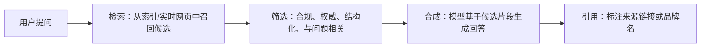

# 第 1 章 基础概念与术语

> 《GEO 生成式引擎优化：完整实操指南》· 信息截至 2026-11-14

[← 目录](README.md) ｜ [目录](README.md) ｜ [第 2 章 底层逻辑：AI 为什么只引用一部分内容 →](02-底层逻辑.md)

---

## 1.1 什么是 GEO

GEO（Generative Engine Optimization，生成式引擎优化）指通过内容、信源与站点优化，提升品牌与页面在生成式 AI 引擎回答中被采纳、引用、提及的机会。这一概念在学术上由 Aggarwal 等在 KDD 2024 会议论文《GEO: Generative Engine Optimization》中系统提出，并给出了黑盒优化框架与 10,000 条查询的评测基准 GEO-bench（论文：[arXiv 2311.09735](https://arxiv.org/abs/2311.09735)）。

GEO 的优化对象是「生成式引擎」——以大语言模型为核心，先检索候选网页再合成答案的系统。国内常见的生成式引擎包括 [豆包](https://www.doubao.com/)、[DeepSeek](https://www.deepseek.com/)、[千问](https://www.qianwen.com/)、[腾讯元宝](https://yuanbao.tencent.com/)、[文心](https://wenxin.baidu.com/)、[Kimi](https://www.kimi.com/)；国外常见的是 [ChatGPT](https://chatgpt.com/)、[Perplexity](https://www.perplexity.ai/)、[Google AI Overviews / AI Mode](https://developers.google.com/search/docs/appearance/ai-features)。

GEO 的典型目标是让 AI 在以下三类回答里出现你的品牌：

- 直接回答型：用户问"推荐一款……"时被点名；
- 对比清单型：出现在候选清单里；
- 事实卡型：联系方式、营业时间、技术参数等被直接引用。

## 1.2 GEO 与 SEO：差异与联系

两者并非替代关系。SEO 面向搜索引擎的排序，GEO 面向生成式引擎的引用。但生成式引擎普遍复用搜索引擎的候选集：Perplexity、ChatGPT Search、Google AI Overviews 均要求页面先能被抓取、能被索引、能作为搜索结果之一出现，才有机会被引用。做好 SEO 基础是 GEO 的前置条件。

| 维度 | SEO | GEO |
| --- | --- | --- |
| 最终产物 | 带链接的搜索结果 | AI 生成的回答文本 |
| 用户动作 | 搜关键词 → 点链接 | 发起提问 → 读 AI 答案 |
| 核心抓取方 | 搜索引擎爬虫 | AI 平台爬虫 + 搜索引擎索引 |
| 优化重点 | 关键词、外链、技术 SEO | 结构化事实、可引用片段、可信信源 |
| 可测量指标 | 关键词排名、点击率 | 提及率、引用率、首段曝光率 |
| 是否零跳转 | 否，需要点击 | 是，答案里直接露出 |

## 1.3 大模型引用内容的基本流程：RAG

主流生成式引擎回答事实性问题时，通常采用检索增强生成（Retrieval-Augmented Generation，RAG）流程：

能否被回答引用，取决于三件事：

1. 爬虫能否抓到你的页面；
2. 页面在检索阶段能否作为候选被召回；
3. 候选内容是否有一段可以直接贴进答案的「事实块」。

## 1.4 关键术语

下列术语在后续章节反复出现，先给出清晰定义。

| 术语 | 含义 |
| --- | --- |
| 生成式引擎（GE） | 以大语言模型为核心、通过检索+生成回答用户提问的系统。 |
| RAG | 检索增强生成。先从外部检索候选信息，再由模型生成回答。 |
| 信源 | AI 回答时引用的来源，包括官网、百科、点评、地图、行业媒体、技术社区等。 |
| 信源权重 | 信源在模型选择中的相对重要程度。公开文档中无统一算法，各家规则不同。 |
| 提示词 / 问题词 | 用户向 AI 提出的问题。本指南中与"关键词"并列，但更贴近自然语言。 |
| 品牌提及率 | 一次评测窗口内，含品牌名的回答条数占比。 |
| 引用率 | 回答中引用了目标官网或指定信源的条数占比。 |
| 首段曝光率 | 回答首段中出现品牌或官网的条数占比。 |
| 情感倾向 | AI 回答对品牌的评价极性：积极 / 中性 / 消极。 |
| 事实块 | 可以独立被模型抽取并贴进回答的一段信息，如参数、价格区间、营业时间、FAQ 结论。 |
| 结构化数据 | 用 [schema.org](https://schema.org/) 等词汇对页面内容做机器可读标注，如 Organization、Product、LocalBusiness。 |
| AI 幻觉 | 模型生成了看似合理但与事实不符的内容。信源不足、口径不一致会放大幻觉。 |
| 可见度 | 综合品牌在多个 AI 平台的曝光、引用、首段展示表现的汇总指标，各工具口径不同。 |

---

[← 目录](README.md) ｜ [目录](README.md) ｜ [第 2 章 底层逻辑：AI 为什么只引用一部分内容 →](02-底层逻辑.md)
