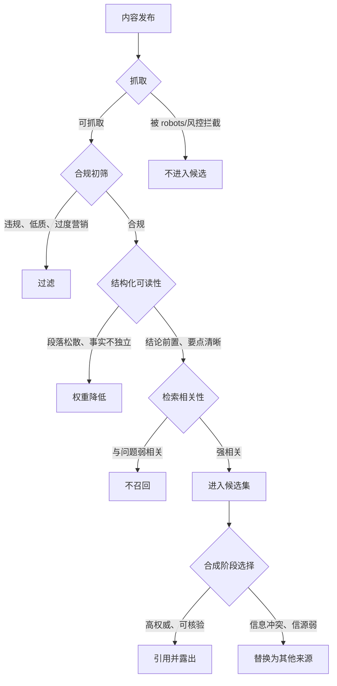

# 第 2 章 底层逻辑：AI 为什么只引用一部分内容

> 《GEO 生成式引擎优化：完整实操指南》· 信息截至 2026-11-14

[← 第 1 章 基础概念与术语](01-基础概念与术语.md) ｜ [目录](README.md) ｜ [第 3 章 全流程实操：九个环节闭环 →](03-全流程实操.md)

---

## 2.1 AI 的信息来自哪里

生成式引擎的回答不是凭空产生的。常见的三条数据链路：

1. **预训练知识**：模型训练时已经吃过的网页、书籍、代码。这部分内容有时效限制，对新信息和小众品牌覆盖有限。
2. **实时检索召回**：回答时临时调用搜索接口或自家索引，拉取最新网页。Perplexity、ChatGPT Search、Google AI Overviews、Kimi 的"全网搜索"功能均属于此类。
3. **自建知识图谱与结构化数据**：部分引擎依赖结构化词条、地图点位、工商备案、电商商品库等高置信度数据，用来兜底事实性问题。

GEO 的大部分工作围绕第 2、3 条展开——让你的内容同时出现在实时检索候选集和结构化数据库里。

## 2.2 三层筛选：从"写出来"到"被引用"

从内容发布到被 AI 采纳，中间至少经过三层筛选：

- 第一层：**抓取许可**。页面能否被 Bytespider、Baiduspider、YisouSpider、OAI-SearchBot、PerplexityBot 等爬虫读取。`robots.txt` 或 WAF 规则拦截了爬虫，页面不会出现在候选集里。
- 第二层：**合规与结构化**。违反《[生成式人工智能服务管理暂行办法](https://www.gov.cn/zhengce/zhengceku/202307/content_6891752.htm)》、《[广告法](https://www.gov.cn/guoqing/2021-10/29/content_5647620.htm)》的内容会被过滤；段落松散、找不到独立事实块的内容被打低权重。
- 第三层：**权威与相关**。即使通过前两层，最终是否被答案引用，仍要看信源权威度、页面与问题的语义相关度，以及同一事实在多信源之间能否交叉验证。

## 2.3 GEO 的目标公式

把上面三层筛选翻译成一条可执行的目标公式：

> 稳定曝光 = 可被抓取的高权威信源 × 结构清晰可核验的事实内容 × 覆盖真实提问的词库 × 周期性数据迭代

四个乘数任何一个为零，整体结果都接近零。本指南的实操部分，就是把这四个乘数分别做起来。

## 2.4 可以做的与不能做的

GEO 作为一种优化方法，边界清晰。

可以做：

- 让官网、公众号、行业文章能被爬虫读到；
- 把真实的产品参数、价格区间、服务流程、案例写成结构化内容；
- 把企业基础信息沉淀到百科、地图、商户目录、点评平台等高置信度信源；
- 监测、复盘、迭代。

不建议做（涉嫌违规或违反平台规则）：

- 编造用户评价、组织好评返现、虚构交易量，受《[网络反不正当竞争暂行规定](https://www.gov.cn/zhengce/202406/content_6959668.htm)》第九条规制；
- 使用"国家级 / 最高级 / 最佳"等绝对化用语做商品宣传，受《[广告法](https://www.gov.cn/guoqing/2021-10/29/content_5647620.htm)》第九条规制；
- 用 AI 生成合成虚假信息且不作标识，违反《[人工智能生成合成内容标识办法](https://www.cac.gov.cn/2025-03/14/c_1743654685896173.htm)》（2025-09-01 施行）；
- 通过技术手段绕过平台风控、刷量、恶意操控 AI 回答。

相关法规详见第 6 章。

---

[← 第 1 章 基础概念与术语](01-基础概念与术语.md) ｜ [目录](README.md) ｜ [第 3 章 全流程实操：九个环节闭环 →](03-全流程实操.md)
