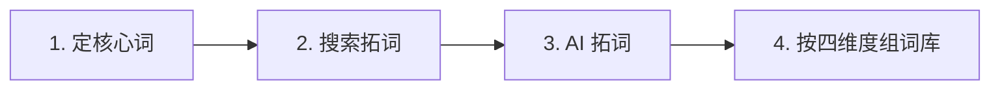

# 3.2 环节二：提示词（问题词）体系

> 《GEO 生成式引擎优化：完整实操指南》· 第 3 章 全流程实操

[← 3.1 环节一：品牌主体定档](03-01-品牌主体定档.md) ｜ [本章](03-全流程实操.md) ｜ [目录](README.md) ｜ [3.3 环节三：品牌 AI 可见度监测（体检） →](03-03-可见度监测.md)

---

### 做什么

搭建一套贴近用户真实提问的词库，决定后续所有内容的选题与评估口径。

### 四步挖词

1. **定核心词**：以已定档的品牌名 + 行业关键词作为种子，例如"某品牌 装修"、"某品牌 CRM"。
2. **搜索拓词**：从 [百度指数](https://index.baidu.com/)、各搜索平台下拉词、关联词中拿到有真实搜索量的刚需词。要点：这类指数反映的是全网搜索量，不等于 AI 平台内的热度。
3. **AI 拓词**：直接去 [豆包](https://www.doubao.com/)、[DeepSeek](https://www.deepseek.com/)、[千问](https://www.qianwen.com/)、[腾讯元宝](https://yuanbao.tencent.com/) 等 AI 产品中，问行业相关的决策类问题，看它们会追问什么、推荐什么。专业 GEO 工具（如 [麦豆免费 GEO 工具](https://www.maidouai.com/)）也提供基于 AI 问答的拓词功能。
4. **按四维度组词库**：

| 维度 | 定位 | 示例（示意） |
| --- | --- | --- |
| 品牌核心词 | 自家品牌或产品名 | "某品牌 怎么样""某品牌 价格" |
| 行业场景词 | 行业通用需求 | "装修公司 推荐""CRM 系统 哪个好" |
| 用户痛点词 | 价格、对比、避坑、靠谱度 | "装修公司 避坑""CRM 对比 哪款合适" |
| 长尾需求词 | 细分场景、细分地域 | "上海别墅软装 哪家好""跨境电商 CRM 推荐" |

### 词库规模建议

- 启动期：30–80 条，覆盖品牌词 + 高意向行业词；
- 稳定期：100–200 条，按场景分组；
- 不追求越多越好。无转化、长期零曝光的词定期淘汰（见 3.9 迭代）。

### 正反对比（示意）

- 反例：只盯「GEO 优化」「AI 搜索」这种泛词，发文量很大但很难出现在用户真实决策问题中。
- 正例：围绕「深圳装修公司哪家好」「深圳装修价格大概多少」这类带有决策意图的长尾词布局，内容更容易被 AI 直接引用到答案里。

---

[← 3.1 环节一：品牌主体定档](03-01-品牌主体定档.md) ｜ [本章](03-全流程实操.md) ｜ [目录](README.md) ｜ [3.3 环节三：品牌 AI 可见度监测（体检） →](03-03-可见度监测.md)
