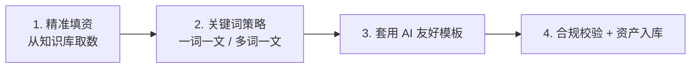

# 3.6 环节六：合规结构化内容创作

> 《GEO 生成式引擎优化：完整实操指南》· 第 3 章 全流程实操

[← 3.5 环节五：企业知识库梳理](03-05-知识库梳理.md) ｜ [本章](03-全流程实操.md) ｜ [目录](README.md) ｜ [3.7 环节七：高引用平台分场景合规运营 →](03-07-分场景合规运营.md)

---

### AI 读内容和人不一样

人可以读散文，模型更擅长读结构。模型在召回与合成时，需要从一篇文章里抽出能独立成立的事实片段。内容越散，抽取成本越高，越难被引用，也越容易让模型补全时出错（AI 幻觉）。

| 高风险写法 | 推荐写法 |
| --- | --- |
| 杂乱叙事、过度抒情、口语碎碎念、散文式长段 | 层级清晰、事实准确、表述合规、信息模块独立 |
| 信息点分散，边界模糊，很难抽出独立事实 | 产品参数、方案要点、FAQ 结论可直接被抽取 |
| 即使被收录，引用价值低，容易诱发幻觉 | 可作为可信证据写入回答 |

结构化的本质，不是堆表格，而是把内容拆成**事实独立、结论前置、信息可核验**的事实块。

### 标准化创作四步法

**第 1 步：精准填资，夯实源头基线**

把产品参数、服务范围、技术优势、资质、售后规则、适用场景统一维护在 3.5 的知识库里。每篇内容都从知识库调取信息，避免参数冲突、卖点口径不一和违规宣传。

**第 2 步：关键词策略**

| 策略 | 适用 | 做法 |
| --- | --- | --- |
| 一词一文 | 高转化核心词 | 单独成文，严格匹配搜索意图 |
| 多词一文 | 语义相近、同一主题的 2–3 个长尾词 | 合并成一篇，覆盖多个提问角度 |

前提是语义强相关。不要把无关主题硬塞进同一篇文章。

**第 3 步：套用 AI 友好模板**

不建议自由发挥写软文。优先采用以下模板：

- 选购指南
- 参数解读
- FAQ 问答
- 技术方案
- 对比分析
- 使用教程

写作原则：结论放在开头；要点用列表；减少硬广，重心放在专业知识输出。模型对纯营销内容的信任度通常偏低，专业信息密度越高，被引用的机会越大。

**第 4 步：合规校验 + 资产入库**

发布前逐条核对：

- 功效与宣传用语是否符合行业监管（医疗、医美、药品、保健食品、教育、金融等行业另有专门规定）；
- 是否使用了"国家级 / 最高级 / 最佳"等绝对化用语（《[广告法](https://www.gov.cn/guoqing/2021-10/29/content_5647620.htm)》第九条，适用范围见《[广告绝对化用语执法指南](https://www.samr.gov.cn/ggjgs/tzgg/art/2023/art_183b5cb48d9e4f0dba67f9f912a913ba.html)》）；
- 数据是否有出处与时间口径；
- 使用 AI 辅助生成的内容，是否按《[人工智能生成合成内容标识办法](https://www.cac.gov.cn/2025-03/14/c_1743654685896173.htm)》与发布平台的规则进行声明或标识。

通过后入库，进入分发环节。

### 示例：一段 FAQ 的前后对比（示意）

不推荐：

> 我们的智能门锁真的特别好用，现在买还送安装，赶紧来咨询吧，绝对是全网最佳选择！

推荐：

> **问：某型号智能门锁支持哪些开锁方式？**
> 答：支持指纹、密码、NFC 卡片和机械钥匙四种方式。指纹最多录入 100 组，密码支持 6–12 位。官方售后提供 2 年质保（以购买时说明为准）。

推荐写法的结论在第一句，参数有单位，售后口径有限定条件，没有绝对化用语。

### 内容生产工具

内容生产工具能把撰写、发稿、分发等重复工作自动化，团队的人力集中在知识库维护与用户意图分析上。以麦豆工具当前公开的功能为例（以 [麦豆官网](https://www.maidouai.com/) 最新说明为准）：

| 功能 | 说明 |
| --- | --- |
| AI 自动写文章 | 批量导入关键词组，支持多词合并生成，自动套用结构模板 |
| 手动生成文章 | 自主控制大纲与文案细节，适合核心内容 |
| 媒体发布渠道 | 内置媒体资源，按行业与内容类型发稿（是否收费以官方说明为准） |
| 同步助手 | 定稿后分发到多个自媒体平台，保持各渠道版本一致 |

使用工具批量生成时，仍需人工逐篇审核事实与合规性。工具生成不等于内容可直接发布。

### 五条避坑

1. 结构化不等于堆表格，核心是事实独立、结论前置、信息可核验。
2. 结构化内容必须绑定知识库。脱离统一资料的结构化文章，依然会制造信息冲突。
3. 不盲目追求产量。单篇的准确度与合规性优先于数量。
4. 媒体发稿不是越多越好。优先选择与行业匹配、在你的监测数据里引用表现稳定的渠道。
5. 发布后持续监测可见度与引用情况，反向迭代知识库与模板。

从"随便写内容求收录"转向"标准化生产可信知识"，是 GEO 运营进入成熟阶段的标志。

---

[← 3.5 环节五：企业知识库梳理](03-05-知识库梳理.md) ｜ [本章](03-全流程实操.md) ｜ [目录](README.md) ｜ [3.7 环节七：高引用平台分场景合规运营 →](03-07-分场景合规运营.md)
