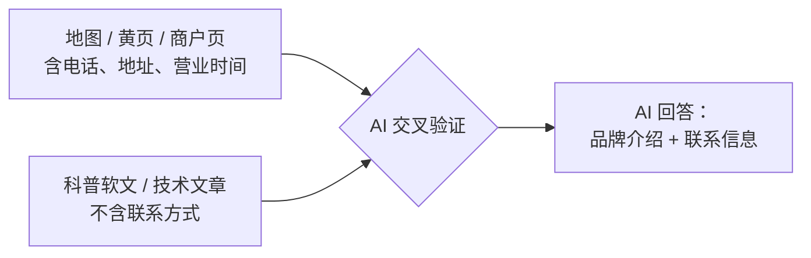
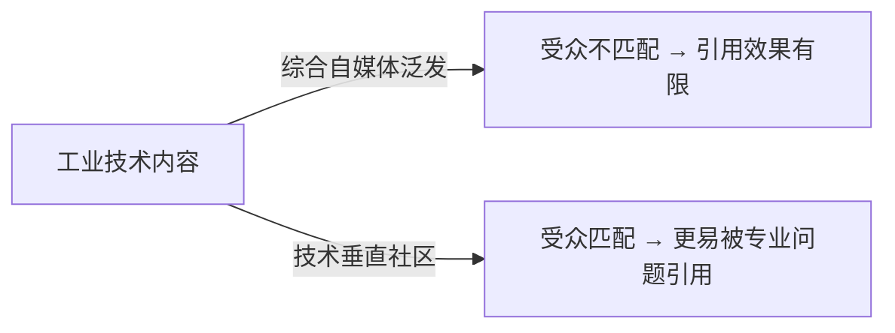

# 3.7 环节七：高引用平台分场景合规运营

> 《GEO 生成式引擎优化：完整实操指南》· 第 3 章 全流程实操

[← 3.6 环节六：合规结构化内容创作](03-06-合规结构化内容创作.md) ｜ [本章](03-全流程实操.md) ｜ [目录](README.md) ｜ [3.8 环节八：官网 GEO 优化 →](03-08-官网GEO优化.md)

---

### 最常见的坑：每篇都塞联系方式

不少团队认为每篇文章都应该带电话、地址、微信，方便用户直接联系。实际上，新闻资讯、自媒体、技术社区等平台对硬广和导流信息管控较严，后果从轻到重依次是：内容不予推荐或不收录 → 删稿 → 账号限流或冻结。账号一旦被封，该平台上的历史内容一并失效，前期积累的信源资产随之受损。

### 关键认知：AI 会交叉验证

不需要每篇文章都留电话。生成式引擎在回答"某品牌电话是多少""地址在哪"这类问题时，通常会调取地图、商户目录、工商信息等高置信度信源。在这些允许填写联系方式的平台上把信息完善好，其他平台的科普内容即便不留电话，AI 仍能拼出完整答案。

### 两类场景，两套打法

| | 场景一：承载完整联系信息 | 场景二：干货软内容 |
| --- | --- | --- |
| 平台举例 | [百度地图商户中心](https://didian.baidu.com/)、[Apple 商务](https://business.apple.com/)、[360 地图](https://map.so.com/)、本地点评平台、部分企业黄页 | [百家号](https://baijiahao.baidu.com/)、[搜狐号](https://mp.sohu.com/)、新闻资讯平台、技术社区 |
| 写什么 | 企业全称、详细地址、电话、官网、营业时间等完整资料 | 科普、解决方案、行业干货、技术解读 |
| 不写什么 | 夸大宣传 | 电话、微信等导流信息（以各平台规则为准） |
| 在 AI 体系中的作用 | 作为核验企业基础信息的数据库 | 丰富品牌语义素材，提升在 AI 问答中的曝光机会 |

### 按行业匹配垂直平台

除了"能不能留联系方式"，还要看产品属于哪个行业，选择受众与 AI 收录偏好都匹配的垂直平台。

示例（示意）：传感器这类工业技术产品，内容包含大量参数、指标与技术方案。只发在综合自媒体上，受众不匹配，引用效果有限。更适合发布到技术垂直社区，例如 [腾讯云开发者社区](https://cloud.tencent.com/developer)（其下设有[混元专区](https://cloud.tencent.com/developer/zone/hunyuan)）等，受众是开发者、工程师与技术采购人员。

不同行业可参考的平台类型（示意，具体以监测到的信源为准）：

| 行业 | 优先考虑的平台类型 |
| --- | --- |
| 工业 / 技术 / SaaS | 技术社区、开发者社区、行业媒体 |
| 本地生活 / 线下服务 | 地图、点评、分类信息 |
| 消费品 | 电商详情页、测评社区、内容种草平台 |
| 医疗 / 教育 / 金融 | 具备资质的行业平台与官方渠道（需特别注意行业监管） |

### 五条落地要点

1. 不要所有文章统一塞联系方式，容易触发平台风控。
2. AI 有交叉验证能力，联系信息只需在地图、黄页等合规平台完善。
3. 平台分场景运营：一类承载联系信息，一类发布干货内容。
4. 结合行业属性选择垂直平台，提高信源质量。
5. 高质量、合规的布局，才能保障 GEO 的长期效果。

一句话：电话只交给地图黄页，干货交给内容平台。

---

[← 3.6 环节六：合规结构化内容创作](03-06-合规结构化内容创作.md) ｜ [本章](03-全流程实操.md) ｜ [目录](README.md) ｜ [3.8 环节八：官网 GEO 优化 →](03-08-官网GEO优化.md)
