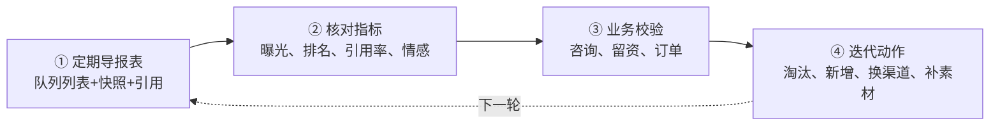

# 3.9 环节九：周期监测、数据复盘与迭代

> 《GEO 生成式引擎优化：完整实操指南》· 第 3 章 全流程实操

[← 3.8 环节八：官网 GEO 优化](03-08-官网GEO优化.md) ｜ [本章](03-全流程实操.md) ｜ [目录](README.md) ｜ [第 4 章 效果评估 →](04-效果评估.md)

---

### GEO 是闭环，不是一次性项目

模型会持续更新，用户的提问习惯会变化，信源的权重也会随平台生态调整。把前面八个环节跑一遍只是起步。

### 为什么必须循环迭代

| 原因 | 具体表现 |
| --- | --- |
| 大模型知识库持续更新 | 品牌在回答中的提及与排序会随更新波动 |
| 用户提问习惯变化 | 旧提示词流量下降，新长尾不断涌现 |
| 信源权重迁移 | 过去的高引用平台可能让位给新平台 |
| 业务目标才是终点 | 曝光不等于咨询和订单 |

### 排名 ≠ 转化：最常见的误判

现象（示例）：已优化的 10 条提示词在 AI 回答里全部拿到不错的提及，但一个月下来没有咨询、没有订单。大概率原因是提示词选型本身偏离了意向客户的实际提问，需要换掉词。

提示词有排名，只代表品牌在 AI 大模型内获得了曝光，不等于这条词有真实流量、能带来意向客户。排名只是中间指标，**最终要回归业务转化**。

### 四步周期流程

| 步骤 | 做什么 |
| --- | --- |
| ① 定期导报表 | 队列列表、答案快照、引用源报表。常见周期：周报、月报；重大活动前后加密到每日 |
| ② 核对指标 | 曝光状态、AI 答案提及位置、信源引用率、内容情感倾向 |
| ③ 业务端校验 | 结合咨询、留资、订单数据，判断每条提示词的商业价值 |
| ④ 迭代动作 | 淘汰无转化的词、新增长尾词、按信源数据调整发布阵地、按反馈补知识库 |

部分工具支持自动化监测（如 [麦豆免费 GEO 工具](https://www.maidouai.com/) 的轮询监测功能，具体频率与是否收费以官网说明为准）；没有工具时，按固定日程人工复查也能跑通。

### 复盘输出的三张清单

每一轮迭代结束，产出三张可执行的清单：

| 清单 | 内容 |
| --- | --- |
| 词库调整清单 | 新增词、淘汰词、合并词 |
| 信源调整清单 | 新增阵地、减量平台、补发页面 |
| 内容调整清单 | 需要补写的 FAQ、要更新的参数、要重写的卖点 |

### 迭代节奏建议

- 每周：异常监测（可见度突降、新负面出现、新竞品信号）；
- 每月：完整一轮监测 + 复盘 + 迭代；
- 每季度：重新审视词库结构、信源结构是否仍与业务目标一致；
- 每半年：从头评估品牌定档、知识库版本、合规清单。

---

[← 第 2 章 底层逻辑：AI 为什么只引用一部分内容](02-底层逻辑.md) ｜ [目录](README.md) ｜ [第 4 章 效果评估：以提示词为单位看结果 →](04-效果评估.md)

---

[← 3.8 环节八：官网 GEO 优化](03-08-官网GEO优化.md) ｜ [本章](03-全流程实操.md) ｜ [目录](README.md) ｜ [第 4 章 效果评估 →](04-效果评估.md)
