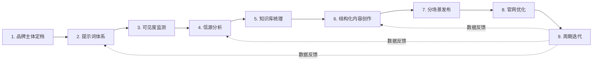

# 第 3 章 全流程实操：九个环节闭环

> 《GEO 生成式引擎优化：完整实操指南》· 信息截至 2026-11-14

[← 第 2 章 底层逻辑](02-底层逻辑.md) ｜ [目录](README.md) ｜ [第 4 章 效果评估 →](04-效果评估.md)

---

把 GEO 落地拆成九个环节。一次性走完是起步，长期要在环节 9 的迭代里循环运行。

## 本章小节

- [3.1 环节一：品牌主体定档](03-01-品牌主体定档.md)
- [3.2 环节二：提示词（问题词）体系](03-02-提示词体系.md)
- [3.3 环节三：品牌 AI 可见度监测（体检）](03-03-可见度监测.md)
- [3.4 环节四：引用源（信源）分析与布局规划](03-04-信源分析.md)
- [3.5 环节五：企业知识库梳理](03-05-知识库梳理.md)
- [3.6 环节六：合规结构化内容创作](03-06-合规结构化内容创作.md)
- [3.7 环节七：高引用平台分场景合规运营](03-07-分场景合规运营.md)
- [3.8 环节八：官网 GEO 优化](03-08-官网GEO优化.md)
- [3.9 环节九：周期监测、数据复盘与迭代](03-09-周期迭代.md)

---

[← 第 2 章 底层逻辑](02-底层逻辑.md) ｜ [目录](README.md) ｜ [第 4 章 效果评估 →](04-效果评估.md)
