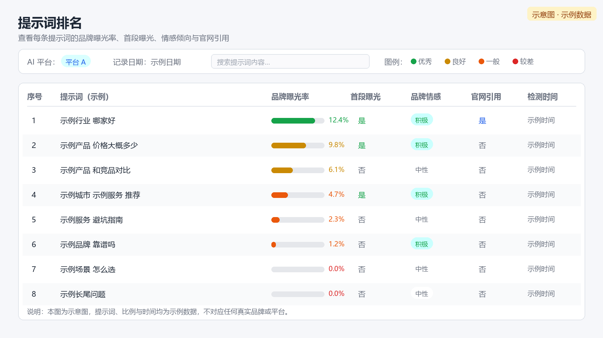
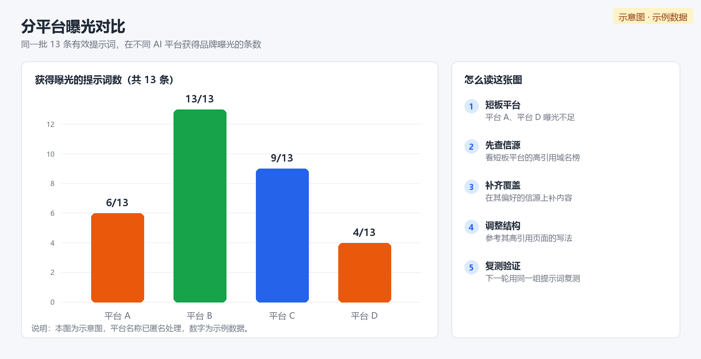

# 第 4 章 效果评估：以提示词为单位看结果

> 《GEO 生成式引擎优化：完整实操指南》· 信息截至 2026-11-14

[← 第 3 章 全流程实操：九个环节闭环](03-全流程实操.md) ｜ [目录](README.md) ｜ [第 5 章 答案快照、智能建议与报告交付 →](05-答案快照与报告交付.md)

---

## 4.1 为什么以提示词为单位

做 GEO 最怕的不是发得少，而是发完不知道有没有效果。按"整体可见度"看只能知道大方向；以每一条提示词为单位追踪，才能看清哪些词已经跑通、哪些还需要补信源，把 AI 曝光变成可追溯的数据。

## 4.2 提示词列表的六个维度

| 维度 | 含义 | 怎么读 |
| --- | --- | --- |
| 品牌曝光状态 | 这条提示词的 AI 回答里是否出现品牌 | 是 / 否 |
| 曝光占比 | 多次提问中提及品牌的比例 | 0% 表示完全没出现；大于 0% 表示已获得曝光 |
| 首段是否曝光 | 品牌是否出现在回答首段 | 首段曝光更接近用户实际看到的内容 |
| 情感倾向 | AI 对品牌的整体评价 | 积极 / 中性 / 负面 |
| 官网引用标记 | 回答是否引用了官网 | 衡量官方信源权威度 |
| 分平台与历史数据 | 按 AI 平台拆开，并保留时间线 | 横向看平台差异，纵向看优化前后变化 |

*图 4-1 提示词排名看板示意图。图中提示词、比例与时间均为示例数据，不对应任何真实品牌。*

## 4.3 示例：从全线零曝光到部分触发（示例数据）

以下为一个虚构项目，用来说明读数方法：

| 时间 | 观测 |
| --- | --- |
| 第 0 天（基线） | 共 19 条提示词，在目标平台上曝光占比全部为 0%，没有一条回答推荐该品牌 |
| 第 1–8 天 | 持续发布结构化内容并补齐高引用信源 |
| 第 8 天 | 19 条中有 10 条开始触发品牌曝光 |

读法：曝光从 0 到非 0，说明前期发布的结构化信源已被检索或收录。但是否带来业务结果，仍要回到 3.9 的业务校验。示例中的天数与条数只用于说明方法，不代表任何项目都能在同样周期内得到同样结果。

## 4.4 分平台对比

不同大模型的检索逻辑、索引来源与更新节奏不一样，同一组提示词的结果可能差距很大。

示例（示例数据）：在同一批 13 条有效提示词中——

| 平台 | 获得品牌曝光的提示词 |
| --- | --- |
| 平台 A | 6 / 13 |
| 平台 B | 13 / 13 |

*图 4-2 分平台曝光对比示意图。平台名称做了匿名处理，数字为示例数据。*

读法：平台 A 是短板。回到 3.4，查看平台 A 的高引用域名榜，针对性补信源、调整内容结构，而不是笼统地加大全平台发文量。

## 4.5 实操五个动作

| 动作 | 做法 |
| --- | --- |
| 1. 基线留存 | 正式优化前先跑一轮全量检测，保存基线数据 |
| 2. 定期巡检 | 固定周期检测，关注新增获得曝光的提示词数量 |
| 3. 分层处理 | 已曝光的词做维稳；长期 0% 的词分析是信源权重不足，还是语义不匹配 |
| 4. 跨平台对比 | 找出薄弱平台，调整发布策略 |
| 5. 结合情感指标 | 监控 AI 对品牌的评价，及时处理负面倾向（先核实是否属实） |

诊断不是终点。每一轮结果都要反补到下一轮：问题怎么选、知识怎么补、内容怎么写、渠道怎么铺。

## 4.6 GEO 评估与 SEO 排名监控的区别

提示词列表的形态很像 SEO 的关键词排名监控，但逻辑不同：

- SEO 看网页排序位次，位次相对固定；
- GEO 看大模型生成回答时是否主动引用、提及品牌信源。回答每次生成都可能不同，没有固定位次。

因此 GEO 的核心指标是：是否曝光、曝光占比、首段曝光、信源引用与情感倾向。单次截图不能代表稳定结果，应以多次提问、多平台、多时间点的统计为准。

## 4.7 补充：评估口径与样本要求

为了让数据可比，评估时固定以下条件：

- **提问方式固定**：同一条提示词的原文不变，避免一会儿问"哪家好"一会儿问"推荐"。
- **多次采样**：同一条提示词在同一平台建议至少问 3 次，取比例，而不是看一次。
- **环境记录**：记录是否登录、是否开启联网搜索、所用模型版本，这些都会影响回答。
- **时间对齐**：对比前后数据时，使用同一时间段长度。
- **区分自然波动**：小样本下的几个百分点变化，可能只是随机波动，不要据此下结论。

## 4.8 效果评估指标体系（汇总）

把前文的指标按"过程 → 结果"排列：

| 层级 | 指标 | 回答的问题 |
| --- | --- | --- |
| 基础层 | 抓取与收录情况、结构化数据有效性 | AI 能不能读到我 |
| 曝光层 | 提及率、首段曝光率、分平台覆盖 | AI 会不会说到我 |
| 信源层 | 官网引用率、高引用域名覆盖度 | AI 引用的是不是我的权威来源 |
| 认知层 | 情感倾向、AI 品牌描述准确率 | AI 说得对不对、好不好 |
| 业务层 | AI 来源访问量、咨询量、留资量、订单量 | 曝光有没有变成生意 |

其中"AI 品牌描述准确率"建议由人工抽查：把 AI 对品牌的描述逐句与知识库比对，统计错误条目占比。准确率低时，优先回到 3.5 补齐资料、回到 3.4 补齐高置信度信源。

---

[← 第 3 章 全流程实操：九个环节闭环](03-全流程实操.md) ｜ [目录](README.md) ｜ [第 5 章 答案快照、智能建议与报告交付 →](05-答案快照与报告交付.md)
