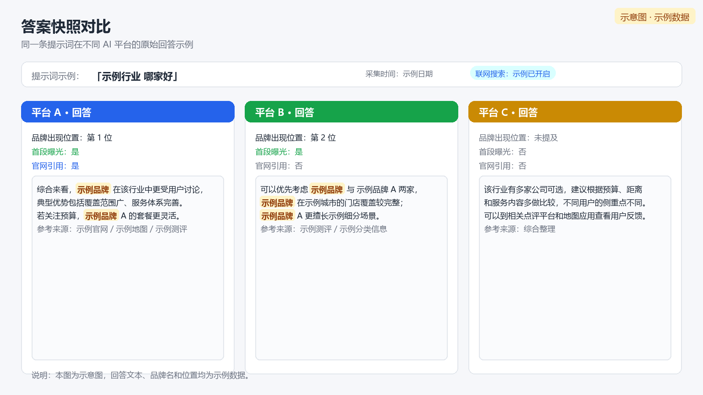
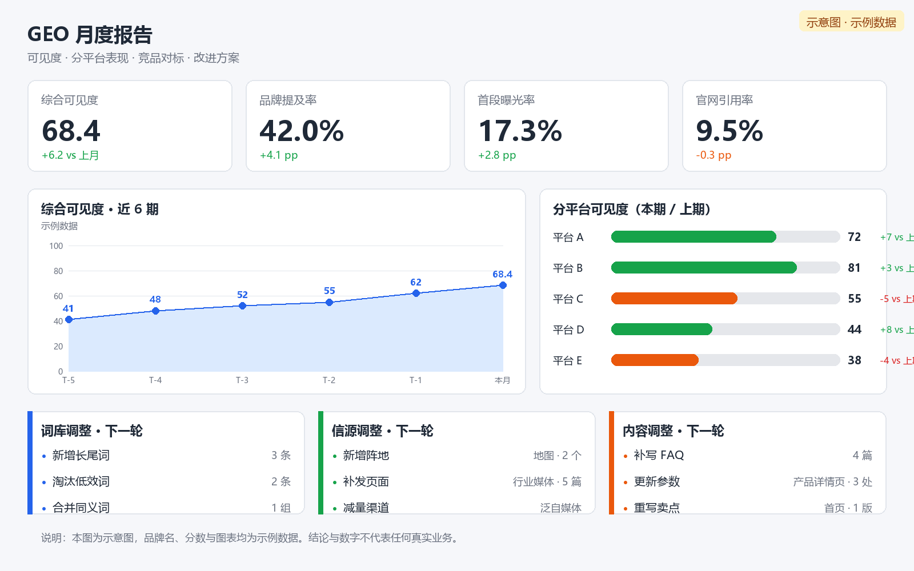

# 第 5 章 答案快照、智能建议与报告交付

> 《GEO 生成式引擎优化：完整实操指南》· 信息截至 2026-11-14

[← 第 4 章 效果评估：以提示词为单位看结果](04-效果评估.md) ｜ [目录](README.md) ｜ [第 6 章 合规边界与风险清单 →](06-合规边界与风险清单.md)

---

指标与图表适合内部判断，但对外汇报时，需要能直接展示"品牌在 AI 回答里到底长什么样"。本章讲复盘与交付的三个收尾动作。

## 5.1 答案快照：最直接的效果凭证

分值类指标是间接数据，原始的 AI 回答才是最直接的结果。答案快照是指在监测时把各 AI 平台对每条提示词的原始问答完整保存下来。

| 作用 | 说明 |
| --- | --- |
| 自动留存 | 监测时抓取并保存各平台原始问答，不需要人工逐条搜索截图 |
| 查看真实位置 | 看品牌在这条提示词的回答中出现在第几位、是否在首段 |
| 跨平台核验 | 同一条提示词在 [文心](https://wenxin.baidu.com/)、[千问](https://www.qianwen.com/)、[豆包](https://www.doubao.com/) 等平台分开查看 |
| 效果验证 | 首段曝光、品牌占位、引用来源一目了然 |

*图 5-1 答案快照对比示意图。回答文本、品牌名和位置均为示例数据。*

使用注意：

- 快照是某一时刻、某一环境下的结果。生成式回答本身有随机性，同一问题再问一次可能不同。对外展示时注明采集时间、平台与是否开启联网搜索。
- 不对快照做裁剪、拼接、篡改。挑选个别有利的快照并暗示为常态，属于误导性展示。

## 5.2 智能改进建议

监测完成后，部分工具会根据全量数据自动生成改进建议。一份有用的建议应当具体到以下四类问题：

| 定位 | 建议应回答 |
| --- | --- |
| 曝光短板 | 哪些提示词曝光不足 |
| 平台短板 | 哪些 AI 平台收录偏弱 |
| 信源缺口 | 缺少哪类信源、哪些高引用域名尚未覆盖 |
| 内容与舆情 | 品牌口碑和内容结构该如何调整 |

工具建议适合新手作为起点，减少试错。但建议由算法生成，执行前仍需结合业务判断：建议与事实不符、与合规要求冲突时，以事实和法规为准。

## 5.3 数据报告导出与交付

报告是运营复盘、管理层汇报与对客户（甲方）交付的核心材料。一份完整报告建议包含四个部分：

| 部分 | 内容 |
| --- | --- |
| 综合数据分析 | 可见度总分、提及率、首段曝光率、官网引用率的整体复盘 |
| 分平台独立解析 | 覆盖豆包、腾讯元宝、千问、文心、DeepSeek 等主流平台的单独数据 |
| 竞品对标 | 同一组提示词下与主要竞品的横向对比，明确优势与短板 |
| 改进方案 | 汇总问题点，给出可执行的下一轮动作（对应 3.9 的三张清单） |

导出格式：

- **PDF**：适合客户交付与正式存档，版本固定；
- **HTML**：适合在线查看，便于后续追加数据或二次编辑。

以麦豆工具为例，其报告导出与快照功能当前对外宣称免费，次数与范围以 [麦豆官网](https://www.maidouai.com/) 最新说明为准。

*图 5-2 月度报告示意图。品牌名、分数与图表均为示例数据。*

## 5.4 报告写作的三条要求

1. **口径写清楚**：每个指标注明定义、样本量、采集时间与平台。
2. **不做效果承诺**：生成式回答没有固定排名，报告只陈述观测到的结果和变化趋势，不承诺"保证上首页""保证被推荐"。
3. **结论落到动作**：每一个问题对应一个下一轮的具体动作和负责人。

快照是证据，报告是交付。两者配合，复盘、汇报与客户交付才能形成闭环。

---

[← 第 4 章 效果评估：以提示词为单位看结果](04-效果评估.md) ｜ [目录](README.md) ｜ [第 6 章 合规边界与风险清单 →](06-合规边界与风险清单.md)
