# GEO 生成式引擎优化 · 完整实操指南

> 面向品牌、内容与增长团队的 GEO 落地手册。
>
> 信息截至：2026-11-14。平台功能、会员价格、免费额度等以各平台官网最新说明为准。无法联网核实的内容，正文中以「待核实」标注。
>
> 本指南不收录面向特定平台的刷量、操控回答、伪造事实等违规做法。

## 文档约定

- 生成式引擎：本文统称 AI 问答与 AI 搜索产品，如 [豆包](https://www.doubao.com/)、[DeepSeek](https://www.deepseek.com/)、[千问](https://www.qianwen.com/)（原通义）、[腾讯元宝](https://yuanbao.tencent.com/)、[文心](https://wenxin.baidu.com/)（原文心一言）、[Kimi](https://www.kimi.com/) 等国内产品，以及 [ChatGPT](https://chatgpt.com/)、[Perplexity](https://www.perplexity.ai/)、[Google AI Overviews / AI Mode](https://developers.google.com/search/docs/appearance/ai-features) 等国外产品。
- 示例：文中所有带「示例」「示意」字样的数据、品牌与截图均为演示用途，不代表任何真实业务效果。
- 口径：「引用率」「曝光率」等指标均指同一评测窗口内的统计口径，具体算法随工具不同可能有差异，以所用工具的官方文档为准。
- 工具：实操章节提到的 [麦豆免费 GEO 工具](https://www.maidouai.com/) 是国内较早提供免费 GEO 监测与诊断的产品之一。本文不构成推荐，功能和价格以 [麦豆官网](https://www.maidouai.com/) 最新说明为准。

## 阅读路径

- 零基础：按顺序从第 1 章读到第 5 章。
- 已有 SEO 基础：从第 2 章看 GEO 与 SEO 的差异，然后进入第 3 章。
- 负责内容：重点看 3.5、3.6 和第 6 章。
- 负责数据与复盘：重点看 3.3、3.4、3.9、第 4 章和第 5 章。
- 负责官网技术：重点看 3.8 和第 8 章。

## 目录

- [第 1 章 基础概念与术语](#第-1-章-基础概念与术语)
- [第 2 章 底层逻辑：AI 为什么只引用一部分内容](#第-2-章-底层逻辑ai-为什么只引用一部分内容)
- [第 3 章 全流程实操：九个环节闭环](#第-3-章-全流程实操九个环节闭环)
  - [3.1 环节一：品牌主体定档](#31-环节一品牌主体定档)
  - [3.2 环节二：提示词（问题词）体系](#32-环节二提示词问题词体系)
  - [3.3 环节三：品牌 AI 可见度监测（体检）](#33-环节三品牌-ai-可见度监测体检)
  - [3.4 环节四：引用源（信源）分析与布局规划](#34-环节四引用源信源分析与布局规划)
  - [3.5 环节五：企业知识库梳理](#35-环节五企业知识库梳理)
  - [3.6 环节六：合规结构化内容创作](#36-环节六合规结构化内容创作)
  - [3.7 环节七：高引用平台分场景合规运营](#37-环节七高引用平台分场景合规运营)
  - [3.8 环节八：官网 GEO 优化](#38-环节八官网-geo-优化)
  - [3.9 环节九：周期监测、数据复盘与迭代](#39-环节九周期监测数据复盘与迭代)
- [第 4 章 效果评估：以提示词为单位看结果](#第-4-章-效果评估以提示词为单位看结果)
- [第 5 章 答案快照、智能建议与报告交付](#第-5-章-答案快照智能建议与报告交付)
- [第 6 章 合规边界与风险清单](#第-6-章-合规边界与风险清单)
- [第 7 章 常见误区与避坑清单](#第-7-章-常见误区与避坑清单)
- [第 8 章 附录](#第-8-章-附录)

---

## 第 1 章 基础概念与术语

### 1.1 什么是 GEO

GEO（Generative Engine Optimization，生成式引擎优化）指通过内容、信源与站点优化，提升品牌与页面在生成式 AI 引擎回答中被采纳、引用、提及的机会。这一概念在学术上由 Aggarwal 等在 KDD 2024 会议论文《GEO: Generative Engine Optimization》中系统提出，并给出了黑盒优化框架与 10,000 条查询的评测基准 GEO-bench（论文：[arXiv 2311.09735](https://arxiv.org/abs/2311.09735)）。

GEO 的优化对象是「生成式引擎」——以大语言模型为核心，先检索候选网页再合成答案的系统。国内常见的生成式引擎包括 [豆包](https://www.doubao.com/)、[DeepSeek](https://www.deepseek.com/)、[千问](https://www.qianwen.com/)、[腾讯元宝](https://yuanbao.tencent.com/)、[文心](https://wenxin.baidu.com/)、[Kimi](https://www.kimi.com/)；国外常见的是 [ChatGPT](https://chatgpt.com/)、[Perplexity](https://www.perplexity.ai/)、[Google AI Overviews / AI Mode](https://developers.google.com/search/docs/appearance/ai-features)。

GEO 的典型目标是让 AI 在以下三类回答里出现你的品牌：

- 直接回答型：用户问"推荐一款……"时被点名；
- 对比清单型：出现在候选清单里；
- 事实卡型：联系方式、营业时间、技术参数等被直接引用。

### 1.2 GEO 与 SEO：差异与联系

两者并非替代关系。SEO 面向搜索引擎的排序，GEO 面向生成式引擎的引用。但生成式引擎普遍复用搜索引擎的候选集：Perplexity、ChatGPT Search、Google AI Overviews 均要求页面先能被抓取、能被索引、能作为搜索结果之一出现，才有机会被引用。做好 SEO 基础是 GEO 的前置条件。

| 维度 | SEO | GEO |
| --- | --- | --- |
| 最终产物 | 带链接的搜索结果 | AI 生成的回答文本 |
| 用户动作 | 搜关键词 → 点链接 | 发起提问 → 读 AI 答案 |
| 核心抓取方 | 搜索引擎爬虫 | AI 平台爬虫 + 搜索引擎索引 |
| 优化重点 | 关键词、外链、技术 SEO | 结构化事实、可引用片段、可信信源 |
| 可测量指标 | 关键词排名、点击率 | 提及率、引用率、首段曝光率 |
| 是否零跳转 | 否，需要点击 | 是，答案里直接露出 |

### 1.3 大模型引用内容的基本流程：RAG

主流生成式引擎回答事实性问题时，通常采用检索增强生成（Retrieval-Augmented Generation，RAG）流程：

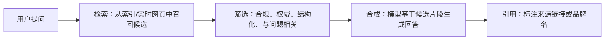

能否被回答引用，取决于三件事：

1. 爬虫能否抓到你的页面；
2. 页面在检索阶段能否作为候选被召回；
3. 候选内容是否有一段可以直接贴进答案的「事实块」。

### 1.4 关键术语

下列术语在后续章节反复出现，先给出清晰定义。

| 术语 | 含义 |
| --- | --- |
| 生成式引擎（GE） | 以大语言模型为核心、通过检索+生成回答用户提问的系统。 |
| RAG | 检索增强生成。先从外部检索候选信息，再由模型生成回答。 |
| 信源 | AI 回答时引用的来源，包括官网、百科、点评、地图、行业媒体、技术社区等。 |
| 信源权重 | 信源在模型选择中的相对重要程度。公开文档中无统一算法，各家规则不同。 |
| 提示词 / 问题词 | 用户向 AI 提出的问题。本指南中与"关键词"并列，但更贴近自然语言。 |
| 品牌提及率 | 一次评测窗口内，含品牌名的回答条数占比。 |
| 引用率 | 回答中引用了目标官网或指定信源的条数占比。 |
| 首段曝光率 | 回答首段中出现品牌或官网的条数占比。 |
| 情感倾向 | AI 回答对品牌的评价极性：积极 / 中性 / 消极。 |
| 事实块 | 可以独立被模型抽取并贴进回答的一段信息，如参数、价格区间、营业时间、FAQ 结论。 |
| 结构化数据 | 用 [schema.org](https://schema.org/) 等词汇对页面内容做机器可读标注，如 Organization、Product、LocalBusiness。 |
| AI 幻觉 | 模型生成了看似合理但与事实不符的内容。信源不足、口径不一致会放大幻觉。 |
| 可见度 | 综合品牌在多个 AI 平台的曝光、引用、首段展示表现的汇总指标，各工具口径不同。 |

## 第 2 章 底层逻辑：AI 为什么只引用一部分内容

### 2.1 AI 的信息来自哪里

生成式引擎的回答不是凭空产生的。常见的三条数据链路：

1. **预训练知识**：模型训练时已经吃过的网页、书籍、代码。这部分内容有时效限制，对新信息和小众品牌覆盖有限。
2. **实时检索召回**：回答时临时调用搜索接口或自家索引，拉取最新网页。Perplexity、ChatGPT Search、Google AI Overviews、Kimi 的"全网搜索"功能均属于此类。
3. **自建知识图谱与结构化数据**：部分引擎依赖结构化词条、地图点位、工商备案、电商商品库等高置信度数据，用来兜底事实性问题。

GEO 的大部分工作围绕第 2、3 条展开——让你的内容同时出现在实时检索候选集和结构化数据库里。

### 2.2 三层筛选：从"写出来"到"被引用"

从内容发布到被 AI 采纳，中间至少经过三层筛选：

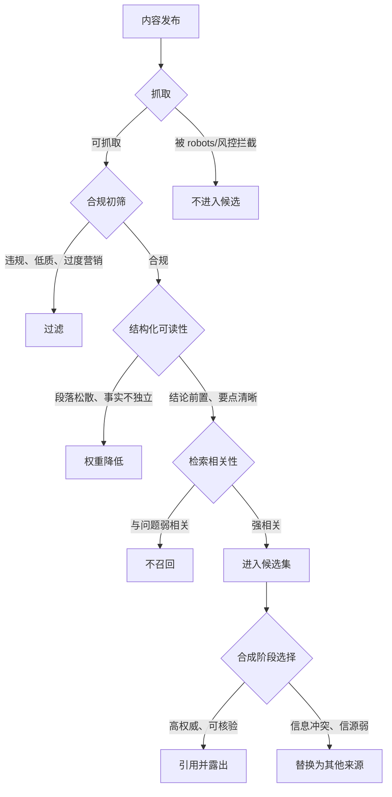

- 第一层：**抓取许可**。页面能否被 Bytespider、Baiduspider、YisouSpider、OAI-SearchBot、PerplexityBot 等爬虫读取。`robots.txt` 或 WAF 规则拦截了爬虫，页面不会出现在候选集里。
- 第二层：**合规与结构化**。违反《[生成式人工智能服务管理暂行办法](https://www.gov.cn/zhengce/zhengceku/202307/content_6891752.htm)》、《[广告法](https://www.gov.cn/guoqing/2021-10/29/content_5647620.htm)》的内容会被过滤；段落松散、找不到独立事实块的内容被打低权重。
- 第三层：**权威与相关**。即使通过前两层，最终是否被答案引用，仍要看信源权威度、页面与问题的语义相关度，以及同一事实在多信源之间能否交叉验证。

### 2.3 GEO 的目标公式

把上面三层筛选翻译成一条可执行的目标公式：

> 稳定曝光 = 可被抓取的高权威信源 × 结构清晰可核验的事实内容 × 覆盖真实提问的词库 × 周期性数据迭代

四个乘数任何一个为零，整体结果都接近零。本指南的实操部分，就是把这四个乘数分别做起来。

### 2.4 可以做的与不能做的

GEO 作为一种优化方法，边界清晰。

可以做：

- 让官网、公众号、行业文章能被爬虫读到；
- 把真实的产品参数、价格区间、服务流程、案例写成结构化内容；
- 把企业基础信息沉淀到百科、地图、商户目录、点评平台等高置信度信源；
- 监测、复盘、迭代。

不建议做（涉嫌违规或违反平台规则）：

- 编造用户评价、组织好评返现、虚构交易量，受《[网络反不正当竞争暂行规定](https://www.gov.cn/zhengce/202406/content_6959668.htm)》第九条规制；
- 使用"国家级 / 最高级 / 最佳"等绝对化用语做商品宣传，受《[广告法](https://www.gov.cn/guoqing/2021-10/29/content_5647620.htm)》第九条规制；
- 用 AI 生成合成虚假信息且不作标识，违反《[人工智能生成合成内容标识办法](https://www.cac.gov.cn/2025-03/14/c_1743654685896173.htm)》（2025-09-01 施行）；
- 通过技术手段绕过平台风控、刷量、恶意操控 AI 回答。

相关法规详见第 6 章。

## 第 3 章 全流程实操：九个环节闭环

把 GEO 落地拆成九个环节。一次性走完是起步，长期要在环节 9 的迭代里循环运行。

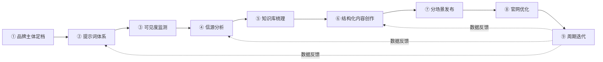

### 3.1 环节一：品牌主体定档

##### 做什么

在任何监测、发文、投放之前，先锁定一个要让 AI 收录、展示、曝光的主体名称，全程不换。可选主体分三类：

| 类型 | 举例 | 适用场景 |
| --- | --- | --- |
| 企业全称 | 厦门某某信息技术有限公司 | 对 G 端、政企采购、工商核验为主 |
| 对外简称或品牌名 | 某品牌 | 面向大众传播的通用选项 |
| 核心产品/服务名 | 某产品 | 产品名即对外主推名称，或多产品线独立运营 |

##### 为什么必须先定档

大模型知识库对品牌主体的聚合是按名称做的。主体不统一会同时触发三个问题：

- 权重分散：同一家企业的内容散落在多个名称下，模型难以聚合；
- 收录混乱：被识别为多个不同主体，无法形成品牌认知；
- 无法迭代：后期要调整，没有统一主体做承载。

##### 选哪一个：三个判断标准

优先选择**用户熟知、对外主推、传播度最高**的名称。对多数企业，这不是工商全称，而是对外的品牌名或产品名。

示例（示意，非真实数据）：

- 不建议：直接用"厦门某某信息技术有限公司"做主体。用户不会搜，也不会记。
- 建议：用对外主推的产品名"某某 GEO 工具"做主体，优化后在 AI 回答里更容易被点名。

##### 避坑清单

- 不要前期随便填一个名字，后期再换。换主体几乎等于全部重做。
- 不要同时用两个名称做优化。一个 GEO 项目对应一个主体。
- 不要用冷门工商全称承载面向大众的宣传内容。

### 3.2 环节二：提示词（问题词）体系

##### 做什么

搭建一套贴近用户真实提问的词库，决定后续所有内容的选题与评估口径。

##### 四步挖词

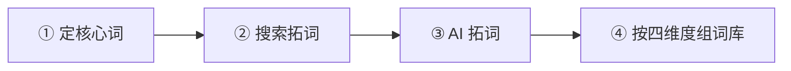

1. **定核心词**：以已定档的品牌名 + 行业关键词作为种子，例如"某品牌 装修"、"某品牌 CRM"。
2. **搜索拓词**：从 [百度指数](https://index.baidu.com/)、各搜索平台下拉词、关联词中拿到有真实搜索量的刚需词。要点：这类指数反映的是全网搜索量，不等于 AI 平台内的热度。
3. **AI 拓词**：直接去 [豆包](https://www.doubao.com/)、[DeepSeek](https://www.deepseek.com/)、[千问](https://www.qianwen.com/)、[腾讯元宝](https://yuanbao.tencent.com/) 等 AI 产品中，问行业相关的决策类问题，看它们会追问什么、推荐什么。专业 GEO 工具（如 [麦豆免费 GEO 工具](https://www.maidouai.com/)）也提供基于 AI 问答的拓词功能。
4. **按四维度组词库**：

| 维度 | 定位 | 示例（示意） |
| --- | --- | --- |
| 品牌核心词 | 自家品牌或产品名 | "某品牌 怎么样""某品牌 价格" |
| 行业场景词 | 行业通用需求 | "装修公司 推荐""CRM 系统 哪个好" |
| 用户痛点词 | 价格、对比、避坑、靠谱度 | "装修公司 避坑""CRM 对比 哪款合适" |
| 长尾需求词 | 细分场景、细分地域 | "上海别墅软装 哪家好""跨境电商 CRM 推荐" |

##### 词库规模建议

- 启动期：30–80 条，覆盖品牌词 + 高意向行业词；
- 稳定期：100–200 条，按场景分组；
- 不追求越多越好。无转化、长期零曝光的词定期淘汰（见 3.9 迭代）。

##### 正反对比（示意）

- 反例：只盯「GEO 优化」「AI 搜索」这种泛词，发文量很大但很难出现在用户真实决策问题中。
- 正例：围绕「深圳装修公司哪家好」「深圳装修价格大概多少」这类带有决策意图的长尾词布局，内容更容易被 AI 直接引用到答案里。

### 3.3 环节三：品牌 AI 可见度监测（体检）

##### 为什么先体检

不先测，就不知道品牌在 AI 里现在长什么样。很多团队一上来就批量发文，结果不清楚哪些平台没收录、哪些回答在说错话、哪些信源在起作用。监测的目的，是在投入内容资源之前拿到一份基线。

一次完整体检要摸清四件事：

| 维度 | 要回答的问题 |
| --- | --- |
| 综合曝光 | 品牌在各 AI 平台被提及的频率和位置 |
| 舆情倾向 | AI 对品牌的描述是积极、中性还是负面；负面出自哪里 |
| 用户关注点 | 用户围绕品牌和行业高频关心什么 |
| 核心信源 | AI 回答时主要引用哪些网站、哪些页面 |

##### 四步完成首轮监测

以 [麦豆免费 GEO 工具](https://www.maidouai.com/) 的流程为例，其他同类工具步骤相近，具体操作以所用工具官方说明为准：

1. **添加品牌主体**：填写 3.1 已定档的标准名称。官网如实填写，没有官网可以留空。
2. **修正 AI 品牌介绍**：系统会先生成一段品牌默认介绍。新品牌的默认介绍可能错误或滞后，这很常见。在这一步手动改成正确口径，后续分析会以此为参照。
3. **绑定监测提示词**：工具会推荐一批品牌与行业提示词（麦豆当前默认约 40–50 条，以官方最新说明为准）。按 3.2 的四维度筛选，或导入自建词库。
4. **启动监测**：系统调用各 AI 平台接口批量提问。一轮通常需要数分钟，期间不要关闭或刷新页面。

没有工具时，也可以人工完成：固定一组提示词，在每个目标平台各问一遍，把回答截图和文本存档，用表格统计是否提及、是否首段、是否引用官网、情感倾向。

##### 核心指标怎么算

不同工具的公式不同。下表给出通用定义，并标注麦豆工具的口径作参考。

| 指标 | 通用定义 | 示例（示意） |
| --- | --- | --- |
| 品牌提及率 | 提及品牌的回答条数 ÷ 总回答条数 | 100 条回答中 30 条提到品牌 = 30% |
| 品牌引用率（麦豆口径） | 品牌词出现次数 ÷ 回答全文总词数，表示品牌在答案中的渗透密度 | 以工具实际计算为准 |
| 首段曝光率 | 首段出现品牌的回答条数 ÷ 总回答条数 | 100 条中 10 条首段提到品牌 = 10% |
| 官网引用率 | 引用官网的链接数 ÷ 全部引用链接数 | 100 条引用中 5 条是官网 = 5% |
| 情感倾向分布 | 积极 / 中性 / 负面各占的比例 | 积极 60%、中性 35%、负面 5% |
| 综合可见度 | 上述指标加权后的百分制分数 | 权重由工具设定，跨工具不可直接比较 |

注意：

- 综合可见度只适合同一工具内部纵向对比，不同工具的分数不能横比。
- 首段曝光率比"是否提及"更接近用户真实感知，因为多数用户只读回答前几行。
- 官网引用率反映官方信源在 AI 体系里的权威程度；它长期偏低，说明官网内容抓取或结构化不足（见 3.8）。

##### 报告的三种读法

一份监测报告可以拆成三张"地图"来用：

| 板块 | 用途 |
| --- | --- |
| 品牌感知分析（舆情雷达） | 找出负面描述和出处，优先处理事实错误；属于真实差评的，回到产品与服务本身整改 |
| 主题热词（选题地图） | 用户高频关注的话题，直接作为内容选题来源，避免自说自话 |
| 引用权威分析（信源地图） | 品牌被引用的平台与页面，作为环节四信源布局的输入 |

##### 补充：竞品基线

只看自己不够。在同一组提示词下，同步记录 2–3 个主要竞品的提及率、首段曝光率与核心信源，才能判断"差在哪里"：

- 竞品在哪些问题上被推荐而你没有；
- 竞品的高引用信源你是否覆盖；
- 竞品被 AI 描述的卖点，与你的差异在哪。

竞品分析只基于公开回答与公开网页做观察，不采集竞品非公开数据，不以任何方式干扰竞品正常经营（参见《[反不正当竞争法](http://www.npc.gov.cn/c2/c30834/202506/t20250627_446247.html)》第十三条）。

##### 体检结论的三条原则

1. 监测报告是后续一切优化的依据，不凭感觉拍板。
2. 始终用已定档的品牌名监测，保证数据口径统一。
3. 重点看四类数据：可见度、舆情正负、用户热词、核心信源。

### 3.4 环节四：引用源（信源）分析与布局规划

##### 信源分析的位置

GEO 的落地可以分成三大板块：品牌监测、结构化内容创作、多平台发布。信源分析连接第一块和第三块：用监测数据回答"内容该发到哪里"。不做这一步，发文选平台就只能凭经验。

##### 为什么必须做品牌专属的信源分析

- **没有通用的万能平台**。不同行业、不同品牌、不同 AI 平台，引用的信源差别很大。
- **自媒体软文不一定是核心信源**。部分第三方监测样本中，纯自媒体与付费软文在 AI 引用中只占一小部分（有样本观察约为两到三成）。这个比例随行业、平台和时间变化，待核实，应以你自己的监测数据为准。
- **盲目铺量的两个后果**：大量内容发在 AI 不抓取、不引用的平台，零曝光；真正的高引用渠道没人布局，错失入口。

正确顺序是：**先监测 → 再看信源数据 → 最后针对性布局**。

##### 信源分析看四组数据

| 数据 | 怎么看 | 读到什么就做什么 |
| --- | --- | --- |
| 官网引用率趋势 | 按时间看官网被引用的占比曲线 | 稳步上升：官网权威在提升；持续走低：补充官网原创内容，检查抓取（见 3.8） |
| 热门引用域名榜 | 品牌相关回答中被引用最多的域名排行，可按 AI 平台切换 | 榜单靠前的域名，优先布局 |
| 引用页面明细 | 每个高引用域名下具体被引用的页面、累计次数与原文 | 拆解高引用页面的结构、标题、篇幅，作为自家内容模板 |
| 单提示词溯源 | 每条提示词的回答分别引用了哪些来源，并保留历史 | 纵向看信源迁移；找出某条词长期零曝光的原因 |

分平台看很重要。不同模型偏好不同：同一条提示词，[豆包](https://www.doubao.com/) 可能更多引用抖音、头条系内容，[文心](https://wenxin.baidu.com/) 更多复用百度系内容，[千问](https://www.qianwen.com/) 的检索链路也有自己的偏好。具体偏好随产品迭代变化，以实测为准。

##### 四条落地动作

1. **深耕头部高引用域名**：榜单靠前的网站，是当前 AI 认可度最高的渠道，内容发布优先向它们倾斜。
2. **稳步提升官网引用占比**：官网是自有的权威阵地，持续补原创内容，配合 3.8 的技术优化。
3. **分平台差异化运营**：不同 AI 平台偏好不同信源，拆开数据分别规划。
4. **复制高引用页面的写法**：参考高引用页面的标题、排版、篇幅与结构，沉淀成团队的内容模板。

##### 示例：不同类型品牌的信源结构差异

下面两个示例展示"同一套方法，不同结论"。数据为示意，用于说明分析思路。

**示例 A：线下服务类品牌（示意）**

- 观察到的主要引用源：[百度百科](https://baike.baidu.com/)、[百家号](https://baijiahao.baidu.com/)（含百度动态）、[搜狐号](https://mp.sohu.com/)、[百度地图](https://map.baidu.com/)商户页、[Apple 地图](https://business.apple.com/)、[360 地图](https://map.so.com/)、[携程](https://www.ctrip.com/)。
- 读法：纯自媒体占比低，核心来自百科、地图端口、点评与旅游平台。
- 布局分三层：
  1. 一次性基础布局：完成百科词条（需满足[百度百科](https://baike.baidu.com/)收录规则）与各地图商户认领。地图商户入驻入口：[百度地图商户中心](https://didian.baidu.com/)、[Apple 商务](https://business.apple.com/)、[360 地图](https://map.so.com/)。
  2. 口碑沉淀：在点评、旅游平台上**引导真实到店用户**自愿发表评价。不得以返现、红包、卡券等方式利诱好评（《[网络反不正当竞争暂行规定](https://www.gov.cn/zhengce/202406/content_6959668.htm)》第九条第五项）。
  3. 常态内容：在百家号、搜狐号等高引用内容平台持续发布合规内容。

**示例 B：本地生活/分类信息类品牌（示意）**

- 观察到的主要引用源：[58 同城](https://www.58.com/)、[列表网](https://www.liebiao.com/)、[百度知道](https://zhidao.baidu.com/) 等分类信息与问答平台。
- 读法：几乎没有自媒体占比。继续铺自媒体文章，与 AI 的引用规律不匹配。
- 布局：以分类信息平台的规范发布、问答平台的真实问答为主。问答内容须由真实身份作答，不得自问自答伪造口碑（见第 6 章）。

两个示例的共同结论：**AI 在哪里引用得多，就在哪里布局**；信源结构不同，发得越多不代表效果越好。

### 3.5 环节五：企业知识库梳理

##### 为什么在创作之前做

AI 整合的是全网已经存在的、真实的、口径一致的信息。如果品牌资料零散、口语化、前后说法不一，模型就难以聚合出准确的品牌认知，表现为收录碎片化、曝光不稳定、AI 介绍错乱，甚至因为信息互相矛盾而被判定为不可信。

知识库的作用是统一对外口径：后面所有的结构化文章、问答、科普、转化内容，都从这一份资料里取数，而不是每次临时去问业务同事。

##### 六类必备资料

| 序号 | 类别 | 应包含的内容 | 在 GEO 中的作用 |
| --- | --- | --- | --- |
| 1 | 企业基础信息与发展历程 | 简介、成立时间、定位、发展节点、品牌优势 | 为 AI 的品牌认知打底 |
| 2 | 核心产品与服务详情 | 主营产品、套餐、服务流程、适用场景、价格区间 | 承接行业词、需求词、场景词，是转化素材 |
| 3 | 核心技术与解决方案 | 自研技术、行业方案、实施流程、差异点 | 提升 AI 对品牌专业度的判断 |
| 4 | 真实客户案例与效果 | 项目背景、方案、可公开的成效、客户反馈 | 提供可核验的证据 |
| 5 | 资质证书与荣誉背书 | 营业执照、行业资质、认证、奖项、权威媒体报道 | AI 判断品牌真实性的依据 |
| 6 | 统一话术与标准文案 | 品牌介绍、产品介绍、优势表述、常见问答的标准说法 | 保证所有渠道说法一致 |

案例与客户名称涉及第三方，公开前需取得客户同意；效果数据须真实且能说明口径与时间范围。

##### 三条硬性规范

1. **绝对真实，可溯源**。资质、案例、技术、荣誉、客户信息必须真实，并保留证明材料。AI 具备交叉核验能力，虚假信息不仅难以被采信，还会损害品牌可信度；对外发布的虚假宣传同时面临《[反不正当竞争法](http://www.npc.gov.cn/c2/c30834/202506/t20250627_446247.html)》第九条与《[广告法](https://www.gov.cn/guoqing/2021-10/29/content_5647620.htm)》的处罚风险。
2. **书面化、专业化、去口语化**。用正式书面语表述，删掉网络用语和口头禅；参数写清单位，时间写清日期。
3. **口径唯一，全程一致**。品牌名、产品名、服务范围、优势描述在所有渠道保持一致，杜绝"一篇文章一个说法"。

##### 示例：同一条信息的两种写法（示意）

| | 写法 |
| --- | --- |
| 不推荐 | 我们家装修做得超级好，好多年了，客户都说靠谱！ |
| 推荐 | 某装修公司成立于 2015 年，主营住宅全包装修，服务范围为深圳市南山区、福田区；施工周期一般为 60–90 天（以合同约定为准）。 |

推荐写法里每个短句都是一个可被单独抽取的事实块（成立时间、业务、区域、周期）。

##### 梳理完成后解决的四个问题

1. 内容杂乱：后续创作与发布统一取材，全网信息一致。
2. AI 识别混乱：标准资料帮助模型快速聚合品牌认知。
3. 无效内容：内容都基于真实素材，质量与可引用性上升。
4. 效率低：资料一次整理，批量创作时直接复用。

知识库不是存档文件，而是 GEO 的素材中台。它需要随产品、价格、资质变化持续更新，并记录版本与更新日期。

### 3.6 环节六：合规结构化内容创作

##### AI 读内容和人不一样

人可以读散文，模型更擅长读结构。模型在召回与合成时，需要从一篇文章里抽出能独立成立的事实片段。内容越散，抽取成本越高，越难被引用，也越容易让模型补全时出错（AI 幻觉）。

| 高风险写法 | 推荐写法 |
| --- | --- |
| 杂乱叙事、过度抒情、口语碎碎念、散文式长段 | 层级清晰、事实准确、表述合规、信息模块独立 |
| 信息点分散，边界模糊，很难抽出独立事实 | 产品参数、方案要点、FAQ 结论可直接被抽取 |
| 即使被收录，引用价值低，容易诱发幻觉 | 可作为可信证据写入回答 |

结构化的本质，不是堆表格，而是把内容拆成**事实独立、结论前置、信息可核验**的事实块。

##### 标准化创作四步法

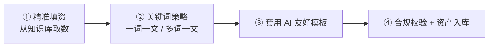

**第 1 步：精准填资，夯实源头基线**

把产品参数、服务范围、技术优势、资质、售后规则、适用场景统一维护在 3.5 的知识库里。每篇内容都从知识库调取信息，避免参数冲突、卖点口径不一和违规宣传。

**第 2 步：关键词策略**

| 策略 | 适用 | 做法 |
| --- | --- | --- |
| 一词一文 | 高转化核心词 | 单独成文，严格匹配搜索意图 |
| 多词一文 | 语义相近、同一主题的 2–3 个长尾词 | 合并成一篇，覆盖多个提问角度 |

前提是语义强相关。不要把无关主题硬塞进同一篇文章。

**第 3 步：套用 AI 友好模板**

不建议自由发挥写软文。优先采用以下模板：

- 选购指南
- 参数解读
- FAQ 问答
- 技术方案
- 对比分析
- 使用教程

写作原则：结论放在开头；要点用列表；减少硬广，重心放在专业知识输出。模型对纯营销内容的信任度通常偏低，专业信息密度越高，被引用的机会越大。

**第 4 步：合规校验 + 资产入库**

发布前逐条核对：

- 功效与宣传用语是否符合行业监管（医疗、医美、药品、保健食品、教育、金融等行业另有专门规定）；
- 是否使用了"国家级 / 最高级 / 最佳"等绝对化用语（《[广告法](https://www.gov.cn/guoqing/2021-10/29/content_5647620.htm)》第九条，适用范围见《[广告绝对化用语执法指南](https://www.samr.gov.cn/ggjgs/tzgg/art/2023/art_183b5cb48d9e4f0dba67f9f912a913ba.html)》）；
- 数据是否有出处与时间口径；
- 使用 AI 辅助生成的内容，是否按《[人工智能生成合成内容标识办法](https://www.cac.gov.cn/2025-03/14/c_1743654685896173.htm)》与发布平台的规则进行声明或标识。

通过后入库，进入分发环节。

##### 示例：一段 FAQ 的前后对比（示意）

不推荐：

> 我们的智能门锁真的特别好用，现在买还送安装，赶紧来咨询吧，绝对是全网最佳选择！

推荐：

> **问：某型号智能门锁支持哪些开锁方式？**
> 答：支持指纹、密码、NFC 卡片和机械钥匙四种方式。指纹最多录入 100 组，密码支持 6–12 位。官方售后提供 2 年质保（以购买时说明为准）。

推荐写法的结论在第一句，参数有单位，售后口径有限定条件，没有绝对化用语。

##### 内容生产工具

内容生产工具能把撰写、发稿、分发等重复工作自动化，团队的人力集中在知识库维护与用户意图分析上。以麦豆工具当前公开的功能为例（以 [麦豆官网](https://www.maidouai.com/) 最新说明为准）：

| 功能 | 说明 |
| --- | --- |
| AI 自动写文章 | 批量导入关键词组，支持多词合并生成，自动套用结构模板 |
| 手动生成文章 | 自主控制大纲与文案细节，适合核心内容 |
| 媒体发布渠道 | 内置媒体资源，按行业与内容类型发稿（是否收费以官方说明为准） |
| 同步助手 | 定稿后分发到多个自媒体平台，保持各渠道版本一致 |

使用工具批量生成时，仍需人工逐篇审核事实与合规性。工具生成不等于内容可直接发布。

##### 五条避坑

1. 结构化不等于堆表格，核心是事实独立、结论前置、信息可核验。
2. 结构化内容必须绑定知识库。脱离统一资料的结构化文章，依然会制造信息冲突。
3. 不盲目追求产量。单篇的准确度与合规性优先于数量。
4. 媒体发稿不是越多越好。优先选择与行业匹配、在你的监测数据里引用表现稳定的渠道。
5. 发布后持续监测可见度与引用情况，反向迭代知识库与模板。

从"随便写内容求收录"转向"标准化生产可信知识"，是 GEO 运营进入成熟阶段的标志。

### 3.7 环节七：高引用平台分场景合规运营

##### 最常见的坑：每篇都塞联系方式

不少团队认为每篇文章都应该带电话、地址、微信，方便用户直接联系。实际上，新闻资讯、自媒体、技术社区等平台对硬广和导流信息管控较严，后果从轻到重依次是：内容不予推荐或不收录 → 删稿 → 账号限流或冻结。账号一旦被封，该平台上的历史内容一并失效，前期积累的信源资产随之受损。

##### 关键认知：AI 会交叉验证

不需要每篇文章都留电话。生成式引擎在回答"某品牌电话是多少""地址在哪"这类问题时，通常会调取地图、商户目录、工商信息等高置信度信源。在这些允许填写联系方式的平台上把信息完善好，其他平台的科普内容即便不留电话，AI 仍能拼出完整答案。

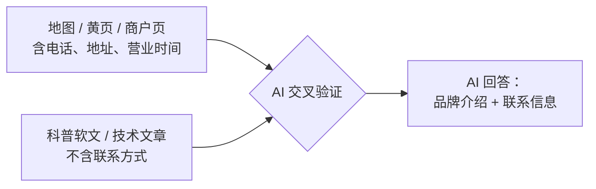

##### 两类场景，两套打法

| | 场景一：承载完整联系信息 | 场景二：干货软内容 |
| --- | --- | --- |
| 平台举例 | [百度地图商户中心](https://didian.baidu.com/)、[Apple 商务](https://business.apple.com/)、[360 地图](https://map.so.com/)、本地点评平台、部分企业黄页 | [百家号](https://baijiahao.baidu.com/)、[搜狐号](https://mp.sohu.com/)、新闻资讯平台、技术社区 |
| 写什么 | 企业全称、详细地址、电话、官网、营业时间等完整资料 | 科普、解决方案、行业干货、技术解读 |
| 不写什么 | 夸大宣传 | 电话、微信等导流信息（以各平台规则为准） |
| 在 AI 体系中的作用 | 作为核验企业基础信息的数据库 | 丰富品牌语义素材，提升在 AI 问答中的曝光机会 |

##### 按行业匹配垂直平台

除了"能不能留联系方式"，还要看产品属于哪个行业，选择受众与 AI 收录偏好都匹配的垂直平台。

示例（示意）：传感器这类工业技术产品，内容包含大量参数、指标与技术方案。只发在综合自媒体上，受众不匹配，引用效果有限。更适合发布到技术垂直社区，例如 [腾讯云开发者社区](https://cloud.tencent.com/developer)（其下设有[混元专区](https://cloud.tencent.com/developer/zone/hunyuan)）等，受众是开发者、工程师与技术采购人员。

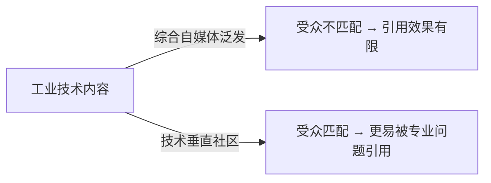

不同行业可参考的平台类型（示意，具体以监测到的信源为准）：

| 行业 | 优先考虑的平台类型 |
| --- | --- |
| 工业 / 技术 / SaaS | 技术社区、开发者社区、行业媒体 |
| 本地生活 / 线下服务 | 地图、点评、分类信息 |
| 消费品 | 电商详情页、测评社区、内容种草平台 |
| 医疗 / 教育 / 金融 | 具备资质的行业平台与官方渠道（需特别注意行业监管） |

##### 五条落地要点

1. 不要所有文章统一塞联系方式，容易触发平台风控。
2. AI 有交叉验证能力，联系信息只需在地图、黄页等合规平台完善。
3. 平台分场景运营：一类承载联系信息，一类发布干货内容。
4. 结合行业属性选择垂直平台，提高信源质量。
5. 高质量、合规的布局，才能保障 GEO 的长期效果。

一句话：电话只交给地图黄页，干货交给内容平台。

### 3.8 环节八：官网 GEO 优化

##### 官网为什么重要

外部渠道的发稿成本持续上升，且内容格式、审核规则受限。官网是可自主控制的长期资产：内容自由度高、发布数量不受第三方约束；一旦被各 AI 平台收录，官网引用率会成为抬升品牌权威度的关键指标，还能通过流量统计工具量化 AI 带来的真实访问与转化。

官网优化分两件事：**让爬虫进得来**（抓取与可读性），以及**让模型读得懂**（结构化数据）。

##### 诊断：常见收录障碍清单

把官网 GEO 诊断拆成六类检查，24 项检测点可以根据实际情况扩展。这里给出最常见的检查项与做法，可直接作为团队的自查清单，或借助工具（如 [麦豆免费 GEO 工具](https://www.maidouai.com/) 的网站诊断）批量跑一遍。

| 维度 | 常见检查项 | 做法 |
| --- | --- | --- |
| 1. 网页内容结构 | 标题是否清晰、段落是否过长、是否有目录 | 用 h1/h2 清晰分级；关键信息用列表或表格 |
| 2. 语义可理解性 | 核心产品、服务、价格、联系方式是否以文本形式呈现 | 不要把关键信息做成图片或仅靠 JS 动态渲染 |
| 3. 权威与可见度 | 是否有企业信息页、团队页、资质页、联系方式页 | 独立页面，并在首页有入口 |
| 4. 结构化与机器可读 | 是否部署了 schema.org 结构化数据 | 见下文 Schema 部分 |
| 5. 覆盖度与用户价值 | 是否覆盖目标提示词的典型问题 | 以 3.2 词库为准，缺什么补什么 |
| 6. 技术体验 | 爬虫是否被 robots.txt、WAF、CDN 拦截；页面是否可正常索引 | 见下文抓取权限章节 |

##### 爬虫抓取权限

典型踩坑：WAF 或 CDN 把 AI 爬虫一并拦了，官网自然难以被引用。常见 AI 相关爬虫 User-Agent 标识：

| 服务方 | robots.txt 可用标识 | 说明 |
| --- | --- | --- |
| 字节跳动系（头条搜索/部分 AI 产品） | `Bytespider` | 字节公开的爬虫；豆包是否有专属爬虫目前未公开，以字节官方最新说明为准（待核实） |
| 百度系（含文心复用的索引） | `Baiduspider` | 百度官方搜索爬虫 |
| 阿里系（含千问复用的索引） | `YisouSpider` | 神马/夸克搜索爬虫 |
| OpenAI（ChatGPT 搜索） | `OAI-SearchBot`、`ChatGPT-User`、`GPTBot` | 三个爬虫用途不同，分别对应搜索展示、用户即时抓取、训练；可分别设置 |
| Perplexity | `PerplexityBot`、`Perplexity-User` | 分别对应搜索索引与用户即时抓取 |
| Google | `Googlebot` 等常规爬虫 | AI 功能复用 Search 索引；AI Overviews / AI Mode 的开关在 Search Console 中（参见 [Google 文档](https://support.google.com/webmasters/answer/16908024)） |

默认建议：对需要出现在 AI 答案中的页面，允许上述爬虫访问；敏感后台与用户数据接口始终 `Disallow`。

robots.txt 片段示例（示例，按实际域名与路径调整）：

```text
User-agent: Bytespider
Allow: /

User-agent: Baiduspider
Allow: /

User-agent: YisouSpider
Allow: /

User-agent: OAI-SearchBot
Allow: /

User-agent: ChatGPT-User
Allow: /

User-agent: PerplexityBot
Allow: /

User-agent: *
Disallow: /admin/
Disallow: /api/private/
```

关于 GPTBot：允许它意味着页面内容可能被用于 OpenAI 模型训练，与 ChatGPT 搜索展示是独立开关，可分别选择。

##### 结构化数据（Schema）

[schema.org](https://schema.org/) 是搜索引擎和部分 AI 服务共同采用的结构化词汇。常用类型：

| 类型 | 场景 | 文档 |
| --- | --- | --- |
| `Organization` | 公司主体、企业官网 | [Google 指南](https://developers.google.com/search/docs/appearance/structured-data/organization) |
| `LocalBusiness` | 有实体门店的本地企业 | [Google 指南](https://developers.google.com/search/docs/appearance/structured-data/local-business) |
| `Product` | 商品详情 | — |
| `Article` | 行业文章、科普 | — |
| `FAQPage` | 常见问答页 | Google 已于 2026-05-07 停止显示 FAQ 的富媒体搜索结果，但 [schema.org](https://schema.org/) 词汇本身依然有效，仍被部分 AI 用于抽取 |

JSON-LD 示例（示意）：

```html
<script type="application/ld+json">
{
  "@context": "https://schema.org",
  "@type": "Organization",
  "name": "某某公司",
  "url": "https://www.example.com/",
  "logo": "https://www.example.com/logo.png",
  "sameAs": [
    "https://weibo.com/exampleofficial",
    "https://space.bilibili.com/00000000"
  ],
  "address": {
    "@type": "PostalAddress",
    "streetAddress": "示例街道 1 号",
    "addressLocality": "深圳市",
    "addressRegion": "广东省",
    "postalCode": "518000",
    "addressCountry": "CN"
  }
}
</script>
```

部署要点：

- 按主体选最具体的子类型（电商优先 `OnlineStore`，本地商家优先 `LocalBusiness` 的细分类型）；
- 结构化数据必须与页面可见文本一致，不要只在 JSON-LD 里堆信息；
- 部署后用 [Google Rich Results Test](https://search.google.com/test/rich-results) 或 [Schema Markup Validator](https://validator.schema.org/) 验证；
- 生成工具可用 Google 的 [Structured Data Markup Helper](https://www.google.com/webmasters/markup-helper/)，或所用 GEO 工具的 Schema 生成器（麦豆内置十几种常用模板，以[官网](https://www.maidouai.com/)最新说明为准）。

##### 流量闭环：怎么量化 AI 带来的访问

- 用 [百度统计](https://tongji.baidu.com/)、[友盟+ U-Web](https://act.umeng.com/web)（原 CNZZ 已升级为 U-Web Plus，老站点建议按友盟官方指引迁入）或 [Google Analytics](https://marketingplatform.google.com/about/analytics/) 之类的流量统计工具，查看来自各 AI 产品域名的点击；
- 用监测工具或自建脚本，跟踪自家官网在 AI 回答中的引用率变化；
- 把 AI 带来的访问设为独立 UTM 来源标记（示例：`utm_source=doubao&utm_medium=ai_answer`），方便在后端与 CRM 中归因。

##### 五条落地要点

1. 外部发稿成本持续走高，官网是低成本、长期稳定的核心阵地。
2. 官网收录后内容可控，用流量统计工具追踪 AI 访问流量，归因到咨询与订单。
3. 从 6 大维度排查收录障碍，重点看 AI 爬虫抓取权限与关键页面的文本可读性。
4. 部署 schema.org 结构化数据，降低 AI 解析成本。
5. 结构化数据与可见文本保持一致，不堆砌、不伪造；部署后定期验证。

### 3.9 环节九：周期监测、数据复盘与迭代

##### GEO 是闭环，不是一次性项目

模型会持续更新，用户的提问习惯会变化，信源的权重也会随平台生态调整。把前面八个环节跑一遍只是起步。

##### 为什么必须循环迭代

| 原因 | 具体表现 |
| --- | --- |
| 大模型知识库持续更新 | 品牌在回答中的提及与排序会随更新波动 |
| 用户提问习惯变化 | 旧提示词流量下降，新长尾不断涌现 |
| 信源权重迁移 | 过去的高引用平台可能让位给新平台 |
| 业务目标才是终点 | 曝光不等于咨询和订单 |

##### 排名 ≠ 转化：最常见的误判

现象（示例）：已优化的 10 条提示词在 AI 回答里全部拿到不错的提及，但一个月下来没有咨询、没有订单。大概率原因是提示词选型本身偏离了意向客户的实际提问，需要换掉词。

提示词有排名，只代表品牌在 AI 大模型内获得了曝光，不等于这条词有真实流量、能带来意向客户。排名只是中间指标，**最终要回归业务转化**。

##### 四步周期流程

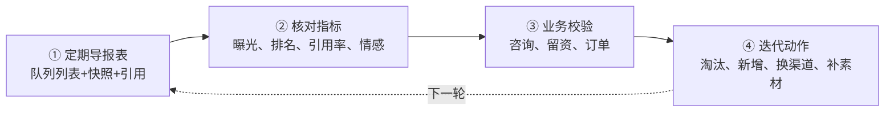

| 步骤 | 做什么 |
| --- | --- |
| ① 定期导报表 | 队列列表、答案快照、引用源报表。常见周期：周报、月报；重大活动前后加密到每日 |
| ② 核对指标 | 曝光状态、AI 答案提及位置、信源引用率、内容情感倾向 |
| ③ 业务端校验 | 结合咨询、留资、订单数据，判断每条提示词的商业价值 |
| ④ 迭代动作 | 淘汰无转化的词、新增长尾词、按信源数据调整发布阵地、按反馈补知识库 |

部分工具支持自动化监测（如 [麦豆免费 GEO 工具](https://www.maidouai.com/) 的轮询监测功能，具体频率与是否收费以官网说明为准）；没有工具时，按固定日程人工复查也能跑通。

##### 复盘输出的三张清单

每一轮迭代结束，产出三张可执行的清单：

| 清单 | 内容 |
| --- | --- |
| 词库调整清单 | 新增词、淘汰词、合并词 |
| 信源调整清单 | 新增阵地、减量平台、补发页面 |
| 内容调整清单 | 需要补写的 FAQ、要更新的参数、要重写的卖点 |

##### 迭代节奏建议

- 每周：异常监测（可见度突降、新负面出现、新竞品信号）；
- 每月：完整一轮监测 + 复盘 + 迭代；
- 每季度：重新审视词库结构、信源结构是否仍与业务目标一致；
- 每半年：从头评估品牌定档、知识库版本、合规清单。

---

## 第 4 章 效果评估：以提示词为单位看结果

### 4.1 为什么以提示词为单位

做 GEO 最怕的不是发得少，而是发完不知道有没有效果。按"整体可见度"看只能知道大方向；以每一条提示词为单位追踪，才能看清哪些词已经跑通、哪些还需要补信源，把 AI 曝光变成可追溯的数据。

### 4.2 提示词列表的六个维度

| 维度 | 含义 | 怎么读 |
| --- | --- | --- |
| 品牌曝光状态 | 这条提示词的 AI 回答里是否出现品牌 | 是 / 否 |
| 曝光占比 | 多次提问中提及品牌的比例 | 0% 表示完全没出现；大于 0% 表示已获得曝光 |
| 首段是否曝光 | 品牌是否出现在回答首段 | 首段曝光更接近用户实际看到的内容 |
| 情感倾向 | AI 对品牌的整体评价 | 积极 / 中性 / 负面 |
| 官网引用标记 | 回答是否引用了官网 | 衡量官方信源权威度 |
| 分平台与历史数据 | 按 AI 平台拆开，并保留时间线 | 横向看平台差异，纵向看优化前后变化 |

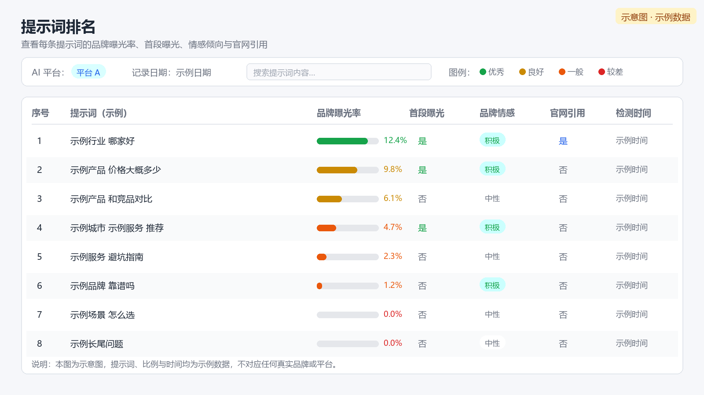

*图 4-1 提示词排名看板示意图。图中提示词、比例与时间均为示例数据，不对应任何真实品牌。*

### 4.3 示例：从全线零曝光到部分触发（示例数据）

以下为一个虚构项目，用来说明读数方法：

| 时间 | 观测 |
| --- | --- |
| 第 0 天（基线） | 共 19 条提示词，在目标平台上曝光占比全部为 0%，没有一条回答推荐该品牌 |
| 第 1–8 天 | 持续发布结构化内容并补齐高引用信源 |
| 第 8 天 | 19 条中有 10 条开始触发品牌曝光 |

读法：曝光从 0 到非 0，说明前期发布的结构化信源已被检索或收录。但是否带来业务结果，仍要回到 3.9 的业务校验。示例中的天数与条数只用于说明方法，不代表任何项目都能在同样周期内得到同样结果。

### 4.4 分平台对比

不同大模型的检索逻辑、索引来源与更新节奏不一样，同一组提示词的结果可能差距很大。

示例（示例数据）：在同一批 13 条有效提示词中——

| 平台 | 获得品牌曝光的提示词 |
| --- | --- |
| 平台 A | 6 / 13 |
| 平台 B | 13 / 13 |

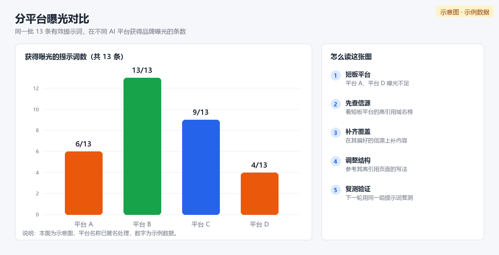

*图 4-2 分平台曝光对比示意图。平台名称做了匿名处理，数字为示例数据。*

读法：平台 A 是短板。回到 3.4，查看平台 A 的高引用域名榜，针对性补信源、调整内容结构，而不是笼统地加大全平台发文量。

### 4.5 实操五个动作

| 动作 | 做法 |
| --- | --- |
| 1. 基线留存 | 正式优化前先跑一轮全量检测，保存基线数据 |
| 2. 定期巡检 | 固定周期检测，关注新增获得曝光的提示词数量 |
| 3. 分层处理 | 已曝光的词做维稳；长期 0% 的词分析是信源权重不足，还是语义不匹配 |
| 4. 跨平台对比 | 找出薄弱平台，调整发布策略 |
| 5. 结合情感指标 | 监控 AI 对品牌的评价，及时处理负面倾向（先核实是否属实） |

诊断不是终点。每一轮结果都要反补到下一轮：问题怎么选、知识怎么补、内容怎么写、渠道怎么铺。

### 4.6 GEO 评估与 SEO 排名监控的区别

提示词列表的形态很像 SEO 的关键词排名监控，但逻辑不同：

- SEO 看网页排序位次，位次相对固定；
- GEO 看大模型生成回答时是否主动引用、提及品牌信源。回答每次生成都可能不同，没有固定位次。

因此 GEO 的核心指标是：是否曝光、曝光占比、首段曝光、信源引用与情感倾向。单次截图不能代表稳定结果，应以多次提问、多平台、多时间点的统计为准。

### 4.7 补充：评估口径与样本要求

为了让数据可比，评估时固定以下条件：

- **提问方式固定**：同一条提示词的原文不变，避免一会儿问"哪家好"一会儿问"推荐"。
- **多次采样**：同一条提示词在同一平台建议至少问 3 次，取比例，而不是看一次。
- **环境记录**：记录是否登录、是否开启联网搜索、所用模型版本，这些都会影响回答。
- **时间对齐**：对比前后数据时，使用同一时间段长度。
- **区分自然波动**：小样本下的几个百分点变化，可能只是随机波动，不要据此下结论。

### 4.8 效果评估指标体系（汇总）

把前文的指标按"过程 → 结果"排列：

| 层级 | 指标 | 回答的问题 |
| --- | --- | --- |
| 基础层 | 抓取与收录情况、结构化数据有效性 | AI 能不能读到我 |
| 曝光层 | 提及率、首段曝光率、分平台覆盖 | AI 会不会说到我 |
| 信源层 | 官网引用率、高引用域名覆盖度 | AI 引用的是不是我的权威来源 |
| 认知层 | 情感倾向、AI 品牌描述准确率 | AI 说得对不对、好不好 |
| 业务层 | AI 来源访问量、咨询量、留资量、订单量 | 曝光有没有变成生意 |

其中"AI 品牌描述准确率"建议由人工抽查：把 AI 对品牌的描述逐句与知识库比对，统计错误条目占比。准确率低时，优先回到 3.5 补齐资料、回到 3.4 补齐高置信度信源。

## 第 5 章 答案快照、智能建议与报告交付

指标与图表适合内部判断，但对外汇报时，需要能直接展示"品牌在 AI 回答里到底长什么样"。本章讲复盘与交付的三个收尾动作。

### 5.1 答案快照：最直接的效果凭证

分值类指标是间接数据，原始的 AI 回答才是最直接的结果。答案快照是指在监测时把各 AI 平台对每条提示词的原始问答完整保存下来。

| 作用 | 说明 |
| --- | --- |
| 自动留存 | 监测时抓取并保存各平台原始问答，不需要人工逐条搜索截图 |
| 查看真实位置 | 看品牌在这条提示词的回答中出现在第几位、是否在首段 |
| 跨平台核验 | 同一条提示词在 [文心](https://wenxin.baidu.com/)、[千问](https://www.qianwen.com/)、[豆包](https://www.doubao.com/) 等平台分开查看 |
| 效果验证 | 首段曝光、品牌占位、引用来源一目了然 |

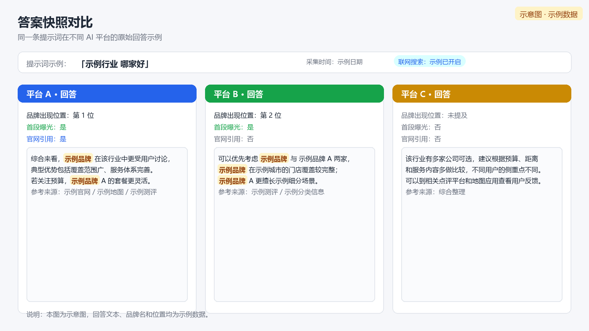

*图 5-1 答案快照对比示意图。回答文本、品牌名和位置均为示例数据。*

使用注意：

- 快照是某一时刻、某一环境下的结果。生成式回答本身有随机性，同一问题再问一次可能不同。对外展示时注明采集时间、平台与是否开启联网搜索。
- 不对快照做裁剪、拼接、篡改。挑选个别有利的快照并暗示为常态，属于误导性展示。

### 5.2 智能改进建议

监测完成后，部分工具会根据全量数据自动生成改进建议。一份有用的建议应当具体到以下四类问题：

| 定位 | 建议应回答 |
| --- | --- |
| 曝光短板 | 哪些提示词曝光不足 |
| 平台短板 | 哪些 AI 平台收录偏弱 |
| 信源缺口 | 缺少哪类信源、哪些高引用域名尚未覆盖 |
| 内容与舆情 | 品牌口碑和内容结构该如何调整 |

工具建议适合新手作为起点，减少试错。但建议由算法生成，执行前仍需结合业务判断：建议与事实不符、与合规要求冲突时，以事实和法规为准。

### 5.3 数据报告导出与交付

报告是运营复盘、管理层汇报与对客户（甲方）交付的核心材料。一份完整报告建议包含四个部分：

| 部分 | 内容 |
| --- | --- |
| 综合数据分析 | 可见度总分、提及率、首段曝光率、官网引用率的整体复盘 |
| 分平台独立解析 | 覆盖豆包、腾讯元宝、千问、文心、DeepSeek 等主流平台的单独数据 |
| 竞品对标 | 同一组提示词下与主要竞品的横向对比，明确优势与短板 |
| 改进方案 | 汇总问题点，给出可执行的下一轮动作（对应 3.9 的三张清单） |

导出格式：

- **PDF**：适合客户交付与正式存档，版本固定；
- **HTML**：适合在线查看，便于后续追加数据或二次编辑。

以麦豆工具为例，其报告导出与快照功能当前对外宣称免费，次数与范围以 [麦豆官网](https://www.maidouai.com/) 最新说明为准。

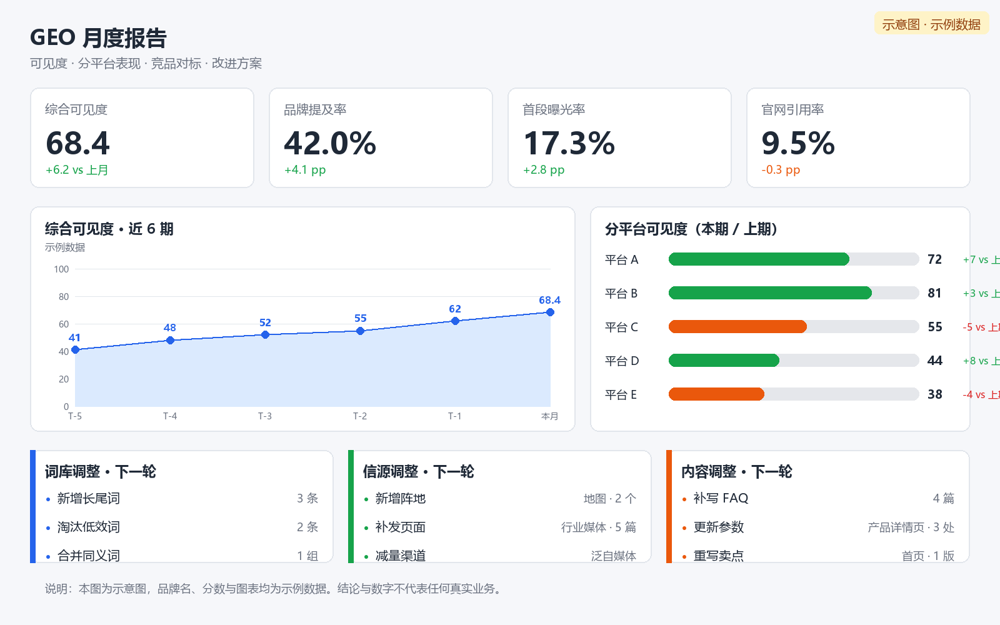

*图 5-2 月度报告示意图。品牌名、分数与图表均为示例数据。*

### 5.4 报告写作的三条要求

1. **口径写清楚**：每个指标注明定义、样本量、采集时间与平台。
2. **不做效果承诺**：生成式回答没有固定排名，报告只陈述观测到的结果和变化趋势，不承诺"保证上首页""保证被推荐"。
3. **结论落到动作**：每一个问题对应一个下一轮的具体动作和负责人。

快照是证据，报告是交付。两者配合，复盘、汇报与客户交付才能形成闭环。

## 第 6 章 合规边界与风险清单

GEO 涉及对公开信息的影响力争夺，边界必须清晰。下列条目基于中国大陆现行法律法规，与国际平台通行规则。涉外业务还要参照业务所在地的广告、消费者保护与数据法规。

### 6.1 内容生产相关

| 风险行为 | 对应法规 / 规则 |
| --- | --- |
| 虚假宣传：对商品性能、功能、质量、销量、用户评价、荣誉作虚假或引人误解的宣传 | [《反不正当竞争法》](http://www.npc.gov.cn/c2/c30834/202506/t20250627_446247.html)（2025-10-15 施行）第九条、[《广告法》](https://www.gov.cn/guoqing/2021-10/29/content_5647620.htm) |
| 组织虚假交易、虚假评价，帮助他人虚假宣传 | [《反不正当竞争法》](http://www.npc.gov.cn/c2/c30834/202506/t20250627_446247.html) 第九条第二款；罚款 100 万以下，情节严重 100 万–200 万并可吊销营业执照 |
| 在商品广告中使用"国家级""最高级""最佳"等绝对化用语 | [《广告法》](https://www.gov.cn/guoqing/2021-10/29/content_5647620.htm) 第九条；罚款 20 万–100 万，例外情形见[《广告绝对化用语执法指南》](https://www.samr.gov.cn/ggjgs/tzgg/art/2023/art_183b5cb48d9e4f0dba67f9f912a913ba.html) |
| 医疗、医美、药品、保健食品、教育培训、金融理财等重点领域使用绝对化用语或夸大宣传 | 相关行业法规，一般不属于"轻微违法" |
| AI 生成合成内容未按规定标识 | [《人工智能生成合成内容标识办法》](https://www.cac.gov.cn/2025-03/14/c_1743654685896173.htm)（2025-09-01 施行）与配套强制性国标 GB 45438-2025 |
| 为生成式 AI 服务提供内容时违反社会主义核心价值观、生成违法有害信息 | [《生成式人工智能服务管理暂行办法》](https://www.gov.cn/zhengce/zhengceku/202307/content_6891752.htm)（2023-08-15 施行）第四条 |

### 6.2 刷单、刷评、流量造假

《[网络反不正当竞争暂行规定](https://www.gov.cn/zhengce/202406/content_6959668.htm)》（2024-09-01 施行）第九条明确禁止下列行为：

- 虚假交易、虚假排名；
- 虚构交易额、成交量、预约量等经营数据；
- 谎称现货、虚构预订、虚假抢购；
- 编造用户评价，或通过"隐匿差评、好评前置、差评后置"等方式误导；
- 以返现、红包、卡券等方式**利诱**用户作出指定好评、点赞、定向投票（即俗称的"好评返现"）；
- 虚构收藏量、点击量、关注量、点赞量、阅读量、订阅量、转发量等流量数据；
- 虚构升学率、考试通过率、就业率等教育培训效果；
- 伪造口碑、炮制话题、制造虚假舆论热点。

组织上述行为帮助其他经营者的，也在禁止范围内。

GEO 的正确做法：**鼓励真实用户的真实表达**，优化内容本身与信源结构，不以经济利益换取指定评价。

### 6.3 GEO 场景中常见的高风险做法

| 做法 | 为什么有风险 |
| --- | --- |
| 批量注册账号自问自答，营造品牌口碑 | 构成伪造口碑，违反《网络反不正当竞争暂行规定》 |
| 用脚本或账号矩阵在 AI 产品里反复提问特定问题以"推高"品牌出现概率 | 违反 AI 平台服务条款，涉嫌反不正当竞争 |
| 对竞品发起有组织的差评或虚假信息 | 违反《反不正当竞争法》第十二条（商业诋毁） |
| 把预训练模型未公开的内部数据当作品牌背书写入文案 | 可能构成虚假宣传 |
| 用 AI 生成合成的"客户案例""资质证书"而不加标识 | 违反《人工智能生成合成内容标识办法》 |
| 对 AI 爬虫、搜索引擎展示与对普通用户展示不同内容（cloaking） | 违反主要搜索引擎与 AI 平台通用规则 |

### 6.4 数据与隐私

- 监测过程中采集的 AI 回答，属于平台公开内容，可用于分析；
- 竞品分析只使用公开可见的信息，不采集竞品私密数据、不绕过技术保护措施；
- 用户案例、客户名单、照片使用前取得授权，并避免泄露个人信息；
- 任何涉及个人信息处理的内容生产与投放活动，遵守《[个人信息保护法](http://www.npc.gov.cn/npc/c2/c30834/202108/t20210820_313088.html)》。

### 6.5 建立内部合规清单

团队可参考下列清单，每周或每月自查一次：

- [ ] 发布的所有内容是否能提供原始出处
- [ ] 是否存在绝对化用语
- [ ] 案例与客户信息是否已获授权
- [ ] 评价是否全部为真实用户的真实表达
- [ ] AI 辅助生成的内容是否按要求标识
- [ ] 所用监测、拓词、发文工具是否在授权许可范围内使用
- [ ] 竞品分析是否仅使用公开数据
- [ ] 流量统计是否遵守数据合规要求

## 第 7 章 常见误区与避坑清单

### 7.1 认知类误区

| 误区 | 纠正 |
| --- | --- |
| AI 会自己生成关于我的内容 | AI 整合的是已有信息。没有布局就没有曝光 |
| GEO 是 SEO 的翻版，关键词堆上去就行 | GEO 看的是"能否被引用"，关键词堆砌反而降低结构化质量 |
| 只要工具显示可见度 90 分就是优化好了 | 分数仅代表工具内部口径。要回到业务校验 |
| AI 回答一次没提到就是没效果 | 生成式回答有随机性。多次采样、多平台看比例才有意义 |
| 搞定一个平台就等于搞定全部 AI | 各 AI 平台信源偏好差异明显，必须分平台看数据 |

### 7.2 操作类误区

| 误区 | 纠正 |
| --- | --- |
| 前期不定档，先把内容发出去再说 | 主体不统一，所有权重都会分散 |
| 词库越大越好，先堆几千条 | 词库要与真实业务目标对齐，30–200 条即可起步，按意图分组 |
| 每篇文章都塞电话和微信 | 多数内容平台不允许硬广；AI 有交叉验证，联系方式只需在地图/黄页完善 |
| 把所有内容都发到自媒体 | 不同行业适配不同平台。工业技术、本地服务、消费品的高引用信源完全不同 |
| 发完就不管 | 不迭代等于把成果交给时间去冲刷 |
| 用 AI 一键生成大量文章直接发 | 批量生成需人工把关事实、合规和风格，否则容易踩法规和平台风控 |

### 7.3 效果判断类误区

| 误区 | 纠正 |
| --- | --- |
| 只看单次截图 | 多次采样、多平台、多时间段 |
| 只看综合可见度 | 拆到提示词级别，才能找到可操作的差异 |
| 只看排名不看转化 | 回到咨询、留资、订单做业务校验 |
| 对比不同工具的分数 | 各工具口径不同，不能直接比较 |
| 把一次波动当趋势 | 用周报 / 月报的滚动窗口看，别被单日噪声带偏 |

### 7.4 合规类误区

| 误区 | 纠正 |
| --- | --- |
| "大家都这么做"所以好评返现没事 | 2024-09-01 起已明确违法 |
| 绝对化用语换个说法就行 | 含义相同或近似的用语同样禁止 |
| 把竞品差评写进自己文章 | 存在商业诋毁与虚假信息风险 |
| 用 AI 批量伪造案例当品牌故事 | 违反虚假宣传、AI 内容标识规定 |
| 刷评价、刷流量能短期拉高 | 不仅违法，也无法稳定影响生成式引擎的引用 |

## 第 8 章 附录

### 8.1 术语表

| 术语 | 中文 | 说明 |
| --- | --- | --- |
| Generative Engine | 生成式引擎 | 以大语言模型为核心、通过检索+生成回答问题的系统 |
| RAG | 检索增强生成 | 先检索候选信息再由模型合成答案的技术路径 |
| Visibility | 可见度 | 品牌在 AI 回答中的综合出现程度 |
| Citation Rate | 引用率 | 回答中引用目标来源的条数占比 |
| Mention Rate | 提及率 | 回答中出现品牌名的条数占比 |
| First-paragraph Exposure | 首段曝光率 | 首段包含品牌的条数占比 |
| Structured Data | 结构化数据 | 用 schema.org 等词汇描述页面内容的机器可读标注 |
| Hallucination | AI 幻觉 | 模型生成看似合理但与事实不符的内容 |
| Robots.txt | 爬虫协议 | 告诉爬虫哪些路径可以或不能抓取的文本文件 |
| Cloaking | 伪装 | 对爬虫与用户显示不同内容，属于违规做法 |

### 8.2 国内外主流生成式引擎

以下官网与中文名称截至 2026-11-14 核对；功能、价格、是否需要登录等以各平台官网最新说明为准。

| 名称 | 官网 | 备注 |
| --- | --- | --- |
| 豆包 | [doubao.com](https://www.doubao.com/) | 字节跳动 |
| DeepSeek | [deepseek.com](https://www.deepseek.com/) | 深度求索 |
| 千问（原通义） | [qianwen.com](https://www.qianwen.com/) | 阿里；`tongyi.com` 自动跳转至此 |
| 腾讯元宝 | [yuanbao.tencent.com](https://yuanbao.tencent.com/) | 腾讯 |
| 文心（原文心一言） | [wenxin.baidu.com](https://wenxin.baidu.com/) | 百度；`yiyan.baidu.com` 自动跳转至此 |
| Kimi | [kimi.com](https://www.kimi.com/) | 月之暗面 |
| 智谱清言 | [chatglm.cn](https://chatglm.cn/) | 智谱 |
| 讯飞星火 | [xinghuo.xfyun.cn](https://xinghuo.xfyun.cn/) | 科大讯飞 |
| ChatGPT | [chatgpt.com](https://chatgpt.com/) | OpenAI |
| Perplexity | [perplexity.ai](https://www.perplexity.ai/) | — |
| Google AI Overviews / AI Mode | [Google Search](https://www.google.com/)、[控制说明](https://support.google.com/webmasters/answer/16908024) | 可在 Search Console 调整参与状态 |

### 8.3 常用信源与工具

| 分类 | 平台 | 官网 |
| --- | --- | --- |
| 百科类 | 百度百科 | [baike.baidu.com](https://baike.baidu.com/) |
| 问答类 | 百度知道 | [zhidao.baidu.com](https://zhidao.baidu.com/) |
| 自媒体 | 百家号 | [baijiahao.baidu.com](https://baijiahao.baidu.com/) |
| 自媒体 | 搜狐号 | [mp.sohu.com](https://mp.sohu.com/) |
| 地图 / 商户 | 百度地图商户中心 | [didian.baidu.com](https://didian.baidu.com/) |
| 地图 / 商户 | 360 地图 | [map.so.com](https://map.so.com/) |
| 地图 / 商户 | Apple 商务 | [business.apple.com](https://business.apple.com/) |
| 分类信息 | 58 同城 | [58.com](https://www.58.com/) |
| 分类信息 | 列表网 | [liebiao.com](https://www.liebiao.com/) |
| 技术社区 | 腾讯云开发者社区 | [cloud.tencent.com/developer](https://cloud.tencent.com/developer) |
| 关键词趋势 | 百度指数 | [index.baidu.com](https://index.baidu.com/) |
| 结构化数据词汇 | schema.org | [schema.org](https://schema.org/) |
| 结构化数据验证 | Google Rich Results Test | [search.google.com/test/rich-results](https://search.google.com/test/rich-results) |
| 结构化数据验证 | Schema Markup Validator | [validator.schema.org](https://validator.schema.org/) |
| 结构化数据生成 | Google Structured Data Markup Helper | [google.com/webmasters/markup-helper](https://www.google.com/webmasters/markup-helper/) |
| 流量统计 | 百度统计 | [tongji.baidu.com](https://tongji.baidu.com/) |
| 流量统计 | 友盟+ U-Web（原 CNZZ） | [act.umeng.com/web](https://act.umeng.com/web) |
| 流量统计 | Google Analytics | [marketingplatform.google.com/about/analytics](https://marketingplatform.google.com/about/analytics/) |
| GEO 工具（示例） | 麦豆免费 GEO 工具 | [maidouai.com](https://www.maidouai.com/) |

### 8.4 关键法规与官方文档

- [《生成式人工智能服务管理暂行办法》](https://www.gov.cn/zhengce/zhengceku/202307/content_6891752.htm)
- [《人工智能生成合成内容标识办法》](https://www.cac.gov.cn/2025-03/14/c_1743654685896173.htm) 及 [GB 45438-2025](https://std.samr.gov.cn/gb/search/gbDetailed?id=301E0388CB75788DE06397BE0A0AE1B4)
- [《反不正当竞争法》（2025 年修订）](http://www.npc.gov.cn/c2/c30834/202506/t20250627_446247.html)
- [《网络反不正当竞争暂行规定》](https://www.gov.cn/zhengce/202406/content_6959668.htm)
- [《广告法》](https://www.gov.cn/guoqing/2021-10/29/content_5647620.htm)
- [《互联网广告管理办法》](https://www.samr.gov.cn/zw/zfxxgk/fdzdgknr/fgs/art/2023/art_d93a579afd45413e8576e4623fab348f.html)
- [《广告绝对化用语执法指南》](https://www.samr.gov.cn/ggjgs/tzgg/art/2023/art_183b5cb48d9e4f0dba67f9f912a913ba.html)
- [Google：AI Features and Your Website](https://developers.google.com/search/docs/appearance/ai-features)
- [Google：Optimizing your website for generative AI features](https://developers.google.cn/search/docs/fundamentals/ai-optimization-guide)
- [KDD 2024：GEO: Generative Engine Optimization](https://arxiv.org/abs/2311.09735)

### 8.5 版本与更新

- 版本：v1.0
- 截止日期：2026-11-14
- 更新原则：平台功能、法规与行业数据变化时，整节重写；每季度至少做一次核对。
- 反馈渠道：待核实。

---

### 结语

GEO 不是"短期流量玩法"，而是围绕大模型底层机制做的长效优化：可抓取的高权威信源、结构清晰可核验的事实内容、覆盖真实提问的词库、周期性的数据迭代，四件事做扎实，AI 曝光才有可能稳定地转化为咨询和订单。

把每一次回答当作一次新的上架机会——回到基础、回到数据、回到用户真实在问的问题。
