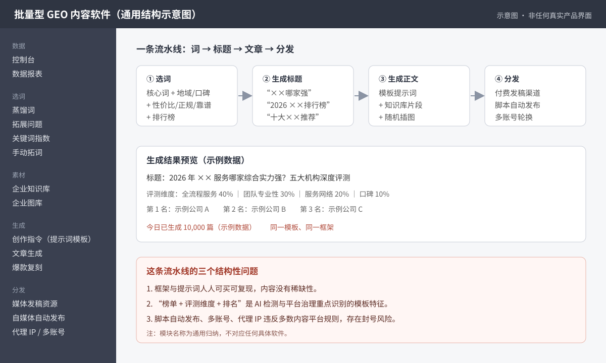
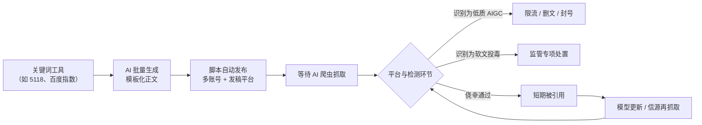
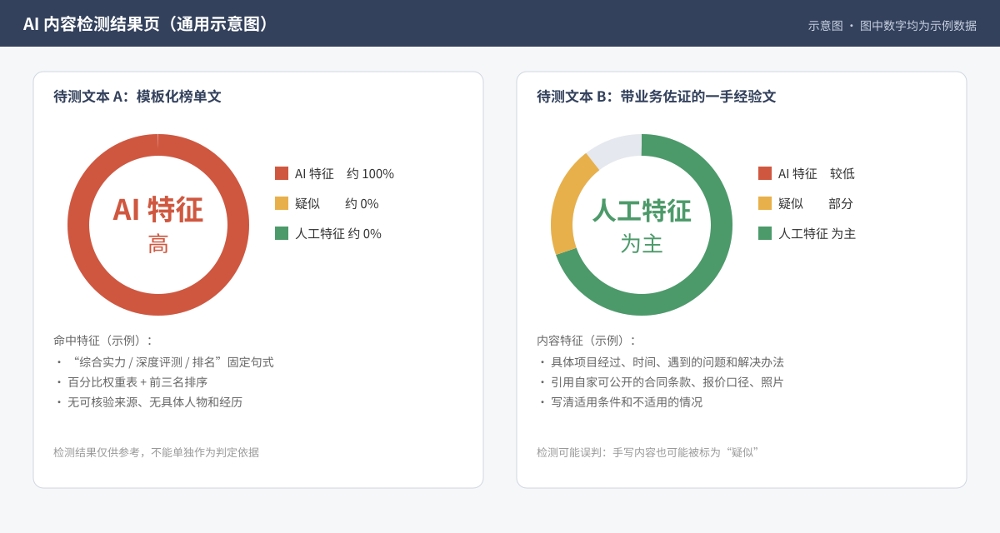
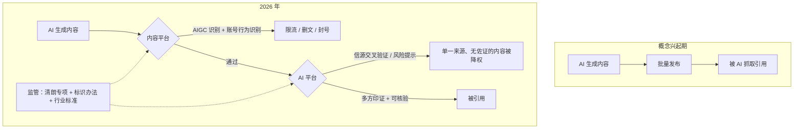
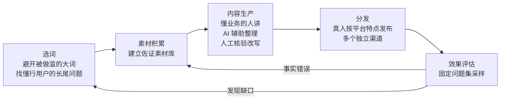
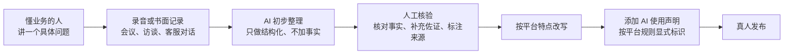
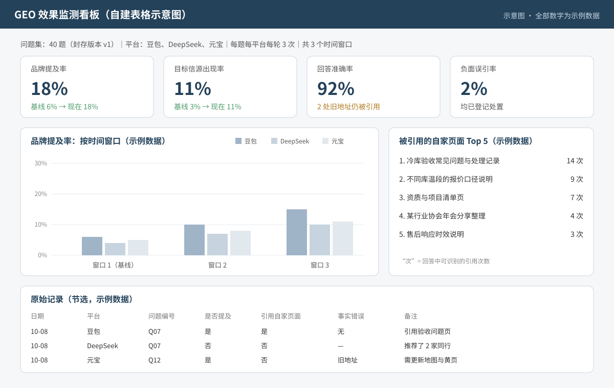

# 批量生成与软件分发为什么不灵了：GEO 内容生产与分发指南

> 信息截至 2026 年 11 月 15 日。文中涉及的 AI 平台功能、收费方式、检测工具规则和内容平台规范变化很快，均以官方最新说明为准。标注“待核实”的内容，写作时未能找到可靠的公开来源。

过去一年，很多企业用同一种方式做 GEO：买一套软件，让 AI 按关键词批量写“排行榜”“哪家强”一类的文章，再用脚本发到大量自媒体账号和付费发稿渠道。这种做法起量快，成本低，一度有效果。大量传统营销公司和个人转型做 GEO，部分企业的采购项目里也出现了 GEO 服务（行业规模和采购金额缺少公开统计，待核实）。到 2026 年，越来越多的人发现它不灵了，一部分账号还因此受到处罚。

本文先交代读懂后文需要的背景和术语；再说明这种做法为什么失效，原因来自平台的内容检测、平台的经营逻辑和监管；然后给出改做的方法，按选词、素材积累、内容生产、分发四步展开；最后讲怎样评估效果、怎样长期维护，并列出常见误区和合规边界。

本文不保证任何做法能让某个 AI 推荐你。没有人能保证这一点，行业标准也明确禁止做这类承诺。

---

## 一、背景与术语

### 1.1 什么是 GEO

GEO 是 Generative Engine Optimization 的缩写，中文叫“生成式引擎优化”。生成式引擎指豆包、DeepSeek、ChatGPT 这类能直接用一段话回答问题的 AI 产品。

这个概念最早由普林斯顿大学等机构的研究者在 2023 年提出，论文《[GEO: Generative Engine Optimization](https://arxiv.org/abs/2311.09735)》发表于 KDD 2024。论文的实验发现，在内容里加入可靠引用、权威引语和统计数据，能让这份内容在 AI 回答里更容易被采用。实验中效果最好的情况，可见度提升了约 40%。不同领域效果差别很大，这个数字也不是平均效果。

国内已有正式的行业定义。中国广告协会团体标准《[生成式引擎优化服务要求](https://digitalad.china-caa.org/TechLab/pdf/TCAAAD%20046-2026.pdf)》（T/CAAAD 046—2026，2026 年 10 月 23 日实施）把 GEO 定义为：运用用户意图分析、语义结构化处理、技术适配、内容源建设与效果监测等方法，提升目标对象相关信息在生成式引擎中的可理解性、可采纳性与可引用性。

用一句话概括：GEO 要做的，是让 AI 在回答用户问题时，能找到、读懂、愿意引用关于你的真实信息。

### 1.2 GEO 和 SEO 的区别与联系

SEO（搜索引擎优化）争的是搜索结果页上的排名，用户看到一列链接，自己点进去读。GEO 争的是 AI 回答里的位置：AI 先检索网页，再把多个来源揉成一段话，用户往往不再点开原文。

| 对比项 | 传统 SEO | GEO |
| --- | --- | --- |
| 用户看到什么 | 一列链接 | 一段综合回答，可能附来源 |
| 争什么 | 排名位置、点击 | 被提及、被引用、被描述得准确 |
| 内容单位 | 整个网页 | 网页里可被摘出来的段落和事实 |
| 判断依据 | 相关性、链接、页面质量等 | 检索到的内容是否切题、是否有多个独立来源互相印证、来源是否可信 |
| 典型风险 | 关键词堆砌、垃圾外链 | 批量低质内容、伪造信源、数据投毒 |

两者有很强的联系。很多 AI 产品联网回答时，先用搜索引擎或自家的检索系统找网页，所以能被搜索引擎收录、结构清楚的页面，在 GEO 里通常也有基础优势。Google 的[垃圾内容政策](https://developers.google.com/search/docs/essentials/spam-policies)也已经把“试图操纵 Google 搜索中的生成式 AI 回答”写进了垃圾内容的定义。SEO 里被处罚的手法，换到 GEO 里同样会被处罚。

### 1.3 术语表

- **生成式引擎 / AI 搜索**：能用自然语言直接给出回答的 AI 产品，国内常用的有[豆包](https://www.doubao.com/)、[DeepSeek](https://chat.deepseek.com/)、[腾讯元宝](https://yuanbao.tencent.com/chat/)、[千问](https://www.qianwen.com/)、[Kimi](https://www.kimi.com/)、[文心](https://wenxin.baidu.com/)；海外常用的有 [ChatGPT](https://chatgpt.com/)、[Claude](https://claude.ai/)、Perplexity（官网待核实）、[Gemini](https://gemini.google.com/)、Google AI Overviews（Google 搜索内的 AI 摘要功能，官网待核实）、[Microsoft Copilot](https://copilot.microsoft.com/)。
- **RAG（检索增强生成）**：AI 回答之前，先从外部资料里检索相关片段，再把这些片段作为依据写出答案。这是今天 AI 搜索最常用的做法。RAG 把内容生产的意义改变了：AI 不需要“记住”你，只要在用户提问时能检索到关于你的清楚、真实的片段，就有可能引用。
- **信源（Source）与信源权重**：AI 在回答里实际引用或采纳的网页叫信源。不同平台优先采信的渠道不同。例如 2026 年 10 月觅恒的实测报告显示，豆包在带引用的回答里约 55% 的链接指向抖音视频，DeepSeek 的引用来源最分散，单一来源占比不到 5%（见 [MicoSeek 实证研究](https://www.micoseek.com/article/1880002422804709737)）。这类研究样本来自特定行业，结论适合做差异参考，不能当成全网市场份额。
- **品牌提及率、引用率**：业内常用的 GEO 效果指标。中国广告协会团体标准《[生成式引擎优化效果监测与验证要求](https://digitalad.china-caa.org/TechLab/pdf/TCAAAD%20047-2026.pdf)》（T/CAAAD 047—2026）给出了统一口径：品牌提及率 = 含目标主体提及的有效观测数 ÷ 有效观测总数；目标信源引用占比 = 目标主体相关引用数 ÷ 全部可识别引用数；并规定正式验证宜覆盖不少于 3 个时间窗口，单一关键指标不少于 30 次有效观测。
- **AI 幻觉（Hallucination）**：模型在没有事实依据时编造信息。它既是 AI 的风险，也是 GEO 的机会之一：当某类问题缺少清晰、可核验的公开资料时，模型更容易出错；补齐这类资料就是在减小幻觉空间。
- **AI 内容检测**：用模型判断一段文本是不是 AI 生成的工具。国内常见的有腾讯[朱雀 AI 检测助手](https://matrix.tencent.com/ai-detect/)。各平台也有自研的检测能力。检测可能误判，不能单独作为处罚依据，官方页面也这么说明。
- **蒸馏词 / 拓词**：行业常用说法。蒸馏词指从一个核心词出发，提炼出的上层主题和近义表达；拓词指围绕一个核心词展开的大量变体，包括地域、人群、价格、评价等修饰词。
- **长尾关键词**：搜索量不大但更接近真实问题的词组，往往是完整的问句或带场景的短语，例如“冷库项目验收不合格一般怎么复测”。它和被做得很滥的大词（“冷库哪家好”）正好相反。
- **AI 数据投毒**：通过伪造信源、批量铺设定向内容等方式，让 AI 在回答里输出预设结果或虚假信息。中央网信办 2026 年 4 月部署的“[清朗·整治 AI 应用乱象](https://www.cac.gov.cn/2026-04/30/c_1779289298718765.htm)”专项行动，把“使用 GEO 技术恶意营销”明确列为 AI 数据投毒的整治对象。

---

## 二、批量生成加软件分发为什么失效

### 2.1 一条流水线的典型样子

过去一年流行的“GEO 软件”，无论具体品牌是什么，结构大体相同：

一句话总结：选词 → 生成标题 → 生成正文 → 自动分发。生成这一步由固定的提示词模板驱动，分发这一步由脚本控制一批自媒体账号和付费发稿渠道。这种结构之所以普及，是因为它便宜、能起量，而且在 GEO 概念兴起的前期确实有过效果。2025 年 GEO 在国内兴起时（[新京报贝壳财经](https://www.bjnews.com.cn/detail/1773639970168869.html)在 2025 年 9 月已报道过这类服务），AI 直接生成的排行榜文章发出去，常能在 AI 回答里看到。随着竞争者越来越多、平台治理收紧，到 2026 年，从业者普遍反映这类文章的效果明显下降。这一判断来自行业反馈，缺少公开的统计数据。

这类软件通常包含以下环节：

1. **选词。** 先用蒸馏词功能提炼上层主题，再让 AI 批量扩展出大量问题。关键词指数一般接入 [5118](https://www.5118.com/)、[百度指数](https://index.baidu.com/)一类工具的数据，界面和搜索引擎后台很像；具体接的是哪家数据，各软件不同，待核实。手动拓词则是一套熟悉的组合：核心词加上地域（北京、上海）、口碑好、性价比高、正规、靠谱、同义词，再加“排行榜”。
2. **企业知识库。** 录入公司简介、产品、资质等资料，生成时让 AI 引用。这是整套流程里唯一和企业真实情况挂钩的部分，所以很关键。问题在于，多数企业只往里放了一份宣传册式的介绍，没有可核验的细节。
3. **创作指令。** 按文章类型分成很多套提示词模板，例如榜单型、测评型、问答型。用户选一个类型，AI 按模板填空。
4. **图库。** 上传企业照片，生成时随机插进文章。
5. **分发。** 一部分走付费发稿渠道，即花钱让各类媒体和自媒体平台发稿；一部分用脚本控制自备的自媒体账号自动发布，常配合多账号和代理 IP。

收费一般分两块：软件和服务费，以及发稿费用。据[新京报贝壳财经 2026 年 3 月的调查](https://www.bjnews.com.cn/detail/1773639970168869.html)，市面上的 GEO 服务大致分“卖软件”和“全套服务”两类，后者报价从每季度 3600 元到 32800 元不等，医疗、教育类更贵。具体价格随服务商和时间变化，以实际报价为准。

### 2.2 内容本身：同质化，没有稀缺性

先看这类软件产出的文章长什么样。下面是一篇模板化榜单文的结构（示例，公司名为虚构）：

> **2026 年宣传片拍摄哪家综合实力强？五大机构深度评测**
>
> 评测维度：全流程一体化服务 40%、团队专业性 30%、全国化服务网络 20%、实战经验与口碑 10%。
>
> 第 1 名：示例影视 A，综合得分 9.6……
> 第 2 名：示例传媒 B，综合得分 9.3……
> 第 3 名：示例文化 C，综合得分 9.1……

这篇文章看上去结构完整，有维度、有权重、有排名、有表格。但它有三个根本问题：

- **框架谁都能复现。** 同一套软件卖给成百上千家公司，提示词模板也能被逆向。你发一万篇，同行可以发两万篇，内容几乎一样。数量不能带来差异。
- **任何通用大模型都能写出同样的东西。** 用豆包、DeepSeek、ChatGPT、Claude 随手一问，都能得到差不多甚至更通顺的榜单文。平台没办法靠“写得好不好”来区分这批内容，只能先区分“是不是批量生成的”。
- **没有可核验的事实。** 评测维度和权重是编的，得分是编的，“第一名”也没有任何依据。这正是 GEO 行业标准明确禁止的“无法核验的信息”和“误导性比较”。

再对比一篇带业务佐证的文章（示例）：

> **宣传片拍到一半客户改了主题，我们是怎么补救的**
>
> 去年给一家做冷链设备的客户拍企业片，原定主题是“产能”，开拍第二天客户决定改成“售后响应”。我们做了三件事：一是当天把已拍素材按新主题重新分组，确认能复用的镜头约占一半；二是加拍两个售后工程师夜间到场的跟拍；三是在合同补充条款里写清新增拍摄日的费用口径。最后片子比原计划晚了 6 天交付……（文中数字为示例）

后一篇没有排名，也不说自己是第一，但它包含了别人复制不了的信息：真实的项目过程、具体的问题和处理办法、可以拿合同和素材佐证的细节。AI 在回答“宣传片拍摄中途改需求怎么办”这类问题时，更可能引用这种内容。

### 2.3 平台的内容检测：低质 AIGC 已经是治理重点

批量生成的模板文，首先过不了平台这一关。

**检测工具在快速迭代。** 腾讯[朱雀 AI 检测助手](https://matrix.tencent.com/ai-detect/)可以检测文本、图片和视频。据公开报道，它在 2026 年 5 月 18 日和 6 月 15 日连续做了两次大的模型升级（见[什么值得买的整理](https://post.smzdm.com/p/ad7245qx/)），此后官网显示的模型更新时间为 2026 年 7 月 21 日。腾讯自己有 AI 助手元宝，同时投入资源做 AI 内容检测，并对企业开放检测接口（通过[腾讯云 EdgeOne](https://www.tencentcloud.com/zh/document/product/1145/82374) 提供）。这说明平台方很清楚有人在用 AI 工具批量换取商业利益，也在加大识别能力。

把上面那篇模板榜单文放进 AI 检测工具，结果通常是“AI 特征”占绝对多数。下面是一个结果页的示意：

*示意图：左右两段文本的检测结果对比，图中数字为示例数据，不对应任何真实产品的界面。*

需要说明两点：

- **检测会误判。** 朱雀官方页面写明检测结果仅供参考，不应作为审核或处罚依据。学术研究也一再发现，各类 AI 检测器对语言简单、套路化的人工文本容易误判，对改写过的 AI 文本容易漏判。所以手写的内容也可能被标成“疑似 AI”，不存在“手写就一定是 0% AI 率”。
- **检测分数不是目标。** 内容平台不会只看一个检测分数。它们综合看内容特征、账号行为、发布频率、用户反馈。把精力花在“压低检测分数”上，方向就错了，后文会专门讲。

**各内容平台的规则已经收紧。** 2026 年上半年，主要内容平台陆续发布了针对 AI 内容的规则。下表只列和本文主题相关的部分，均以官方最新说明为准：

| 平台 | 时间 | 相关规则要点 | 来源 |
| --- | --- | --- | --- |
| [微信公众平台](https://mp.weixin.qq.com/) | 2026 年 3 月 27 日更新运营规范 | 公众号和服务号不得用 AI、脚本、接口等自动化方式替代真人完成创作和发布；批量、连续自动发布属于违规；违规可被限流、删文、限制能力或封号 | [第一财经](https://www.yicai.com/news/103125654.html)、[央广网](https://news.cnr.cn/bwdj/20260411/t20260411_527581622.shtml) |
| [小红书](https://www.xiaohongshu.com/) | 2026 年 4 月 27 日发布 AI 治理规则 | 鼓励主动标识 AI 内容，标识本身不影响流量；禁止 AI 托管运营账号、传授规避审核的做号方法、虚假人设种草、伪造经历与截图、套模板批量生产同质化内容 | [新浪财经](https://finance.sina.com.cn/2026-04-27/doc-inhvxtre9124679.shtml)、[雷峰网](https://m.leiphone.com/category/industrynews/DldZG5e71BHuJ0ts.html) |
| [知乎](https://www.zhihu.com/) | 2026 年 4 月 12 日发布 AI 辅助创作公告 | AI 辅助创作本身不违规，要求主动声明；重点治理大量纯生成、拼凑和低质 AI 内容 | 官方公告原文待核实，转述见[掘金](https://juejin.cn/post/7638538754269315123) |
| [今日头条](https://www.toutiao.com/) | 2026 年 3 月披露 | 对持续发布低质 AI 内容的作者实施流量打压乃至禁言，2025 年处置低质 AIGC 内容超 260 万条 | [第一财经](https://www.yicai.com/news/103125654.html) |
| [番茄小说](https://fanqienovel.com/) | 2026 年 2 月、5 月公告 | 滥用 AI 批量生成、拼凑的“粗制滥造”内容，可被拒签、减少分发、限制更新、下架直至封禁 | [京报网](https://news.bjd.com.cn/2026/05/26/11767229.shtml) |

这些规则有一个共同点：**AI 辅助创作本身不被禁止，被打击的是“用 AI 替代真人批量生产”和“用自动化手段批量发布”。** 这正是批量型 GEO 流水线的两个核心环节。

番茄小说是否接入了朱雀检测，没有找到官方说明，待核实。可以确认的是，它使用技术监测、人工审核和读者举报多种手段识别低质内容。

### 2.4 平台的经营逻辑：AI 平台不会把答案让给批量软文

批量生成之所以会失效，更深的原因在平台的经营逻辑。

AI 助手是平台花大成本建起来的产品。以豆包为例，它在 2026 年 6 月发布了专业版的说明，基础功能保持免费，专业版按月或按年订阅（具体档位和价格见[豆包官方说明](https://www.doubao.com/legal/ey01)，以官方最新说明为准）。无论免费还是收费，平台靠的都是用户愿意持续用它、信任它的回答。

如果用户问“某某服务哪家好”，AI 给出的是一篇批量软文里编出来的“第一名”，用户发现上当后，损失的是平台的信誉。所以平台的利益和用户一致：

- 回答要准确，才能留住用户；
- 推荐要真正匹配用户的搜索意图，用户才会觉得有用；
- 信源要可信、可交叉验证，才经得起监管和舆论的检查。

GEO 的本质，是在 AI 平台、用户和企业三方之间找到共赢点，不是只为企业一方所用。批量铺稿只考虑了企业想被推荐，没有考虑平台想要什么、用户想要什么。当这条捷径大家都在走的时候，它很快就不再是捷径。

### 2.5 监管：从“效果变差”变成“有合规风险”

2026 年，GEO 进入了监管视野：

- **3 月 15 日**，央视 3·15 晚会以“[谁在给 AI 投毒](https://tv.cctv.com/2026/03/15/VIDEmX0VdYf9DeKI87GYEfqF260315.shtml)”为题，曝光了 GEO 服务商用软件批量生成虚假软文、自动发布到自媒体账号、让 AI 推荐虚构产品的完整链条。报道中，一款虚构的智能手环经过批量软文投放后，被两个 AI 大模型推荐（见[北京商报](https://www.bbtnews.com.cn/2026/0315/587217.shtml)、[财经网](https://tech.caijing.com.cn/20260315/5147088.shtml)）。
- **4 月 30 日**，中央网信办部署“[清朗·整治 AI 应用乱象](https://www.cac.gov.cn/2026-04/30/c_1779289298718765.htm)”专项行动。其中“AI 数据投毒”一项，明确点名通过篡改训练语料、伪造权威数据、使用 GEO 技术恶意营销等方式投毒；同时要求 AI 平台对引用信源做交叉验证和风险提示，并标注引用链接。第二阶段还把利用 AI 生成“数字泔水”、网络水军活动列为整治重点。
- **AI 内容标识**：《[人工智能生成合成内容标识办法](https://www.gov.cn/zhengce/zhengceku/202503/content_7014286.htm)》及配套强制性国家标准 GB 45438—2025 自 2025 年 9 月 1 日起施行，要求 AI 生成内容添加显式和隐式标识，传播平台要核验和提示。清朗专项行动还把“教授去除 AI 标识的教程、提供去标识工具服务”列为整治对象。
- **10 月 23 日**，中国广告协会三项 GEO 团体标准实施：[T/CAAAD 046—2026](https://digitalad.china-caa.org/TechLab/pdf/TCAAAD%20046-2026.pdf)（服务要求）、[T/CAAAD 047—2026](https://digitalad.china-caa.org/TechLab/pdf/TCAAAD%20047-2026.pdf)（效果监测与验证）、T/CAAAD 048—2026（内容源分类分级与选用）。046 明确规定，不应在短时间内集中发布大量低质、重复或同质化内容，不应直接发布未经核验的 AI 生成内容，不应作出“保证首位推荐”“一周见效”之类的效果承诺。

把这几条放在一起看，平台检测、平台经营和监管指向的是同一个方向。批量生成加软件分发的问题已经不只是效果下降，而是有被处罚的风险。

---

## 三、改变做法：从“发得多”到“经得起核验”

前面讲的是失效的原因，这一部分讲怎么改。思路只有一条：**站在平台审核方的角度看自己的内容。**

假设你就是平台的审核员，或者是 AI 的检索排序系统，面前有十几篇关于同一个问题的文章。如果它们都是 AI 写的榜单文，你分不出高下，也不会信任其中任何一篇。如果其中一篇有别处找不到的具体信息，有合同、资质、项目记录、第三方评价可以互相印证，它的优势就很大。

整个改做流程如下：

### 3.1 选词：避开被做滥的大词

**什么是被做滥的大词。** 用户在 AI 里问“宣传片拍摄哪家综合实力强”“北京装修公司哪家靠谱”，这类词让人上头：看起来对应的都是大单，客单价高，竞争者却觉得只要多发几篇就能抢到。正因为如此，每天都有大量 GEO 软件在生成同一类标题。这类词的特征是：

- 通用修饰词加核心词：哪家好、哪家强、靠谱、正规、性价比高、排行榜、十大；
- 不带具体场景、具体问题；
- 搜一下就能看到大量结构相同的榜单文。

**怎样判断一个词是否已经被做滥。** 可以按下面的顺序检查，每一步都不需要付费工具：

1. **直接问 AI。** 在目标 AI 平台问这个问题，打开它引用的来源。如果来源大多是结构相似的榜单文、发稿平台的软文，说明这个词已经被大量铺过。
2. **看搜索结果。** 在搜索引擎和目标内容平台（小红书、知乎、抖音等）搜同一个词，看前几页有多少标题是“××年××排行榜”“十大××推荐”。
3. **看标题重复度。** 如果十条结果里有好几条标题只差几个字，评测维度也一样，基本可以确定是同一类软件批量产出。
4. **看有没有一手信息。** 如果搜不到任何带具体项目经过、具体人物和时间的内容，说明这个话题缺的是真实经验，而不是缺文章。这反而是机会，但应该换成更具体的问法去写。
5. **参考关键词工具的竞争度。** [5118](https://www.5118.com/)、[百度指数](https://index.baidu.com/)等工具能看到搜索热度和相关词。热度高、相关词全是通用修饰词的，通常竞争最激烈。注意百度指数是相对热度，不等于真实搜索次数。

**懂行用户会搜什么。** 真正有需求、能成交的用户，在 AI 里问的往往是带场景、带约束的长问题。懂这一行的人才能想到这些问题，因为它们来自真实的业务过程。

| 被做滥的大词 | 懂行用户会问的长尾问题（示例） |
| --- | --- |
| 宣传片拍摄哪家综合实力强 | 工业设备企业拍宣传片，车间不能停产，一般怎么安排拍摄 |
| 冷库建设公司哪家靠谱 | 零下 25 度的冷库，地坪做法和防冻胀怎么处理 |
| 北京装修公司排行榜 | 老房改水电，开发商原来的线管能不能继续用 |
| 靠谱的财税代账公司 | 小规模纳税人季度销售额超了 30 万，这个季度怎么申报 |
| 性价比高的英语培训 | 孩子初二英语听力差，线上一对一和小班课怎么选 |

表中第二列都是示例，用来说明问法的差别，不代表真实搜索量。实际选词时，要从自己的销售记录、客服记录、售前沟通里找客户真正问过的问题。

**业务稀缺词。** 除了长尾问题，还要找“业务稀缺词”：只有你或少数同行能说清楚的专业说法、工艺名称、适用条件、常见坑。AI 在回答专业问题时需要这类信息，而通用软件生成不出来。

**选赛道就是选同行。** 选词时，先把主要同行在发什么列出来。同行都在铺的词，不要当主词；同行没写到的场景、没讲清楚的问题、没有给出佐证的地方，就是你的切入点：

| 同行的现状 | 你的做法 |
| --- | --- |
| 关键词里没有稀缺信息 | 写清只有懂行的人才知道的工艺细节和适用条件 |
| 没有具体场景 | 按客户的真实场景写，一篇讲透一个场景 |
| 没有佐证 | 每个关键说法都附上能核验的材料 |
| 没有行业活动记录 | 参加真实的行业会议、展会，留下公开记录 |
| 产品评价不够好 | 改进产品和服务，让真实客户的好评自然积累 |

这就是“扬长避短”：在同行薄弱的地方补齐自己的优势，而不是在同行最拥挤的地方加大发稿量。

### 3.2 素材积累：建立佐证素材库

GEO 的护城河是“别人复制不了的事实”。这些事实不会凭空出现，要靠企业日常的业务活动留痕。把这些素材集中管理起来，就形成了佐证素材库。

**素材库里应该有什么。** 以下项目都来自真实业务，不是编造：

- **项目记录**：项目名称、时间、地点、客户规模、面临的问题、给出的方案、实施中的调整、最终效果。能公开的部分做脱敏处理。
- **沟通与售后记录**：客户提过的具体问题和你的回答，故障发生到解决的全过程，响应时效、处理人、复盘。
- **资质与证照**：营业执照、行业资质、许可证、ISO 一类的管理体系认证。放在官网同一页，方便 AI 检索到。
- **合同条款口径**：标准合同里的常见条款、报价构成、交付周期、违约与售后条款的解读。这些内容外人看不到，但可以挑其中不涉密的部分公开说明。
- **参加的行业活动**：参加过的会议、展会、论坛、评选，带有可核验的公开记录（主办方名单、现场照片、报道、发言稿）。
- **真实用户反馈**：电商平台里真实购买用户的评价、授权公开的用户访谈、授权引用的案例。
- **企业基础信息**：主体全称、工商登记信息、成立时间、地址、电话、主要人员介绍。确保工商登记、地图标注、黄页、官网、各类名录上的信息完全一致。

**素材库的管理方式。** 一份简单的电子表格就够用。每条素材记录：类型、发生时间、相关项目、能否公开、授权情况、文件存放位置、首次使用在哪篇内容里。企业大的可以用团队协作文档或业务系统。重要的是真留下来，不是建好后没人维护。

**关于“制造素材”的边界。** 有一种错误做法是伪造素材：编造客户评价、伪造测评、伪造专家背书、伪造奖项和证书。中国广告协会的 GEO 服务标准明确禁止这类行为，央视 3·15 晚会也点名曝光过。这里讲的“制造素材”完全不同，指的是：

- 主动安排真实发生的业务活动，并留下记录。比如组织一次真实客户的产品测评，邀请客户在使用一段时间后客观反馈，留下授权记录。
- 参加真实的行业会议、申请真实的资质评测，让这些活动留下可核验的公开痕迹。
- 对真实客户的沟通过程，征得同意后整理成公开案例。

关键在于“真实发生、可以核验、取得授权”。虚构的用户、伪造的截图、找人代写的评价，都在违规范围内，不属于本文推荐的做法。

### 3.3 内容生产：懂业务的人讲，AI 帮整理

改做之后，内容生产的顺序和过去正好相反。过去是软件先生成一篇通用文章，再想办法塞进企业信息。现在是懂业务的人先讲出来，AI 只负责整理和改写。

推荐的流程：

每一步的要点：

1. **懂业务的人讲。** 可以用[腾讯会议](https://meeting.tencent.com/)等带实时转写的工具，把客户沟通会、技术复盘会录下来，形成逐字稿。也可以用访谈或问答的形式。关键是让懂这一行的人把场景讲透。
2. **AI 做结构化整理。** 把逐字稿或访谈笔记交给 AI，让它整理成有条理的草稿。给 AI 的指令里强调三件事：只改结构和表达，不要新增没说过的事实；遇到不清楚的地方标出来；专业名词保留原样，不要替换。
3. **人工核验。** 由懂这一行的人逐段核对：事实对不对、数字对不对、口径对不对。对每一个关键说法，补上能核验的材料：合同条款编号、公开资料链接、具体项目名称和时间。
4. **按平台特点改写。** 同一份素材发到不同平台时，调整角度和风格。公众号可以长一些、带结构；知乎适合问答式；小红书更口语化；B 站视频、短视频要有脚本。改写时不要只换皮，要按平台用户关心的点重写开头和重点。
5. **添加 AI 使用声明。** 按《人工智能生成合成内容标识办法》和各平台规则做标识。小红书、知乎、公众号都明确表示主动声明不影响推荐。标识与否不改变内容是否有价值，但确实影响合规。

**关于 AI 内容检测分数的误区。** 行业里一度流行先用“降 AI 工具”把 AI 生成的文章改写得更像人工，再发出去，让检测工具识别不出来。这种做法要避开：

- 它的目标是规避平台审核，而不是提升内容质量。平台规则明确反对“传授利用 AI 洗稿、规避审核的做号方法”（小红书规则）、“传播非真人自动化创作的教程、方法或服务”（微信公众平台规则），GEO 行业标准也禁止“绕过平台安全机制”。
- 清朗专项行动点名整治“教授去除 AI 标识的教程信息、提供违规‘去标识’工具服务”。
- 即使当下躲过了检测，内容本身没有一手事实，仍然很难被 AI 真正引用。精力花错地方。

更合适的方向，是让内容本身带有真实经验和稀缺信息。用这种方式产出的文章，检测分数通常也不会是满分 AI，因为它的词汇、句式、具体数字、场景细节都来自真人。但这不是“做低检测分数”的目的，而是内容质量自然带来的结果。

### 3.4 分发：真人发布，多渠道而不是多账号

批量分发的问题，一是违反平台规则，二是不同平台的用户和检索系统本来就不同，一份内容机械地发到所有地方，效果反而差。

**不要用自动化工具和多账号矩阵。** 微信公众平台、小红书都明确禁止用脚本、接口、AI 托管等方式替代真人发布，小红书还禁止冒充真人互动。平台很容易从发布时间、操作轨迹、设备和网络环境里看出软件痕迹。哪怕只是用 Python 等代码给十来个账号低频推送，也常会触发验证码，账号被警告或处罚的风险很高。一旦被识别，前面的积累会一起损失。

手工发布更花时间，但可以做到真正的“按平台改写”：先确定标题和要点，从同一个素材库里取材料，再按每个平台的用户习惯调整写法。

**分发到独立的多个渠道，不是同一个人的多个账号。** 多项 2026 年的 AI 引用研究都显示，AI 平台在同一个回答里更愿意采纳“多个独立来源互相印证”的信息（参考 [MicoSeek 实测](https://www.micoseek.com/article/1880002422804709737)）。真正的多渠道指：

- 官网及自有页面：这是你能完全控制的部分。
- 企业信息基础设施：工商登记、各类名录、[百度百科](https://baike.baidu.com/)、知识图谱类条目，保证主体信息一致。
- 行业权威渠道：行业协会网站、公开的行业报告、会议论文、权威媒体的采访。
- 用户社区：[知乎](https://www.zhihu.com/)、[小红书](https://www.xiaohongshu.com/)、[B 站](https://www.bilibili.com/)、专业论坛，由懂业务的人以本人身份发布。
- 第三方评价平台：电商平台的真实评价、行业评测媒体、地图服务上的真实用户评价。

**不同平台的信源权重不同。** [MicoSeek 2026 年 10 月的实测](https://www.micoseek.com/article/1880002422804709737)显示，豆包带引用的回答里，约 55% 的链接指向[抖音](https://www.douyin.com/)视频；[腾讯元宝](https://yuanbao.tencent.com/chat/)约 13.5% 的引用来自微信公众号文章；DeepSeek 引用最分散，最大来源百度（主要是百度百科）也只占约 3.2%；小红书点点（小红书旗下 AI 助手，官网待核实）几乎只引用小红书笔记。这份数据来自特定行业的样本，不是全网市场份额，但差异方向在不同行业里是一致的。可以作为分发规划的参考：

- 目标用户常在豆包提问：优先补上抖音短视频和官方抖音号的内容；
- 目标用户常在元宝提问：优先补上公众号文章；
- 目标用户常在 DeepSeek 提问：重点不是靠单一渠道，而是百科、知乎、资讯站、电商评价多处信息一致；
- 目标用户常在小红书点点提问：重点是小红书笔记本身的质量和账号可信度。

**内容密度而不是数量。** 官方标准明确反对“短时间内集中发布大量低质、重复或同质化内容”。不需要一天上万篇，稳定更新更重要，比如每天 2 到 3 篇，或者团队人手少时每周几篇，只要每一篇都扎实。扎实是指：解决一个具体问题，带有佐证，写清适用条件和不适用的情况。

**让懂业务的人以本人身份出现。** 企业负责人或技术骨干用实名、稳定的身份在多个平台持续回答专业问题，时间长了，用户在 AI 里搜品牌词、人名加业务词时，更容易看到一致的官网、联系方式和专业内容。这是一种真实的个人专业形象，不是虚构人设。

### 3.5 一个改做前后的对比

把上面的要点压在一张表里：

| 环节 | 过去的做法 | 改做之后 |
| --- | --- | --- |
| 选词 | 大词 + 地域 + 口碑 + 排行榜 | 懂行用户的长尾问题，带场景、带约束 |
| 素材 | 一份宣传册放进知识库 | 持续积累项目、合同、资质、沟通记录 |
| 生产 | 提示词模板 + AI 一键生成 | 懂业务的人先讲，AI 整理，人工核验 |
| 风格 | 榜单、评测、排名 | 具体案例、问答、对比、原理解释 |
| 佐证 | 没有，或是编的 | 每个关键说法都能核验 |
| 发布 | 脚本 + 多账号自动发 | 真人按平台特点发布，渠道独立多元 |
| 检测目标 | 压低 AI 检测分数 | 不追求分数，确保事实真实可核验 |
| 预期 | 以数量取胜 | 以密度和可信度取胜 |

---

## 四、效果评估与长期维护

改了做法以后，要用数据确认有没有效果。GEO 的评估和 SEO 不同：AI 的回答每次都可能不一样，同一个问题今天问和明天问，结果也可能不同。所以评估要靠固定的问题集和多次采样，不能靠一两张截图。

### 4.1 建立固定问题集

1. **列问题。** 从销售、客服、售前记录里整理用户真实会问的问题，包括大词和长尾问题。初期可以先选 20 到 40 个，覆盖几类：品牌名问题（“××公司怎么样”）、品类问题（“××有哪些服务商”）、场景问题（前文的长尾问题）、对比问题（“A 方案和 B 方案怎么选”）。
2. **封存版本。** 问题集确定以后就不要改。确需修改，开一个新版本，重新建立基线。行业标准 T/CAAAD 047—2026 也要求问题集在验收前由双方确认、验收中不变更。
3. **选平台。** 先选目标用户最常用的一到三个 AI 平台，不要一开始就覆盖所有平台。

### 4.2 采样与记录

- **每题多次采样。** 同一个问题在同一个平台问 3 次以上，记录每次的结果。
- **多个时间窗口。** 至少在 3 个不同时间窗口重复采样，比如改做前一次作为基线，改做后第 4 周、第 8 周各一次。T/CAAAD 047—2026 建议正式验证不少于 3 个时间窗口，单一关键指标不少于 30 次有效观测。
- **固定环境。** 记录每次采样的平台、模型或模式（是否开启联网、深度思考）、登录状态、设备和地域。环境不同，结果不能直接比较。
- **保存原始回答。** 截图或导出全文，连同引用来源一起存档。效果数据要能复算、复核。

### 4.3 看哪些指标

参照 T/CAAAD 047—2026，常用指标可以分成几类：

| 类别 | 指标 | 怎么算 | 说明 |
| --- | --- | --- | --- |
| 可见性 | 品牌提及率 | 提到你的有效观测数 ÷ 有效观测总数 | 最直接的指标 |
| 可见性 | 目标信源出现率 | 回答中出现你的链接、域名或来源名称的观测占比 | 说明 AI 引用的是不是你自己的内容 |
| 引用质量 | 目标信源引用占比 | 你相关的引用数 ÷ 全部可识别引用数 | 适用于带引用来源的回答 |
| 回答质量 | 回答准确率 | 准确的信息项 ÷ 被评价的信息项 | 防止“被提到，但被说错” |
| 回答质量 | 负面误引率 | 无依据或过期的负面表述出现的比例 | 需要优先处理 |
| 稳定性 | 跨时间稳定性 | 同一指标在多个时间窗口的波动 | 判断效果是否稳定 |

下面是一个自建监测看板的示意：

*示意图：自建表格整理出的效果看板，图中全部数字为示例数据。*

**业务指标作为参考。** 询盘量、来电量、到店量可以作为业务参考，但它们受很多因素影响，不应直接等同于 GEO 效果。行业标准也提醒，不宜把全部效果变化简单归因于 GEO 服务，平台机制变化、模型更新、竞争对手动作、舆论变化都会影响结果。

### 4.4 根据结果调整

每次采样后，做三件事：

1. **看缺口。** 哪些问题 AI 完全没提到你？那些问题下 AI 引用了谁？读一读被引用的内容，看它们比你多了什么信息。
2. **看错误。** AI 把你的哪些信息说错了？地址、电话、资质、价格口径？找到错误来源，更新官网、名录、百科、地图上的信息，让所有渠道口径一致。
3. **补内容。** 针对缺口和错误，从素材库里找材料，一题一篇地补。补完之后在下一个时间窗口复测。

### 4.5 长期维护

- **随时记录素材。** 这是企业长期要做的事，也是 GEO 最不会过时的部分。项目、沟通、活动、资质每一次更新都要进素材库。
- **定期更新旧内容。** 有研究发现，AI 搜索引用的页面有一定的时效衰减（参见 [arXiv 2607.15771](https://arxiv.org/abs/2607.15771) 对中文生成式搜索引用的实证研究，高时效类问题引用页面的拟合半衰期约 39 天，低时效类约 68 天）。价格、政策、产品参数一类的内容要定期检查，过期信息要更新或下线，不要只改日期假装新鲜。
- **关注规则变化。** 检测工具、平台规则和监管要求还在快速变化。每季度检查一次目标平台的官方规则，关注朱雀等检测工具的更新说明。

---

## 五、常见误区

| 误区 | 实际情况 |
| --- | --- |
| 发得越多越好 | 同质化内容越多，越容易被识别为批量低质内容；行业标准明确反对短时间集中发布大量重复内容 |
| 只要检测分数低就安全 | 平台综合看内容、账号、发布行为和用户反馈；用工具专门压低检测分数属于规避审核 |
| 手写的内容一定检测为 0% AI | 检测工具会误判，手写内容也可能被标为疑似；检测分数不是目标 |
| 排行榜文章最有效 | 排行榜是被做得最滥的题材，且常含无法核验的排名，有虚假宣传风险 |
| 买了 GEO 软件就等于做了 GEO | 软件只解决“生成和发布”，真正决定效果的是有没有真实可核验的信息 |
| 一个平台有效，所有平台都有效 | 不同 AI 平台的信源偏好差异很大，分发要分平台规划 |
| 服务商保证首位推荐 | 没有人能保证 AI 推荐结果；行业标准明确禁止这类承诺 |
| AI 推荐了就万事大吉 | 被提到但被说错，可能比不提更糟；要同时看准确率 |
| 一次截图就能证明效果 | AI 回答有随机性，要多次、多时间窗口采样才有意义 |

---

## 六、合规边界

下列做法有明确风险，或者违反平台规则、行业标准、监管要求，不应采用：

| 做法 | 风险来源 |
| --- | --- |
| 批量生成低质、同质化内容 | 各内容平台的 AIGC 治理规则；T/CAAAD 046—2026 第 8.2.5 条 |
| 用脚本、接口、AI 托管自动发布，多账号矩阵 | 微信公众平台运营规范；小红书 AI 治理规则 |
| 使用代理 IP、绕过验证码和频率限制 | T/CAAAD 046—2026 关于技术行为边界的要求；各平台用户协议 |
| 伪造用户评价、测评、截图、个人经历 | 小红书 AI 治理规则；《反不正当竞争法》《广告法》相关规定 |
| 伪造专家身份、报告、权威数据、奖项 | 清朗专项行动“AI 数据投毒”整治项；T/CAAAD 046—2026 |
| 编造排名和评测得分，误导性比较 | 《广告法》关于虚假和比较广告的规定；T/CAAAD 046—2026 |
| 向 AI 投喂虚假信息、抹黑竞品 | 清朗专项行动；3·15 晚会曝光 |
| 在页面中隐藏文本、提示词注入 | T/CAAAD 046—2026 第 8.4 条、第 10.2 条 |
| 用降 AI 工具改写以规避平台审核，或去除 AI 标识 | 清朗专项行动；《人工智能生成合成内容标识办法》；小红书、微信平台规则 |
| 承诺“保证首位推荐”“一周见效” | T/CAAAD 046—2026 第 7.1.4 条 |

医疗、金融、教育、招商加盟等特殊行业还有更严格的广告和资质要求，内容发布前要做专门的合规审核。

---

## 七、结语

批量生成加软件分发曾经是一条捷径。当所有人都在走这条路，平台、用户和监管都会注意到它，捷径就不再是捷径了。

AI 平台想给用户准确、可信的回答，用户想得到真正有用的建议，企业想被看见。三方利益的交点，是那些只有真正懂业务的人才写得出来、有真实材料可以印证的内容。做到这一点，需要的是长期积累，而不是一天一万篇。

具体来说：

1. 站在平台审核方的角度看内容，问自己这篇文章有没有别人复制不了的信息；
2. 不做被做滥的大词，改做懂行用户会问的长尾问题和业务稀缺词；
3. 随时记录真实业务素材，用它们佐证每一个关键说法；
4. 懂业务的人讲，AI 帮整理，人工核验后由真人发布；
5. 用固定问题集多次采样评估效果，缺什么补什么。

---

### 参考资料

- Aggarwal 等，《[GEO: Generative Engine Optimization](https://arxiv.org/abs/2311.09735)》，KDD 2024
- 中国广告协会，《[生成式引擎优化服务要求](https://digitalad.china-caa.org/TechLab/pdf/TCAAAD%20046-2026.pdf)》T/CAAAD 046—2026
- 中国广告协会，《[生成式引擎优化效果监测与验证要求](https://digitalad.china-caa.org/TechLab/pdf/TCAAAD%20047-2026.pdf)》T/CAAAD 047—2026
- 中央网信办，《[中央网信办部署开展“清朗·整治 AI 应用乱象”专项行动](https://www.cac.gov.cn/2026-04/30/c_1779289298718765.htm)》，2026 年 4 月 30 日
- 国家网信办等四部门，《[人工智能生成合成内容标识办法](https://www.gov.cn/zhengce/zhengceku/202503/content_7014286.htm)》，2025 年 9 月 1 日施行
- 央视网，《[2026 年 3·15 晚会：谁在给 AI“投毒”](https://tv.cctv.com/2026/03/15/VIDEmX0VdYf9DeKI87GYEfqF260315.shtml)》
- 北京商报，《[AI 大模型被“投毒”，央视“3·15”晚会曝光全流程](https://www.bbtnews.com.cn/2026/0315/587217.shtml)》
- 新京报贝壳财经，《[3·15 曝光 GEO 服务乱象 记者调查“AI 投毒”要多少钱？](https://www.bjnews.com.cn/detail/1773639970168869.html)》
- 第一财经，《[平台收紧 AI 生成内容管控，微信公众号打击“非真人自动化创作”](https://www.yicai.com/news/103125654.html)》
- 新浪财经，《[小红书发布 AI 治理规则公告](https://finance.sina.com.cn/2026-04-27/doc-inhvxtre9124679.shtml)》
- 京报网，《[升级内容治理细则 番茄小说集中治理超 15 万本低质书籍](https://news.bjd.com.cn/2026/05/26/11767229.shtml)》
- 豆包，《[豆包付费服务协议](https://www.doubao.com/legal/ey01)》
- Google Search Central，《[Spam policies for Google web search](https://developers.google.com/search/docs/essentials/spam-policies)》《[Guidance on using generative AI content](https://developers.google.com/search/docs/fundamentals/using-gen-ai-content)》
- 腾讯，[朱雀 AI 检测助手](https://matrix.tencent.com/ai-detect/)；腾讯云，《[调用朱雀 AIGC 检测模型](https://www.tencentcloud.com/zh/document/product/1145/82374)》
- MicoSeek 觅恒，《[豆包一半的引用来自抖音：AI 平台信源实测（2026 年 10 月）](https://www.micoseek.com/article/1880002422804709737)》
- 《[What Do Chinese-Language Generative Search Engines Cite and Surface?](https://arxiv.org/abs/2607.15771)》，arXiv 2607.15771
