# GEO 实战手册

更新日期：2026 年 11 月

GEO（Generative Engine Optimization，生成式引擎优化）要解决的问题很具体：用户问 AI「附近哪家装修公司靠谱」「20 万以内买什么电车」时，答案里有没有你，说得对不对，下面有没有附上你的页面。

这份手册写给企业主、品牌和内容运营。它覆盖国内主流 AI 助手，也兼顾海外产品。文中提到的平台都附了官方网址。

使用前请先记住三点：

- 没有人能保证 AI 一定推荐你。模型版本、索引、问法都会让结果变化，承诺「包排名」「提升 N 倍」的服务不可信。
- GEO 的基础是真实信息。编造排名、评分、测评属于数据投毒，2026 年已有多起处罚（见第四章）。
- 文中的平台差异多来自从业者实测，平台没有公开排序规则。动手前用自己的问题测一遍。

## 目录

1. GEO 是什么
2. AI 怎么生成一个答案
3. 平台格局与用户
4. 合规边界
5. 第一步：企业事实卡与知识图谱
6. 信源建设
7. 官网技术基础
8. 提问意图与关键词
9. 内容怎么写
10. 分平台要点
11. 本地商家：电话、地址与地图
12. AI 说错了怎么办
13. 监测与复盘
14. 90 天落地路线
15. 附录：平台网址与自查清单

---

## 一、GEO 是什么

过去，用户在搜索框里输关键词，翻几页链接，自己比较。现在越来越多的人直接向 AI 提一个完整的问题，读一段答案就做决定。排名靠前但不被 AI 引用，这部分流量就看不到你。

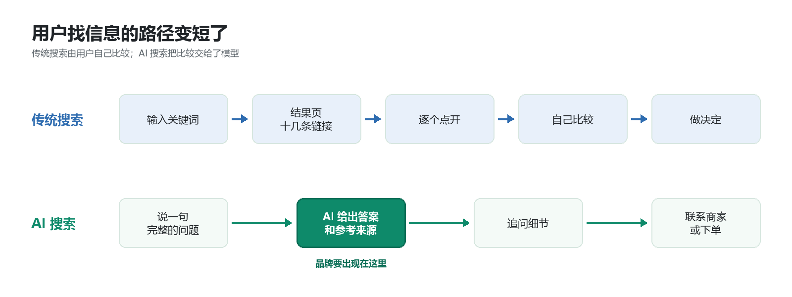

| 维度 | SEO | GEO |
| --- | --- | --- |
| 用户行为 | 输关键词、翻链接 | 提完整问题、看答案、追问 |
| 优化对象 | 结果页排名 | 答案里的提及、引用和事实准确 |
| 关键因素 | 相关性、外链、站点权重 | 能否被检索、来源是否可靠、多来源是否一致 |
| 内容单位 | 页面 | 段落、事实、结构化字段 |

两者可以叠加。页面能被搜索引擎正常收录，通常也更容易被 AI 检索到。但 SEO 的一些老办法，比如站群、外链农场、关键词堆砌，在 GEO 里会起反作用：AI 会把大量相似的低质页面看成同一主体的噪声，甚至判成垃圾内容。

GEO 能带来的价值主要有三点：

- 用户自然提问时出现在答案里，不需要按点击付费。
- 用户普遍把 AI 给出的推荐看得比广告更中立，信任门槛更低。
- 答案里如果有地址、电话、价格区间，用户会直接去搜、去约，路径更短。

---

## 二、AI 怎么生成一个答案

多数 AI 搜索产品采用检索增强生成（RAG）：先检索，再筛选，最后生成。

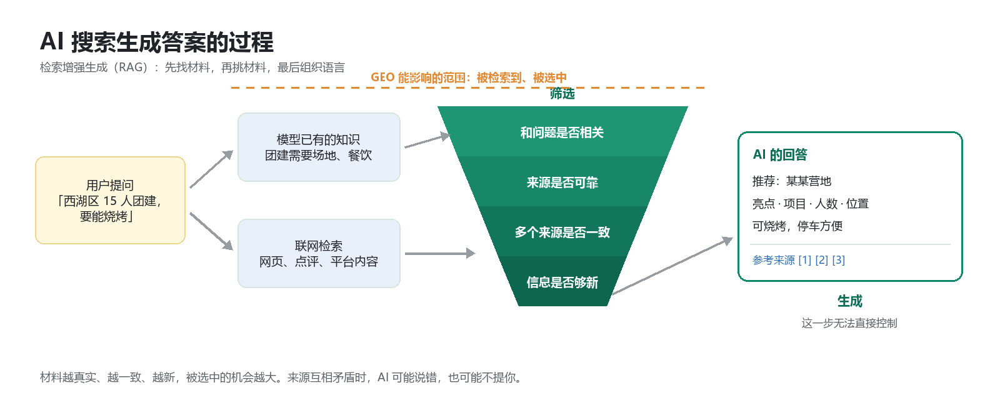

以「公司 15 人，周末在杭州西湖区团建，要能烧烤，推荐一下」为例：

1. **检索**：模型知道团建需要场地、餐饮、娱乐，再联网抓取最新的场地介绍、点评和营业状态。
2. **筛选**：挑出和「15 人」「西湖区」「烧烤」都对得上的内容，看来源可不可靠、多个来源说法是否一致、信息新不新。
3. **生成**：把选中的信息整理成场地名称、亮点、项目、容纳人数、位置等字段。用户还可以追问「能开发票吗」「有停车位吗」，AI 会在原推荐里再筛一轮。

这对内容提出了几条要求：

- **能被抓到**：页面可访问，没有屏蔽 AI 爬虫，正文不是图片。
- **能被拆开用**：信息写成清楚的字段和短段落，AI 才能直接摘取。
- **多处一致**：同一个事实在官网、百科、地图、平台账号上说法相同。来源互相矛盾时，AI 可能选错，也可能干脆不提你。
- **够新**：写明更新日期，过期内容及时修订。

AI 是按概率生成文字的，会出现「幻觉」。你无法直接控制第 3 步，能做的是让第 1、2 步拿到的材料真实、一致、充分。

---

## 三、平台格局与用户

### 国内

截至 2026 年 9 月，国内 AI 原生 App 月活约 5.46 亿。豆包约 4.19 亿，断层领先；千问约 1.58 亿、DeepSeek 约 1.23 亿，构成第二梯队；元宝约 3733 万。

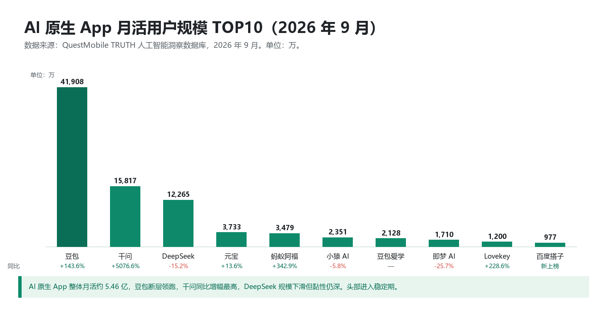

规模之外还要看使用深度。DeepSeek 月活同比下降，但月人均使用时长最长；豆包规模和频次兼得。

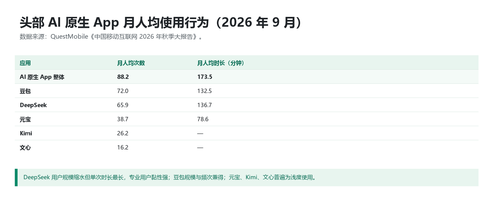

数据来源：[QuestMobile](https://www.questmobile.com.cn/)《中国移动互联网 2026 年秋季大报告》及 2026 年三季度 AI 应用报告。

| 平台 | 所属 | 官方网址 | 内容生态 |
| --- | --- | --- | --- |
| 豆包 | 字节跳动 | <https://www.doubao.com/> | 抖音、今日头条、抖音百科、抖音生活服务 |
| 千问 | 阿里巴巴 | <https://www.qianwen.com/> | 淘宝、天猫、支付宝、高德、夸克 |
| DeepSeek | 深度求索 | <https://www.deepseek.com/> | 无自有内容生态，依赖开放网页 |
| 腾讯元宝 | 腾讯 | <https://yuanbao.tencent.com/> | 微信公众号、视频号、腾讯新闻 |
| 文心一言 | 百度 | <https://yiyan.baidu.com/> | 百度搜索、百度百科、百家号 |
| Kimi | 月之暗面 | <https://www.kimi.com/> | 开放网页 |

此外，百度搜索的 AI 回答（<https://www.baidu.com/>）和夸克（<https://www.quark.cn/>）的 AI 搜索也是重要入口。

各平台的用户和常见引用来源，按从业者观察大致是：

| 平台 | 用户侧重 | 常见引用来源 |
| --- | --- | --- |
| 豆包 | 覆盖最广，学生、职场、家长、中老年、本地商家都有 | 抖音、今日头条、抖音百科，其次是电商页面、什么值得买、综合资讯 |
| 千问 | 偏商业与消费，电商卖家、网购用户、企业主、外贸与金融 | 电商页面、产业财经、官方新闻、政务网站 |
| DeepSeek | 偏专业，程序员、理工科研、金融量化、法律 | 数码测评、垂直媒体、百科和门户，例如什么值得买、中关村在线 |
| 腾讯元宝 | 微信生态用户，公众号读者、资讯用户 | 微信公众号、腾讯新闻、电商页面 |

这些画像不是平台公布的数据。做之前拿自己目标客户的真实问题测一遍比套画像准。

### 海外

做出海业务时，需要覆盖的主要是：

| 平台 | 官方网址 |
| --- | --- |
| ChatGPT（OpenAI） | <https://chatgpt.com/> |
| Google AI 概览 / AI Mode、Gemini | <https://www.google.com/>、<https://gemini.google.com/> |
| Perplexity | <https://www.perplexity.ai/> |
| Claude（Anthropic） | <https://claude.ai/> |
| Microsoft Copilot | <https://copilot.microsoft.com/> |

海外产品主要依赖开放网页和各自的搜索索引（ChatGPT 搜索、Copilot 与 Bing 关系密切，Google AI 概览依赖 Google 搜索索引）。基础做法和国内一致：官网事实完整、第三方来源可核对、允许对应爬虫抓取。

### 怎么用这些信息

不要一套内容、一个渠道用到底。先确定目标客户最常用哪个 AI，再看这个平台偏好引用哪些来源，把内容放到那里。平台偏好会随模型更新改变，每个季度都值得重测一次。

---

## 四、合规边界

2026 年，监管已经把恶意 GEO 列为整治对象。

- 2026 年 5 月，中央网信办部署「清朗·整治 AI 应用乱象」专项行动，把「通过篡改训练语料、伪造权威数据、使用 GEO 技术恶意营销等方式实施 AI 数据投毒」列为重点整治问题，并点名「炒作、教授 AI 数据投毒方法，或在电商平台兜售教程及工具」。参见[武汉网信办转载的通知报道](http://www.whwx.gov.cn/wlzl/zljg/202605/t20260513_2764156.shtml)。
- 市场监管部门已对 GEO 服务商作出多起处罚。据 [21 世纪经济报道](https://www.21jingji.com/article/20261010/herald/4ea02f4540b643b5468d483beb866537.html)，北京朝阳（6 月）、广州越秀（9 月，罚款 12 万元）、深圳（9 月，罚款 5 万元）的案件涉及虚构评分、虚构案件量、编造行业排行榜，依据主要是《反不正当竞争法》和《网络反不正当竞争暂行规定》。

已有处罚案例集中在几种做法：编造排行榜、评分、满意度、案件量；伪造专家、媒体、第三方测评的身份；批量生成相似稿铺到大量低质站点制造「共识」；把商业推广伪装成用户评价或客观榜单；探测模型偏好后定向投放虚假内容。

合规的判断可以归结为四个问题：

1. 内容是不是真的，能不能核验？
2. 传播方式是否正当，有没有批量制造虚假「共识」？
3. 推广内容能不能被识别为推广？
4. 会不会误导消费者对产品性能、销量、荣誉的判断？

还有几条容易忽略的规定：

- 《广告法》禁止「最佳」「第一」「国家级」等绝对化用语，医疗、药品、保健食品、金融等行业另有限制。
- AI 生成的图文按《人工智能生成合成内容标识办法》需要标识，发布平台通常也有要求。
- 评价必须来自真实客户，组织刷好评在点评平台和法律上都有风险。
- 写对比内容时，不点名贬低具体竞品，否则可能构成商业诋毁。

建议保留内容制作和投放记录：谁写的、依据什么材料、发在哪里、什么时间。出了问题，这些记录能证明你的内容有真实依据。

---

## 五、第一步：企业事实卡与知识图谱

### 企业事实卡

所有内容都应该从同一份事实来源出发。先写一张企业事实卡，再动笔写文章。

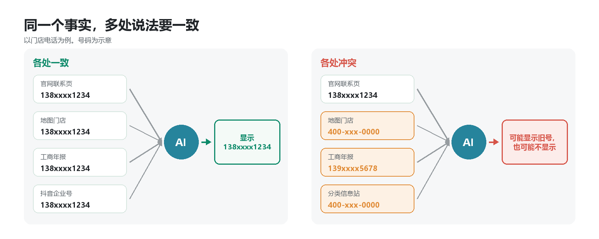

事实卡最少要包括：

- 营业执照全称、统一社会信用代码、品牌名和简称的对应关系。
- ICP 备案主体（应与执照主体一致）。
- 门店地址（写到门牌号）、服务半径、营业时间、唯一对外电话。
- 产品和服务的标准名称、型号、核心参数、价格区间、交付流程。
- 适合谁、不适合谁、做不到什么。
- 资质证书编号、可公开的案例、媒体报道链接。
- 客户下单前最常问的 20 到 50 个问题和统一答案。
- 负责人、复核周期、变更后要同步的平台清单。

事实卡由负责人签字确认。之后官网、百科、地图、平台账号、文章都从这里取数。

### 知识图谱

事实卡是清单，知识图谱是把清单里的事物连起来：哪家门店服务哪几个区，哪项服务解决哪类问题，哪个产品适合哪类人群，哪张证书证明哪项能力。

要分清三个层次：

- 语料：散落的文章和介绍，彼此没有关联。AI 很难从中拼出你是谁。
- 知识库：资料按类别整理好了，但条目之间的关系没有写出来。
- 知识图谱：实体（品牌、门店、产品、资质、问题），关系（哪家门店服务哪个区、哪项服务解决哪类问题），属性（地址、价格、流程、证书、案例、标准答案）都齐。

搭建分三步：

1. **列全实体**：品牌、门店、地区、产品、服务、资质、案例、客户类型、高频问题。
2. **串起关系**：用业务语言写，例如「南山店 → 服务南山区、前海 → 提供上门回收」。
3. **补齐属性**：地域（地址、半径）、业务（价格、流程、适用人群）、信誉（证书、案例、评价）、问答（标准答案）。

知识图谱不必另建系统，它可以直接体现在官网的服务页、门店页、FAQ 页和结构化数据里（见第七章）。

用 AI 工具帮忙扩写图谱或资料时，生成的内容常常会补上你实际做不到的服务和优势。发布前必须逐条人工核对，删掉不属实的内容。

---

## 六、信源建设

信源就是 AI 用来学习、核对、引用的信息来源。没有信源，答案里就没有你。信源可以分成三层。

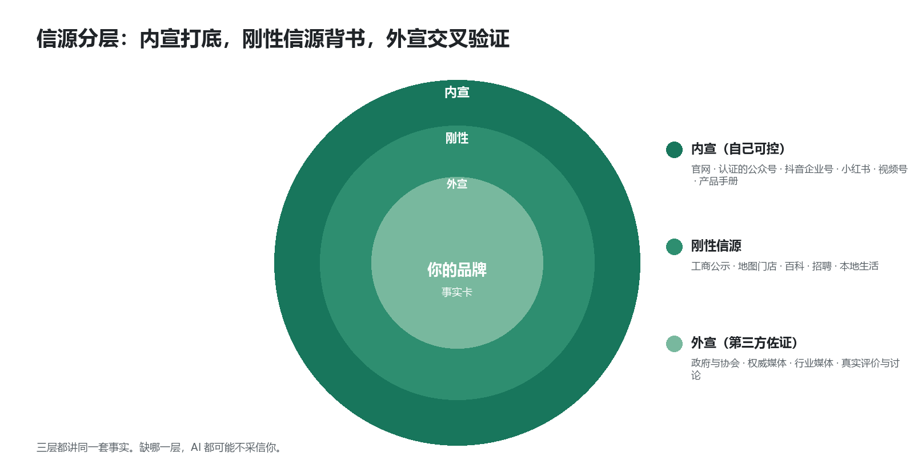

### 内宣：自己可控的官方基准

| 渠道 | 官方网址 | 要点 |
| --- | --- | --- |
| 企业官网 | 自有域名 | 最重要，见第七章 |
| 微信公众号 | <https://mp.weixin.qq.com/> | 完成企业认证，元宝常引用 |
| 抖音企业号 | <https://e.douyin.com/> | 蓝 V 认证，豆包 App 端影响明显 |
| 今日头条 | <https://mp.toutiao.com/> | 字节系图文 |
| 小红书企业号 | <https://pro.xiaohongshu.com/> | 场景类内容 |
| 视频号 | <https://channels.weixin.qq.com/> | 微信生态视频 |
| 百家号 | <https://baijiahao.baidu.com/> | 百度生态图文 |
| 知乎机构号 | <https://www.zhihu.com/> | 专业问答 |

白皮书、产品手册、案例集也属于内宣。把它们做成网页，而不只是 PDF 或图片，AI 才好读取。

### 刚性信源：证明企业真实存在

这类信源权重高，因为它们来自登记或审核，不由企业随意撰写。

| 类型 | 平台与网址 | 要做什么 |
| --- | --- | --- |
| 工商信息 | 国家企业信用信息公示系统 <https://www.gsxt.gov.cn/>；企查查 <https://www.qcc.com/>；天眼查 <https://www.tianyancha.com/>；爱企查 <https://aiqicha.baidu.com/> | 按时报送年报，公示的电话、地址与事实卡一致；在企查查等平台认领企业并补全信息 |
| 地图 | 百度地图 <https://map.baidu.com/>；高德地图 <https://www.amap.com/>；腾讯地图 <https://map.qq.com/> | 认领门店，补齐地址、电话、营业时间、门头和店内照片 |
| 百科 | 百度百科 <https://baike.baidu.com/>；抖音百科（原快懂百科）<https://www.baike.com/>；搜狗百科 <https://baike.sogou.com/> | 符合收录条件时创建或认领词条，用可核验的公开资料作参考 |
| 招聘 | BOSS 直聘 <https://www.zhipin.com/>；智联招聘 <https://www.zhaopin.com/>；前程无忧 <https://www.51job.com/> | 完成企业认证，发布真实在招岗位，完善公司主页 |
| 本地生活 | 抖音来客 <https://life.douyin.com/>；大众点评 / 美团商家 <https://e.dianping.com/> | 认领门店，资料完整，评价来自真实客户 |

百科审核严格，写不进去的荣誉不要硬编。招聘平台不要为了做信源发布假岗位。

### 外宣：第三方交叉验证

权重大致从高到低：

1. 政府、协会、学会的公示与名录，央媒和权威媒体报道。
2. 行业垂直媒体、行业榜单、专业社区专栏。
3. 知乎、百家号、头条号、网易号、搜狐号等内容平台上的真实讨论和文章。
4. 大众点评、什么值得买（<https://www.smzdm.com/>）等平台上的真实评价和众测，作为辅助。

外宣只发到你确实有资格发布、目标平台也确实会引用的站点。判断方法：用自己的问题在目标平台问一遍，展开答案下方的参考来源，记下被引用的站点。

### 常见误区

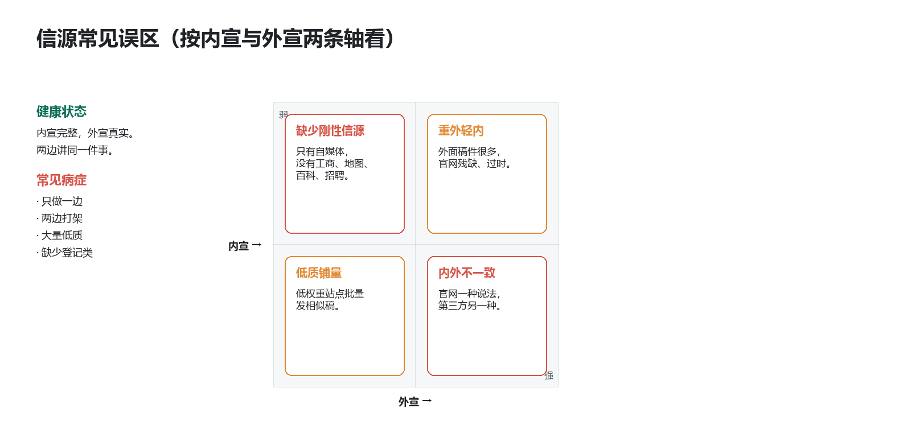

四个常见误区：

- **重外轻内**：外面稿件多，官网残缺、过时。官方基准不可靠，外部稿件也难被采信。
- **内外不一致**：官网一种说法，第三方另一种说法。AI 可能不采用，也可能采用错误版本。
- **低质铺量**：在低权重站点批量发相似稿。效果短暂，容易被判为垃圾内容，还可能触及监管红线。
- **缺少刚性信源**：只有自媒体文章，没有官网、工商、地图、百科、招聘。AI 缺少核验企业是否正规的依据。

内宣让 AI 认识你，外宣让 AI 相信你。只做内宣像自卖自夸，同行的外部背书足就会压过你；只做外宣、没有官网和认证账号，大量软文会被当成营销投放。两边都要做，而且讲同一套事实。

---

## 七、官网技术基础

官网是最重要的内宣，也是第二梯队平台（DeepSeek、海外模型）最依赖的来源。做好下面几条，和内容本身同等重要。

### 必备

- **ICP 备案主体**与营业执照主体一致。可在[工信部 ICP/IP 地址/域名信息备案管理系统](https://beian.miit.gov.cn/)自查。
- **联系页**完整：全称、地址、唯一主电话、营业时间、邮箱。电话用文本，不要只放图片。
- **关于我们**说清主体、年限、团队规模、业务范围、服务区域。
- **产品 / 服务页**写参数、适用场景、价格区间、交付流程。
- **案例页**用可核验的真实案例，带时间和地点。
- **FAQ 页**集中回答高频问题，答案和事实卡一致。

### 结构化数据

用 [Schema.org](https://schema.org/) 的词汇在页面里加结构化数据，让机器直接读出事实：

- `Organization` / `LocalBusiness`：品牌名、地址、电话、营业时间、logo、`sameAs` 指向官方账号。
- `Product`：名称、型号、描述、品牌、价格、评分。
- `Article` / `NewsArticle`：标题、作者、发布日期、更新日期。
- `FAQPage`：问答对。
- `BreadcrumbList`：页面层级。

可用 [Google Rich Results Test](https://search.google.com/test/rich-results)、[Schema.org Validator](https://validator.schema.org/) 验证。

### 对 AI 爬虫开放

在 `robots.txt` 里明确允许主要 AI 爬虫抓取：

```
User-agent: GPTBot
User-agent: OAI-SearchBot
User-agent: ChatGPT-User
User-agent: ClaudeBot
User-agent: Claude-SearchBot
User-agent: PerplexityBot
User-agent: Google-Extended
User-agent: Applebot-Extended
User-agent: Bytespider
Allow: /
```

常见的爬虫 UA 以[各家官方说明](https://platform.openai.com/docs/bots/)和 [Cloudflare 的 bot 名录](https://developers.cloudflare.com/ai-crawl-control/reference/bots/)为准。Bytespider（字节跳动）据报不严格遵守 robots.txt；如果希望豆包引用你的内容，不要把它拒之门外。

### 其他

- `sitemap.xml` 提交给百度、Bing、Google，让新内容被发现得更快。
- 内容放在 HTML 正文里，不要全靠 JavaScript 渲染出来，部分 AI 爬虫不执行 JS。
- 移动端自适应，字节大小合理。字节系的手机端信号会影响移动端表现。
- 用 HTTPS，避免大量 301/302 跳转和软 404。

---

## 八、提问意图与关键词

### 五类意图

传统搜索用关键词匹配，GEO 要匹配的是整句问题背后的意图。把客户真实会问的问题归到五类，用来查缺口。

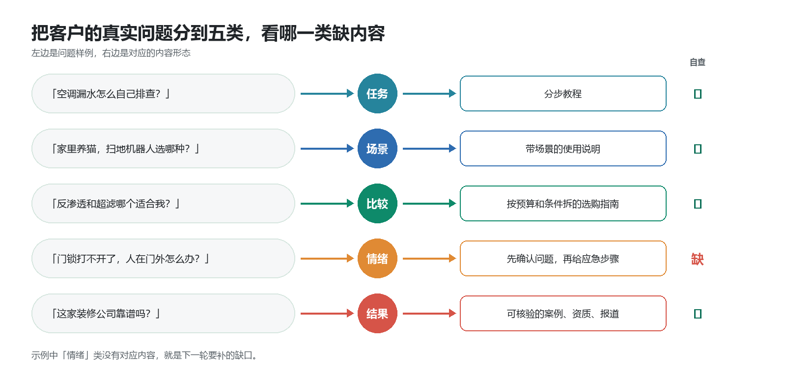

| 意图 | 用户在问什么 | 内容形态 | 适合发布的位置 |
| --- | --- | --- | --- |
| 任务 | 怎么做、完整步骤 | 分步教程、排查手册 | 官网帮助中心、百家号、百度经验、知乎、小红书 |
| 场景 | 某种情况下该用什么 | 带人群、时间、痛点的使用说明 | 小红书、公众号 |
| 比较 | 选哪个、预算怎么分 | 按维度和条件拆的选购指南 | 什么值得买、B 站、行业垂直媒体 |
| 情绪 | 急了怎么办 | 先确认问题，再给应急步骤 | 公众号、小红书、豆瓣、微博、百度贴吧 |
| 结果 | 靠不靠谱、有没有用 | 可核验的案例、资质、报道 | 官网新闻页、你有资格发布的综合或行业媒体 |

写比较类内容时，只写自己产品适合的场景，不点名贬低具体竞品。

举几个对比：

- 投影仪。老写法堆「2000 元以内户外高清便携投影仪」。AI 时代用户直接说「周末山上露营，想买暗光成像清晰、户外低温长续航的投影仪」。内容要写户外自动调光、低温续航实测，而不是只堆品类词。
- 洗烘一体机。用户不会用「E03 故障码」，而是说「中途突然停转，面板闪黄灯滴滴报警」。品牌需要覆盖常见现象的排查教程。
- 代运营。用户说「同城门店，预算 5000，要能短期带动团购核销」。服务商要在对外材料里放真实的到店转化方法，不是空泛的「全网整合」。

五类都要有，才能盖住大部分问法。常见错误是只做「比较类」软文，再铺一堆，覆盖率仍然很窄。

### 三类关键词的挖法

以家用净水器为例：

- **产品词**：反渗透、600G 大通量、厨下式。进定位句和标题。
- **痛点词**：滤芯贵、有水垢、噪音大。回答时给自家数据，例如「滤芯一年一换，年均耗材约 150 元」。
- **决策词**：反渗透 vs 超滤、400G vs 600G。按场景写：「更在意水质的，选反渗透；只是洗菜洗碗、预算紧，选超滤」。

挖词三个来源：客服和售后记录、销售常被追问的问题、电商平台的问答区。可以用 AI 批量扩词，扩完必须人工删掉你不提供的。

---

## 九、内容怎么写

### 容易被 AI 引用的文章结构

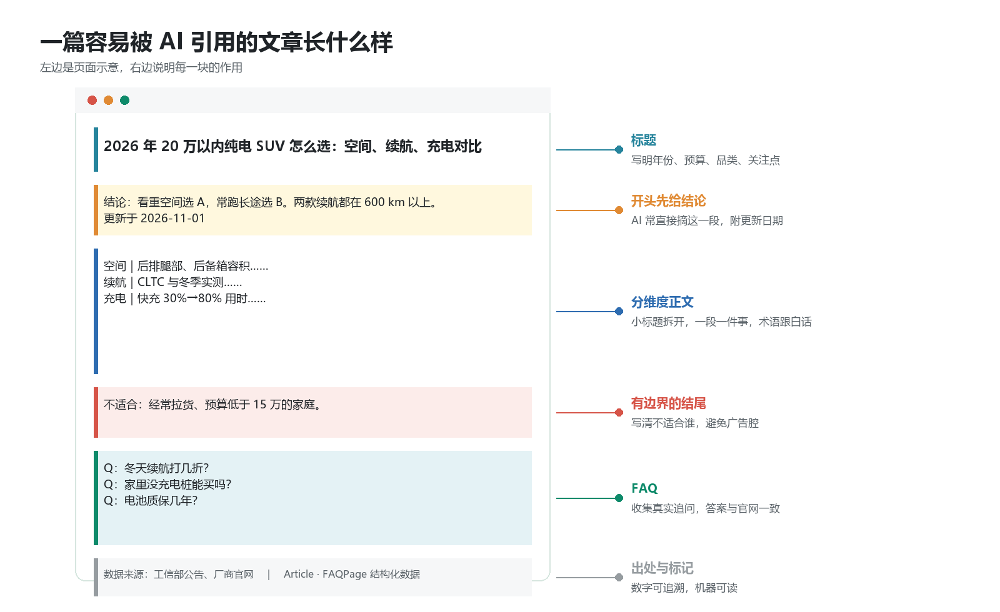

- **标题**带限定条件和核心词（年份、预算、品类、人群）。机器能识别，做决定的人也能看懂。
- **开头给结论**：第一段直接回答问题，给关键参数、适用条件和更新日期。AI 常直接摘这一段。
- **分维度正文**：小标题拆开，比如「空间、续航、安全、预算」。一段只讲一件事，术语后跟白话。
- **结尾有边界**：按场景给建议，并写清不适合谁。不写「所有人都该选」。
- **FAQ**：5 到 10 个高频追问，逐条简短作答。答案和官网一致。
- **出处和日期**：数据注明出处，页面写发布日期和更新日期，加 `Article`、`FAQPage` 结构化数据。

旧文章不必删。补上结论段、FAQ、更新日期和结构化数据即可。

### 质量六条

| 标准 | 怎么做 |
| --- | --- |
| 经验 Experience | 写真实做过的项目：时间、地点、规模、过程。不能编造客户体验 |
| 专业 Expertise | 写只有行内人知道的差别，例如新旧房拆改标准不同 |
| 权威 Authoritativeness | 用可核验的证据：经营年限、资质编号、可参观的展厅、报道链接 |
| 可信 Trust | 报价透明、承诺务实、写明局限，不用绝对化用语 |
| 时效与可验证 | 写明更新日期，过期内容整篇修订；数据标明出处 |
| 信息增量 | 不重复常识，补前提、划边界、给细节 |

EEAT（经验 Experience、专业 Expertise、权威 Authoritativeness、可信 Trust）来自 [Google 的搜索质量评估指南](https://static.googleusercontent.com/media/guidelines.raterhub.com/en/searchqualityevaluatorguidelines.pdf)，是公开可查的标准。国内平台没有同名文件，但判断方向一致。再加两条时效性要求，就是实操中够用的清单。

常见反例和改法：

- 「这家装修公司特别靠谱，口碑一流。」→ 改成「深圳 89 平新房，工期 45 天，从量房到完工我自己盯下来」。
- 「装修很简单，刷刷墙铺铺地。」→ 改成「新旧房拆改标准不同；厨卫按 24 小时闭水试验验收」。
- 「我们是深圳最好的。」→ 改成「深圳本地，十年，持家装二级资质，线下有展厅可参观」。
- 「全国装修，超低价，零瑕疵。」→ 改成「主材辅材明细报价公开，不同户型适用方案和局限都写清楚」。

### 术语加白话

一句行业词一句翻译。只写缩写，外行看不懂；全是白话，专业度上不去。

- GMV：全场订单的成交总金额。
- SOP：标准化操作流程。
- 断桥铝、PA66 隔热条：像在型材中间夹一段隔热断层，夏天挡热、冬天保温。

### 时效、场景、可验证

- **时效**：2021 年的驾考流程不能再发。整篇修订，标题写「2026 年 11 月驾考规则整理」，过期条款全部换掉。
- **场景**：「扫地机器人清洁效果好」太空。改成「工作日加班很晚回家，家里两只猫，提前设定时，扫完自动回充」。人、时间、痛点、功能、结果都有。
- **可验证**：「订单暴涨」要有出处。换成企业年报或行业报告里的装机容量、新增签约、利用率，数字能回到原文件。

### 信息增量

不要再写「别熬夜」「系安全带」这类常识。补前提、划边界、给细节：早起本身不产生效率，关键是前一晚 11 点前睡；熬夜后硬早起是透支。

---

## 十、分平台要点

各平台没有公开排序规则，下面是从业者的实测经验，做之前请用自己的问题复测。

### 豆包

豆包同时有网页端（<https://www.doubao.com/>）、电脑客户端和 App，从业者普遍观察到两端引用的来源不同：

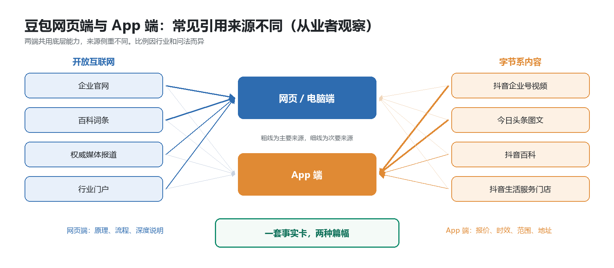

- **网页 / 电脑端**：更多引用官网、百科、权威媒体、行业门户。ICP 备案主体与执照不一致时表现变差。
- **App 端**：更多引用抖音、今日头条、抖音百科、抖音生活服务门店。抖音企业号认证、门店资料、短视频口播里的业务词、联系方式是否完整，影响明显。

做法：

1. 官网先做扎实（第七章）。
2. 认证[抖音企业号](https://e.douyin.com/)，本地商家同时入驻[抖音来客](https://life.douyin.com/)。
3. 发布带精准业务词的口播短视频和头条图文。
4. 同一套事实写两种篇幅：网页端放原理和流程，手机端放报价区间、上门时效、服务范围和地址。
5. 网页端和 App 分开测。网页端弱，补官网深度页和真实媒体报道；App 端弱，更新短视频、补全门店资料。

### 千问

[千问](https://www.qianwen.com/)和淘宝、支付宝、高德等阿里生态联动多，常引用电商页面、产业财经媒体和官方新闻。做电商和消费品的品牌，要把天猫 / 淘宝店铺的商品详情、参数、问答区写完整；本地商家同时维护[高德地图](https://www.amap.com/)门店资料。

### DeepSeek

[DeepSeek](https://www.deepseek.com/) 没有自有内容生态，联网时主要依赖开放网页。用户偏专业，引用里数码测评、垂直媒体、百科较多。对技术型产品，官网的技术文档、参数表、白皮书网页版最关键；什么值得买、中关村在线（<https://www.zol.com.cn/>）等测评站的真实测评也有帮助。

### 腾讯元宝

[腾讯元宝](https://yuanbao.tencent.com/)大量引用微信公众号。认证公众号，按第九章的结构持续发文，比在外部站点铺稿更有效。腾讯新闻、视频号也是来源。

### 文心一言与百度 AI 搜索

[文心一言](https://yiyan.baidu.com/)和百度搜索的 AI 回答依托百度生态：百度百科、百家号、爱企查、百度地图、百度知道。百度系资料完整的品牌在这里更容易出现。

### 海外平台

- **ChatGPT**：搜索功能使用 OAI-SearchBot 抓取网页，确保 robots.txt 放行，并在 [Bing Webmaster Tools](https://www.bing.com/webmasters) 提交站点。
- **Google AI 概览 / Gemini**：依赖 Google 搜索索引。在 [Google Search Console](https://search.google.com/search-console) 提交站点和 sitemap，遵循 [Google 搜索中心关于 AI 功能的说明](https://developers.google.com/search/docs/appearance/ai-features)。
- **Perplexity**：引用来源展示得最明确，适合用来检验你的页面是否被抓到。
- **Claude、Copilot**：同样依赖开放网页，基础做法一致。

---

## 十一、本地商家：电话、地址与地图

对本地商家，AI 答案里的电话和地址是曝光变成咨询的最后一步。号码错了，前面的内容等于白做。

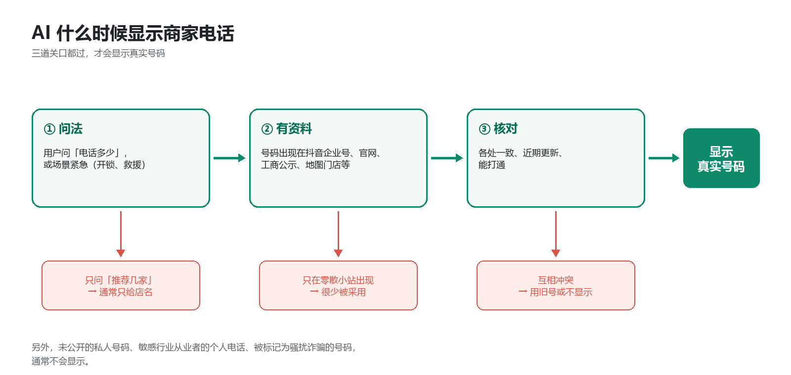

### 什么时候会显示号码

- 用户明确问「某某店电话多少」「怎么联系」。
- 场景本身紧急：开锁、道路救援、紧急维修。
- 只问「推荐几家」「对比一下口碑」时，通常只给店名，用户追问才给号码。

### 号码从哪里来

从业者经验里，大致按以下顺序采信：

1. 抖音企业号与抖音生活服务门店（豆包尤其明显）。
2. 官网联系页。
3. 国家企业信用信息公示系统、企查查、天眼查及工商年报上公示的电话。
4. 百度地图、高德地图、腾讯地图的认证门店。
5. 行业协会、主管部门公布的商家名录。

系统还会核对一致性、时效和能否接通。各平台号码冲突时，AI 可能采用多数页面上的号码，也可能隐藏全部号码。

### 为什么显示的是错号

- **历史虚拟号**：早年在 58 同城（<https://www.58.com/>）、赶集网等分类信息平台留下的 400 号、隐私号还挂在页面上，存在时间长，被抓取的次数多。
- **代运营追踪号**：外包团队投放时留了自己的追踪专线，铺到很多本地信息站，被当成官方号码。
- **多数原则**：八个页面是旧号、两个页面是新号，AI 倾向采用旧号。

### 不会显示的号码

未公开的私人号码，医疗、金融、法律从业者的个人电话，从未对外公布的内部号码，被标记为骚扰、推销、诈骗的号码。这和《个人信息保护法》的要求一致。

### 整改六步

1. 认证抖音企业号，填写真实电话。
2. 清理分类信息平台的历史虚拟号，改成真实号码或申请下线。
3. 官网、地图、工商年报、抖音统一使用同一个号码。
4. 官网电话用文本，不放图片，并加 `LocalBusiness` 的 `telephone` 结构化数据。
5. 至少每半年复核一次各平台资料。换号、搬迁当天同步。
6. 积累真实到店客户的评价，不组织虚假好评。

改完多久生效没有固定答案，取决于各平台的抓取和审核周期。

### 自查七问

- 是否只在小平台登记过，没有进入抖音、地图、工商这类渠道？
- 各平台号码是否不一致？
- 历史虚拟号是否还在线？
- 换号超过半年，是否还有平台没同步？
- 是否缺少抖音企业号、官网、工商认证？
- 号码是否因投诉被标记为骚扰？
- 用户的问法是否本来就不会触发号码展示？

---

## 十二、AI 说错了怎么办

先分清是哪类问题：

- **没提到你**：这不是投诉能解决的。回到信源和内容建设。
- **事实错误或过时**：地址、电话、成立时间、产品功能说错。先改公开信源，再提交反馈。
- **主体混淆**：把同名公司或竞品的信息安到你头上。补充主体说明，再反馈。
- **侵权**：冒用商标、侵犯名誉、泄露个人信息。走平台的侵权投诉流程。

### 处理顺序

1. **留证**：完整截图或录屏，记下提问、回答、日期、平台和版本。
2. **溯源**：展开参考来源，找到错误来自哪个页面。
3. **改源头**：修改自己可控的页面；联系第三方站点更正或下线；必要时发律师函。
4. **提交反馈**：写明哪一项错、错误内容、正确内容、证明材料、生效日期。一次只报一项。
5. **复查**：隔一段时间用原问题复测，保存新回答。

### 各平台反馈入口

| 平台 | 入口 |
| --- | --- |
| 豆包 | App「我的 → 设置 → 帮助与反馈」，或 feedback@mail.doubao.com；侵权投诉见[豆包客服中心](https://www.doubao.com/customer-service) |
| DeepSeek | 产品内「联系我们」，或 service@deepseek.com |
| 千问 | 产品内反馈与举报入口 |
| 腾讯元宝 | 产品内反馈；涉及腾讯平台内容侵权，走[腾讯知识产权保护平台](https://ipp.tencent.com/) |
| 文心一言 | 回答下方点「踩」后选择反馈或侵权投诉 |
| Kimi | 网页端「账户 → 用户反馈」，App「设置 → 反馈」 |

入口会随产品更新调整，提交前以当天界面为准。

真实的负面评价不能靠投诉删除。用户确有差评，正确做法是改进服务、公开回应，并让更多真实的正面体验进入公开渠道。

---

## 十三、监测与复盘

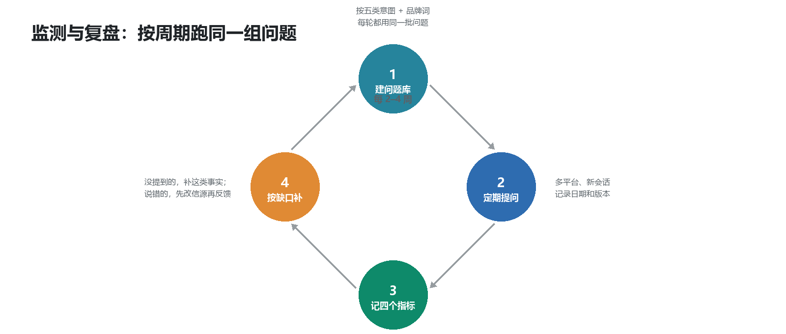

### 建一个固定的问题库

- 五类意图各选 5 到 10 个客户真实问题。
- 加上品牌问题：「某某公司怎么样」「某某电话多少」「某某和某某哪个好」。
- 本地商家加上地域问题：「南山区哪家……靠谱」。

问题库确定后不要随意改，方便前后对比。

### 定期提问

- 每两到四周在目标平台各问一遍。豆包的网页端和 App 分开问。
- 每次开新会话，不登录或用干净账号，记录日期、平台、版本、是否开了联网或深度思考。
- 保存完整回答和参考来源，而不只是一个「有 / 没有」。

### 四个指标

| 指标 | 含义 |
| --- | --- |
| 提及率 | 问题库里有多少比例的答案提到你 |
| 引用率 | 有多少比例的答案把你的页面列为参考来源 |
| 准确率 | 提到你时，名称、地址、电话、价格等事实是否正确 |
| 倾向 | 描述是正面、中性还是负面，和竞品放在一起时排在第几 |

AI 回答本身有随机性，单次结果说明不了问题。看多次、多平台的趋势。

### 按缺口补

- 哪一类意图没有你，就补哪一类内容。
- 引用了你但事实错，先改源头，再反馈。
- 竞品被引用、你没有，展开竞品被引用的来源，看看它在哪里有你没有的信源。

不要用铺更多相似稿的方式去补缺口。

---

## 十四、90 天落地路线

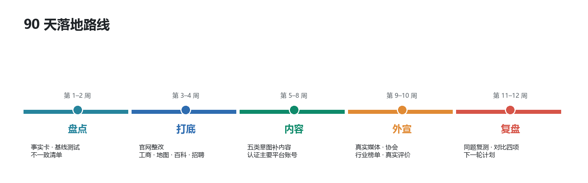

| 阶段 | 时间 | 要做的事 | 产出 |
| --- | --- | --- | --- |
| 盘点 | 第 1–2 周 | 写企业事实卡；建问题库并做首次测试；查全网名称、地址、电话是否一致 | 事实卡、基线测试表、不一致清单 |
| 打底 | 第 3–4 周 | 整改官网（备案主体、联系页、FAQ、结构化数据、robots.txt、sitemap）；补齐工商、地图、百科、招聘 | 合格官网、四类刚性信源 |
| 内容 | 第 5–8 周 | 按五类意图补内容；先改旧文，再写新文；认证抖音企业号、公众号等账号并同步发布 | 内容清单与已发布链接 |
| 外宣 | 第 9–10 周 | 争取真实的媒体报道、协会名录、行业榜单；引导真实客户评价 | 第三方来源清单 |
| 复盘 | 第 11–12 周 | 用同一问题库复测，对比四个指标；确定下一轮的重点 | 复盘报告、下季度计划 |

之后按季度循环：复测、补缺口、更新事实卡。

---

## 十五、附录

### 常用平台官方网址

**AI 助手**

| 平台 | 网址 |
| --- | --- |
| 豆包 | <https://www.doubao.com/> |
| 千问 | <https://www.qianwen.com/> |
| DeepSeek | <https://www.deepseek.com/> |
| 腾讯元宝 | <https://yuanbao.tencent.com/> |
| 文心一言 | <https://yiyan.baidu.com/> |
| Kimi | <https://www.kimi.com/> |
| 夸克 | <https://www.quark.cn/> |
| ChatGPT | <https://chatgpt.com/> |
| Gemini | <https://gemini.google.com/> |
| Perplexity | <https://www.perplexity.ai/> |
| Claude | <https://claude.ai/> |
| Microsoft Copilot | <https://copilot.microsoft.com/> |

**企业与本地信息**

| 平台 | 网址 |
| --- | --- |
| 国家企业信用信息公示系统 | <https://www.gsxt.gov.cn/> |
| 工信部 ICP 备案查询 | <https://beian.miit.gov.cn/> |
| 企查查 | <https://www.qcc.com/> |
| 天眼查 | <https://www.tianyancha.com/> |
| 爱企查 | <https://aiqicha.baidu.com/> |
| 百度地图 | <https://map.baidu.com/> |
| 高德地图 | <https://www.amap.com/> |
| 腾讯地图 | <https://map.qq.com/> |
| 百度百科 | <https://baike.baidu.com/> |
| 抖音百科 | <https://www.baike.com/> |
| 搜狗百科 | <https://baike.sogou.com/> |
| BOSS 直聘 | <https://www.zhipin.com/> |
| 智联招聘 | <https://www.zhaopin.com/> |
| 前程无忧 | <https://www.51job.com/> |
| 大众点评商家 | <https://e.dianping.com/> |
| 抖音来客 | <https://life.douyin.com/> |

**内容平台**

| 平台 | 网址 |
| --- | --- |
| 抖音企业号 | <https://e.douyin.com/> |
| 今日头条创作者 | <https://mp.toutiao.com/> |
| 微信公众平台 | <https://mp.weixin.qq.com/> |
| 视频号 | <https://channels.weixin.qq.com/> |
| 小红书专业号 | <https://pro.xiaohongshu.com/> |
| 百家号 | <https://baijiahao.baidu.com/> |
| 知乎 | <https://www.zhihu.com/> |
| 什么值得买 | <https://www.smzdm.com/> |
| 中关村在线 | <https://www.zol.com.cn/> |

**站长与技术工具**

| 工具 | 网址 |
| --- | --- |
| 百度搜索资源平台 | <https://ziyuan.baidu.com/> |
| Bing Webmaster Tools | <https://www.bing.com/webmasters> |
| Google Search Console | <https://search.google.com/search-console> |
| Google Rich Results Test | <https://search.google.com/test/rich-results> |
| Schema.org | <https://schema.org/> |
| Schema.org Validator | <https://validator.schema.org/> |

**数据与法规**

| 名称 | 网址 |
| --- | --- |
| QuestMobile | <https://www.questmobile.com.cn/> |
| 中国网信网 | <https://www.cac.gov.cn/> |
| 国家市场监督管理总局 | <https://www.samr.gov.cn/> |

### 上线前自查清单

**事实**

- [ ] 企业事实卡已由负责人确认
- [ ] 官网、百科、地图、工商、平台账号的名称、地址、电话一致
- [ ] 历史虚拟号已清理

**官网**

- [ ] ICP 备案主体与营业执照一致
- [ ] 联系页电话为文本，有 `LocalBusiness` 结构化数据
- [ ] 有 FAQ 页，答案与事实卡一致
- [ ] robots.txt 放行主要 AI 爬虫，sitemap 已提交
- [ ] 正文在 HTML 中，不依赖 JS 渲染

**信源**

- [ ] 国家企业信用信息公示系统年报已报送
- [ ] 至少两个地图平台已认领门店
- [ ] 符合条件时已创建或认领百科词条
- [ ] 招聘平台企业认证完成，岗位真实
- [ ] 抖音企业号、公众号等主要账号已认证

**内容**

- [ ] 五类意图都有对应内容
- [ ] 每篇文章有结论段、FAQ、出处、发布和更新日期
- [ ] 没有绝对化用语，没有编造的数据、排名、评价
- [ ] AI 生成内容已人工核对并按规定标识

**监测**

- [ ] 问题库已建立并完成基线测试
- [ ] 复测周期和负责人已确定
